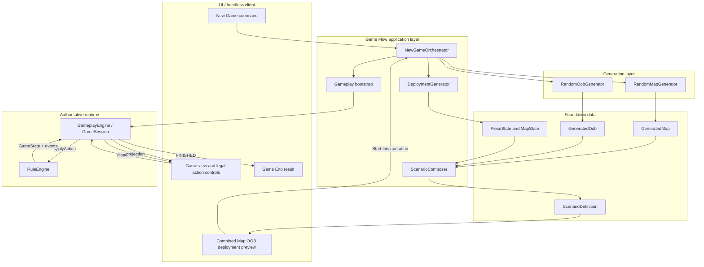
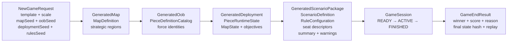
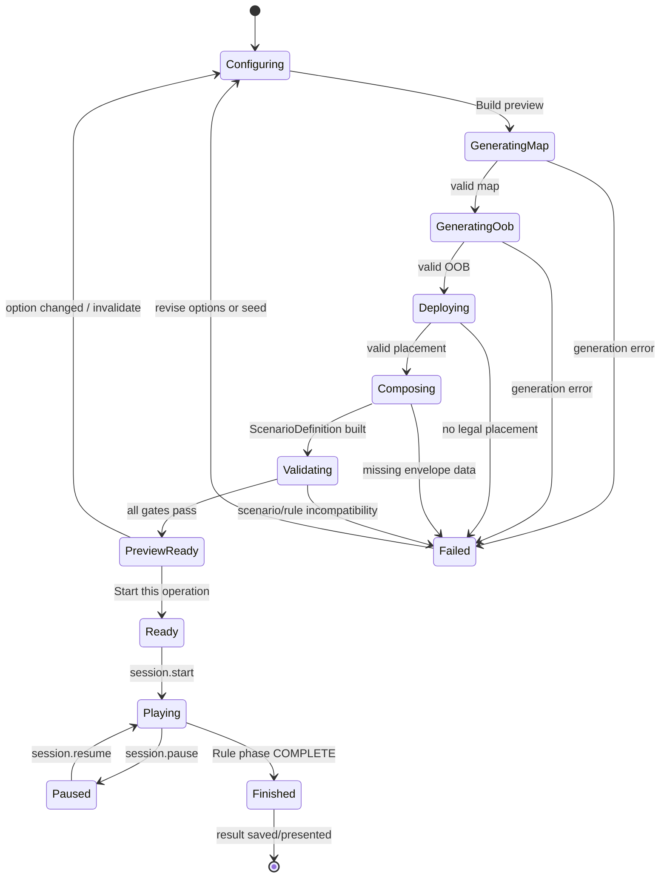

# ocsEngine end-to-end game flow architecture

## 1. Product flow

The product flow is one pipeline, not a collection of independent laboratories:

```mermaid
flowchart LR
    A[New Game] --> B[Generate Map]
    B --> C[Generate OOB]
    C --> D[Compose and deploy Scenario]
    D --> E[Create Gameplay Session]
    E --> F[Play through UI or headless client]
    F -->|legal action| G[Rule Engine transition]
    G -->|updated projection| F
    G -->|phase COMPLETE| H[Game End]
    H --> I[Result, final save, replay and diagnostics]
```



`Generate Map` and `Generate OOB` remain independently seeded and testable, but they are intermediate stages of New Game. A normal player must not need to download their JSON and manually connect them.

## 2. Runtime component ownership



| Component | Owns | Must not own |
|---|---|---|
| New Game UI | options, progress, cancel/retry presentation | terrain, OOB, deployment or rule calculations |
| NewGameOrchestrator | stage order, independent seeds, failure propagation, final package | generator algorithms or OCS legality |
| Map generator | terrain and strategic geography | units, scenario session or deployment |
| OOB generator | force identity, Piece Definitions, support/logistics packages | map Hexes, owners or runtime locations |
| Deployment generator | Piece IDs, owners, locations, modes, steps and initial resources | movement/combat outcomes |
| Scenario composer | complete immutable `ScenarioDefinition` envelope | session lifecycle |
| Gameplay Engine | session lifecycle, dispatch, save/load/replay and projections | generation and rule calculation |
| Rule Engine | legal actions and deterministic authoritative transitions | UI or generator workflow |
| Game End | final result projection, final save and replay entry | retroactive state mutation |

## 3. Data pipeline



The sequential arrows describe the user-visible stage order. Internally, map and OOB generation may be computed independently, but deployment cannot begin until both outputs exist.

## 4. New Game state machine



The UI may enter Gameplay only from `Ready`. It must never mount a generated map preview with a different fixed-fixture session behind it. The preview and mounted session use the same deterministic request, and changing any option invalidates Start until the entire package is rebuilt.

## 5. Required composition boundary

The composer consumes `GeneratedMap` and `GeneratedOob` and must fill every field required by `ScenarioDefinition`:

- `mapDefinition` from Random Map;
- `initialMapState` for control and mutable map state;
- `pieceCatalog` from Random OOB;
- `initialPieceState` from deployment, including stable Piece IDs, players, locations, face, steps, mode, stack order and resource quantities;
- players and seat descriptors;
- turn start, entry and supply declarations derived from strategic regions;
- boxes, tracks and pools required by the selected template;
- immutable scenario options, external tables, provenance and all four seeds.

The composed package then supplies the existing Gameplay API:

```text
gameplay.createSession({
  scenario,
  configuration,
  rulesSeed,
  bindings,
  label
})
```

## 6. Game End contract

Game End begins only when the Rule Engine advances the sequence to `COMPLETE`. Gameplay changes its lifecycle to `FINISHED`, persists the accepted final state, and exposes a result containing winner, scores, reason, final revision/hash and replay/save references. The UI replaces action controls with result, replay, save/export and New Game actions.

## 7. Implemented integration

M8 closes the former fixture/preview gap. `src/game-flow` owns the Scenario composer, deployment generator, cross-domain validation and New Game orchestrator. The browser prepares and displays one combined Map/OOB/deployment package, then mounts its deterministic request as the generated Scenario and ACTIVE session. Standalone player-facing Map/OOB laboratories were removed. A Rule `COMPLETE` transition produces Gameplay `FINISHED` and the Game End result. AI may now begin as a downstream Gameplay client.
