# Operational Combat Series Rules v4.3

> Source: [OCS Series Rules v4.3 (PDF)](https://mmpgamers.com/support/gamersarchive/ocs/OCS_Rulesv4.3.pdf)
>
> Author: Dean N. Essig
>
> Publisher: Multi-Man Publishing, Inc.
>
> Published: 2018
>
> Conversion note: This is an unofficial, layout-aware transcription for engine
> development. PDF page boundaries are preserved as HTML comments. If this text
> differs from the published rulebook, use the PDF as the authority.

<!-- PDF page 1 -->

### Table of Contents

- **Page Item**

- **1 Introduction**

- **1 Game Components 2 1.0 Scale 2 2.0 Sequence of Play 4 3.0 Units and Markers 6 4.0 General Concepts 9 5.0 Modes 11 6.0 Ground Movement**

- **13 7.0 Reaction Phase**

- **13 8.0 Overrun**

- **13 9.0 Ground Combat**

- **20 10.0 Barrage 21 11.0 Exploitation Phase 22 12.0 Supply 27 13.0 Specialized Units 31 14.0 Air Power 37 15.0 Air Bases 38 16.0 Hedgehogs 38 17.0 Weather 38 18.0 Naval Power 41 19.0 Ports & Shipping**

- **42 20.0 Breakdown Regiments 42 21.0 Optional Rules 44 House Rules**

- **45 Terms and Abbreviations**

- **47 Notes**

- **51 Index**

- **55 Summaries**

#### **Series Design:** Dean N. Essig

**Playtesting and Proofreading:** Perry Andrus, Marty Arnsdorf, Matt Bace, Ranier Bastian, Dave Benjamin, John Best, Dirk Blennemann, Doug Burrell, Stephen Campbell, Tom Cannon, Don Charuk, Carl Chatto, Brenden Clark, Bob Cloyd, Dav Combs, Dave Demko, Chris Dodd, Karsten Droste, Sara Essig, Anders Fager, Andrew Fischer, Christophe Foley, Dave Friedrichs, Owen Fuller, Tom Gallinger, Don Gilbertson, Mike Haggett, Dirk Heinz, Paul Herkes, Nolan Hudgens, Roger Hyman, Michael Junkin, John Kisner, Tom Klubi, Roland LeBlanc, John Leggat, Christoph Ludwig, Charles McCallum, Ethan McKinney, Dave Mignerey, Rod Miller, Bill Moody, Maurício Moutinho, Don Nesbitt, Brian Niffin, Elias Nordling, Mark Pitcavage, Steve Poitinger, Barrie Pollock, Dave Powell, Dave Reynolds, Henk Roelant, Ernesto Sassot, Boyd Schorzman, Bernard Sperling, James Sterrett, Russell Stewart, Jim Stravers, John Strycharz, Michael-Peter Sturz, Roger Taylor, Giovanni Toletti, Kevin Valerien, Ric Walters, Al Wambold, Bruce Webb, Jim Wise, and Tony Zbaraschuk

**v4.0 Rewrite Team:** Perry Andrus, Jim Daniels, Dave Demko, Dean Essig, Andrew Fischer, Michael Junkin, John Kisner, Hans Korting, Roland LeBlanc, and Rod Miller.

#### **v4.0 Final Editor:** Dave Demko

**v4.0 to v4.3 Honcho:** John Kisner, who coordinated all the efforts and did much of the heavy lifting. Thanks, John!

**v4.3 Special Thanks:** Gary Wright (for charts) and Mathew Hinkle (for edits).

**Special Assistance:** The Burrito as Big as Your Head, without which this system wouldn’t be what it is today.

## Introduction

Operational Combat Series (OCS) games simulate campaign-level combat from 1900 to the mid-1950s. The series goal is to allow a sophisticated study of historical events while maintaining mechanical simplicity.

## Version 4.3 Rules

The v4.3 rulebook is a minor revision. Some rules have been clarified and errata has been corrected. Small changes are marked with a √. Note the chart booklet was given a complete makeover, but is functionally the same as the previous versions (so feel free to continue using them). Enjoy!

Note that some terms were changed in the move from v3 to v4. Strategic Move Mode was shortened to Strat Mode, Combined Arms Effects was replaced by the more descriptive Anti-Tank Effects, and the old Railroad Interdiction and Interdiction effects were combined into the new Trainbusting mission. Keep these changes in mind when playing older games in the series.

## Game Components

#### I The Game Map

The map depicts the area in which the campaign was fought. Laminate the map or cover it with 1/8” Plexiglas to help protect your gaming investment.

**A.** **The Hex Numbering System.** Each hex is identified by a unique four-digit

<!-- PDF page 2 -->

number in the form “column.row.” If a game has more than one map, a letter identifies each, and the hex numbers for hexes on a given map are prefixed with the map’s letter. So “B10.10” identifies hex 10.10 on Map B. The digits before the decimal point identify the hex row, reading along the horizontal dimension from left to right. The digits after the decimal identify the exact hex in that particular row, reading along the vertical dimension from bottom to top. Only every fifth hex has a printed number (xx.05, xx.10, xx.15) to create grid lines. For example, to find hex 29.17, follow the grid line for xx.15 until you find the 29.xx hexrow, then count up two hexes to 29.17.

**B.** **Map Edge Hexes.** A hex is playable only if at least half of the hex is showing.

**C.** **Off Map Movement.** Unless it is specifically allowed in a game, units can neither exit the map to re-enter later nor conduct any off-map movement. Destroy units forced off the map.

**D. Turn Record.** A turn record track is printed on the map or play aids. Each box represents one game turn. (See 2.1)

**E. Weather Record.** Mark the current weather on this track.

**F.** **Holding Boxes.** There are two types of holding boxes, those corresponding to a specific hex and those showing an abstract off-map location.

- Specific-hex holding boxes are used to relieve congestion on the map. The units are considered still in the hex associated with the box.

- Off-map holding boxes can hold an unlimited number of units. Game-specific rules will restrict these boxes to one side or the other, and describe how units move between them and the map. No combat is allowed.

#### II The Counters

Carefully cut or punch the cardboard counters from the sheets and keep them organized (baggies work nicely) by side, type, and identification. This will make setup easier. The various kinds of units and markers are described in 3.0.

#### III The Rules

An OCS game contains both Series rules and Game rules. The Series booklet has the rules that apply to all OCS games. The Game booklet includes special rules, scenarios, and set-up information for the specific game.

**A. Organization.** Rules are numbered by section and case. Each major rules grouping is a section; each paragraph within a section is a case. The number 6.2 would, for example, refer to section 6, case 2. A specific case may contain a number of statements that are lettered, as in 6.2a and 6.2b.

**B. Repetition.** Once stated, a rule is repeated in another section only when needed for clarification in _that_ section.

#### IV Set Up Notes

In the Game rules is set-up information for the scenarios. Unless amended by special instructions in that booklet, the following are **always** true:

- A) “w/i X” means to set up a given unit or stack at or within X hexes of the location given. A stack can “spread out” into multiple hexes within this radius (and possibly deploy breakdown regiments).

- B) Ground units can be set up in any desired mode. ( **Exception:** ground units **adjacent** to enemy Attack-Capable units cannot be set up in Reserve or Strat Mode.)

- C) Transport Points that are stacked with Supply Points (SP) can set up loaded or unloaded. Transport Points that are not stacked with SP always set up unloaded (unless the scenario rules specify otherwise).

- D) Organic Trucks start “full” only if a scenario explicitly states that they do. (But they can take advantage of C above if they set up stacked with SP).

- E) Aircraft always begin Active.

- F) Units cannot set up over-stacked.

- G) Units generally begin the game at full strength.

- H) When the notation “(inclusive)” follows set-up boundaries, those units can set up anywhere within the zone **including** the boundary lines.

- I) Units can never set up in a hex that they could not enter using regular movement.

- J) Units, Formation markers, and HQs always set up “unfueled.”

- K) Use index cards to create off-map areas for each side’s Dead Pile and to organize reinforcements.

## 1.0 Scale

OCS games can include combat units from company to division in size. The ground scale is usually 5 miles per hex, but can drop as low as 2.5 miles per hex (based on theater, operational density, and so on). A game turn usually represents a half-week of time, but can drop as low as 1/4 week (given 2.5 miles per hex ground scale).

## 2.0 Sequence of Play

### 2.1 The Game Turn

A Game Turn is a series of events, the order of which is called the Sequence of Play. Each Game Turn consists of two Player Turns, one for each player. For reference, we call a player taking action in his own turn the “phasing” player; the one taking action during his opponent’s turn is the “non-phasing” player.

A Player Turn consists of the sequence of steps listed below. Each step involves one player or the other—either phasing or non-phasing—taking action. At the end of the second Player Turn, advance the turn marker and begin the process again. The sequence of play must be strictly followed in the order given.

<!-- PDF page 3 -->

### 2.2 Outline Sequence of Play

#### **• Pre-Turn Phase**

   - **Weather Determination**

   - **First Player Determination**

- **1st Player, Player Turn**

   - **Aircraft Refit Phase**

   - **Reinforcement Phase**

   - **Movement Phase**

Breakout Segment

Movement Segment

Air/Naval Barrage Segment

(No Artillery Barrages)

#### **◊ Supply Phase**

#### **◊ Reaction Phase**

**(Non-Phasing Player)**

Movement Segment

Barrage Segment

#### **◊ Combat Phase**

Artillery Barrage Segment

(No Air or Naval Barrages)

- Combat Segment

- **Exploitation Phase**

Movement Segment

Barrage Segment

   - Combat Segment

   - **Clean Up Phase**

- **2nd Player, Player Turn**

   - Repeat for other player.

- **Turn End**

### 2.3 Narrative Sequence of Play

#### **• Pre-Turn Phase**

#### **◊ Weather Determination Segment**

One player, it is irrelevant which, rolls to determine the weather. The weather affects the entire Game Turn.

#### **◊ First Player Determination Segment**

Each player rolls two dice. The player with the higher roll elects to be first or second in the Game Turn. Re-roll any ties.

#### **• 1st Player, Player Turn**

#### **◊ Aircraft Refit Phase**

The phasing player refits his Inactive air units. Pay 1T per base at which the player desires to refit. At these bases, the player can refit up to two aircraft per base Level. An air base **cannot** refit aircraft if in an un-negated enemy Zone of Control (ZOC).

#### **◊ Reinforcement Phase**

The phasing player places any new units in their entry points according to the Arrival Schedules. He rolls on his Supply Table to determine the number of new Supply Points available and places them on the map. He rolls on his Variable Reinforcement Table (sometimes called the Repl Table) and places any resulting reinforcements on the map. The phasing player conducts Unit Rebuilds and/or Unit Consolidations as desired.

#### **◊ Movement Phase**

The phasing player may Breakout any combat units not in trace supply. He then moves his ships and ground units, individually or in stacks, making any voluntary mode changes as each unit starts to move. Restrictions are imposed by mode, supply, terrain, and enemy units. As they move, combat units can conduct overruns, a form of attack made on the move. They can also destroy or damage supply dumps and facilities, as well as build or improve air bases and hedgehogs. Units and supplies can move by rail or sea transport. The phasing player’s Active air units can perform missions throughout the phase: Fighter Sweep, Hip Shoot, and Air Transport/ Drop during the movement segment; Barrage in the barrage segment (which is also when naval units execute barrages).

#### **◊ Supply Phase**

The phasing player must replenish units with Low or Exhausted internal stocks, if possible. He then determines which of his combat units are in trace supply. Those out of trace must either expend on-map supply or be marked Out of Supply and be checked for attrition.

#### **◊ Reaction Phase**

The non-phasing player can move his ships and aircraft and released Reserves. He can destroy supply dumps, but no other destruction or construction-type activities are allowed. Released units can move half their Movement Allowance (or MA) and overrun. The non-phasing player’s Active air units can perform missions throughout the phase: Fighter Sweep, Hip Shoot, and Air Transport in the movement segment; Barrage in the barrage segment (when ships and artillery also execute their barrages). This phase does not have a Combat Segment.

#### **◊ Combat Phase**

The phasing player first resolves artillery barrages. Then his combat units make attacks, with restrictions imposed by mode, supply, and terrain. A combat result might cause retreat, advance, or mode change.

#### **◊ Exploitation Phase**

The phasing player can move and fight with released Reserves (full MA) and with units in Exploitation Mode (half MA). He can destroy supply dumps, but no other construction-type activity is allowed. The phasing player’s Active air units can perform missions throughout the phase: Fighter Sweep, Hip Shoot, and Air Transport in the movement segment, and Barrage in the barrage segment (when ships and artillery units also execute their barrages). Finally there is a Combat Segment, when eligible combat units can attack.

#### **◊ Clean Up Phase**

The phasing player removes all DG and Exploitation markers from his units and removes (or flips) all his Fuel markers. Remove Trainbusting markers generated by the **non-Phasing Player** .

#### **• 2nd Player, Player Turn**

Repeat the above steps for the second player with the roles reversed.

#### **• Turn End**

Advance the Turn Record marker and begin the above sequence again.

<!-- PDF page 4 -->

### 2.4 Simulcast Turns

Some games contain periods where the major activity is logistical buildup on both sides. These periods can run much faster if both players declare the turn to be a “simulcast” turn and follow these rules:

- 1) Players execute the turn sequence at the same time.

- 2) No combat or barrage is allowed.

- 3) Neither player executes anything which could be construed as an offensive, raid, or any other such activity on land, water, or air.

**_Design Note:_** _The goal of the simulcast turn is to speed up the down periods— don’t screw up that goal by attempting to gain some sort of advantage. If you have some operations in mind, don’t agree to the simulcast turn in the first place. However, don’t waste time playing a regular turn for minor reasons._

## 3.0 Units and Markers

The terms used to describe classes of units have **precise meanings** that are important to understanding these rules. For instance, “ground units” describes a broader range of units than “combat units” (which are a subset of ground units), and “Attack-Capable units” are a further subdivision of combat units. Use of the word “units” by itself (not modified as in “independent units” or “DG Mode units”) refers collectively to all units—ground, naval, and air—when a narrower context is not obvious.

### 3.1 Ground Units

Ground units are divided into a pair of large sub-categories: combat units (3.2) and non-combat units (3.3). Each has some or all of the following printed on the counter: unit designation; size and type symbols; Combat, Barrage, Action Rating, and Movement values; and supply-throw or barrage ranges.

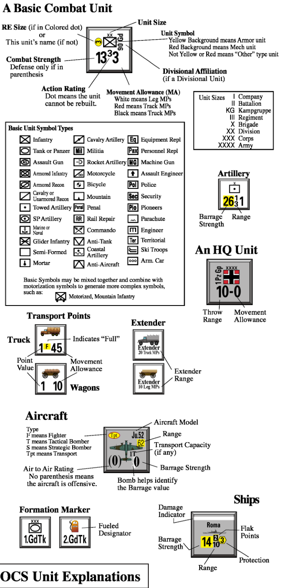

<!-- PDF page 5 -->

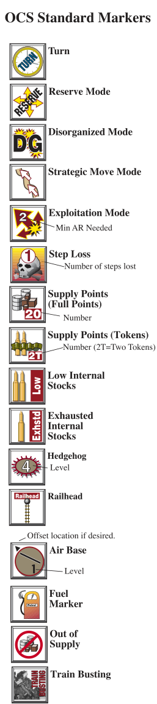

#### **Size Abbreviations**

Company = Co Battalion = Bn Regiment = Rgt Brigade = Bde Division = Div

**3.1a** **Mobility Types.** Color indicates a ground unit’s mobility type: Leg, Truck, or Tracked. This can be different from one side of the counter to the other. Note that if the Movement Allowance (MA) is in an outline font, use the color inside the outline.

- **Leg** units have a White MA.

- **Truck** units have a Black MA.

- **Tracked** units have a Red MA in a yellow box.

**3.1b** A type symbol has one “wheel” for semi-motorized; two “wheels” for fullymotorized. This notation is for historical interest only.

**3.1c** A Multi-Unit Formation (13.7) is a group of ground units with the same higher-level designation (such as “1st Armor Division” or “6th Tank Corps”). Colored stripes mark these formations in newer games.

**3.1d** Some ground units have a yellow dot behind their Action Rating. These **cannot** be rebuilt (13.5c).

### 3.2 Combat Units

Combat units are any ground units with a Combat Strength. Each side of the counter shows the unit in a different mode (see 5.0). Note that HQs (13.1c) and artillery (13.4b) are combat units, even though their Combat Strengths are not printed on the counter.

**3.2a Combat Categories.** Color inside the unit symbol rectangle indicates a ground unit’s Combat Category (see 9.4e):

- **Armor** has a yellow background.

- **Mech** has a red background.

- **Other** has any color other than red or yellow.

**_Design Note:_** _A unit with an armor unit symbol can have a red background. Such a unit has a tank force with an infantry component. Other such combinations are possible. The combination of color and symbol depict the functional as well as the nominal organization of a unit._

**3.2b** A unit with a combat value in parenthesis is **not** Attack-Capable (see 4.4). It can only defend.

**3.2c** The Action Rating grades a unit’s leadership, training, equipment, and cohesion. Printed values range from 0 to 5, with higher numbers being better. (Some modes reduce these ratings, so a -1 AR is possible.)

**3.2d** Multi-step combat units (usually infantry divisions) have a Regimental Equivalent (RE) number printed on the counter. This RE value is used for a number of purposes (such as stacking and transportation) and is in a colored dot for easy identification. Step losses reduce the strength and size (9.11d) of these units.

**3.2e** Specialized units covered by the series rules are listed below (individual games may add other types):

- HQ units (13.1)

- Rail Repair units (13.3g)

- Artillery units (13.4)

- Replacement units (13.5)

- Engineer units (13.8)

- Breakdown units (20.0)

**3.2f** **Independent Units.** Any unit that is neither part of a multi-unit formation (3.1c) nor a multi-step unit (3.2d) is “independent.” This is important mostly for Fuel Supply (12.5e).

### 3.3 Non-Combat Units

Non-combat units come in five types: ports, air bases, hedgehogs, Transport Points, and Supply Points (SP). These are ground units, but not combat units. They have no Combat Strength and cannot be used to absorb step losses. An Organic Truck has the same Transport Points value on both front and back of the counter; other non-combat units flip to show a different number of generic “points” or “levels.”

**3.3a Supply Points (SP)** are supplies in a specific location. A single SP roughly equates to 1,500 tons of consumable supply (an ideal mix of fuel, ammo, and stores is assumed). An SP can be divided into four smaller amounts called Tokens

<!-- PDF page 6 -->

(T); each token is 1/4 SP. The SP and Ts can break down and recombine as needed. SP have no inherent movement ability. They can be moved via the side’s abstract rail/sea capacity and by units with a transport capability: Transport Points, certain ship types, and certain aircraft types. The term for SP in a hex, whether loaded on a Transport Point or unloaded on the ground, is **supply dump** . SP are “generic” units and can be captured (and recaptured) when control of a hex changes.

**3.3b Transport Points** have a point value that shows both their size and how many SP they can carry. (Thus a 1-point truck’s full load is 1 SP.) Transport Points can represent just about any kind of vehicle or animal pressed into service (from trucks to elephants). Transport Points with a unit ID on their counter are “Organic Trucks” that belong to a specific multi-unit formation.

**3.3c Ports, Air Bases, and Hedgehogs** of various sizes can begin the game in place or be constructed. These cannot be moved. Ports can be damaged, which reduces their capacity until repaired. Air Bases can be reduced to a smaller size. Hedgehogs can be reduced in level by friendly (not enemy) action. References to “air bases” in these rules generally include air strips and aircraft carriers as well; references to “ports” include printed ports and converted LSTs.

**Important Note** : Ports and hedgehogs are often printed on the map. A noncombat unit is considered to be in each such hex.

### 3.4 Ships

Naval units—also called ships or by their specific type, such as ‘Cruiser’ or ‘Destroyer’—can represent one or many vessels, depending on type. Most naval units are marked with Barrage Strength, Range, Flak, and Protection Values. The front of most naval counters represents the full-strength ship, while the back is the same ship but at reduced strength due to damage. Landing Craft (18.4) are different: they are presented as generic “points” of capacity capable of delivering

cargo (combat units, Transport Points, and SP) to coastal hexes and ports.

**_Design Note:_** _Individual ships (such as carriers) are named and will be “slow” on their damaged side. Naval units without a “slow” side represent multiple ships: generally two Cruisers or four Destroyers. Each “point” of Landing Craft represents many small craft (usually “slow”)._

### 3.5 Aircraft

Air units—called aircraft or planes or by their specific type (such as Fighter or Transport)—represent roughly 20 to 45 aircraft. These are marked with an Aircraft Silhouette, Aircraft Type, Air Combat Rating, Barrage Strength, and Range. Some aircraft also have a Transport Capacity. The front of the counter represents a full-strength unit; the back is the same unit but at reduced strength.

### 3.6 Game Markers

**3.6a** **Supply Markers.** These indicate supply states such as Out of Supply, Low or Exhausted internal stocks, and Fuel status.

**3.6b** **Mode Markers.** These designate Reserve, Disorganized, Exploitation, and Strat Mode.

**3.6c** **Weather Markers.** These show the current weather, flight, and ground conditions.

- **3.6d** **Turn and Phase Markers.** These keep track of the game turn and phase.

**3.6e** **Step Loss Markers.** These show the losses to multi-step units.

**3.6f** **Formation Markers.** Use these to represent a group of counters kept off-map. This reduces on-map counter density and can add to fog of war (13.7).

## 4.0 General Concepts

### 4.1 Rounding Rule

Players will often be required to round decimals to whole numbers. When the fractional part is less than .5, round down. When the fractional part is .5 or more, round up.

### 4.2 Fractions

Round the final odds in combat, but do not round fractional strengths prior to determining odds. Fractional barrage factors are combined and then rounded to determine the barrage column. **Never** round fractional Movement Allowances.

**_Design Note:_** _Players should take note of the important effect of this rounding rule on odds calculation. In this series, a 15 to 6 attack rounds to 3:1._

**_Example:_** _Three units attack with modified combat strengths of 2.5, 3.25, and 4 (for a total strength of 9.75) against the defender’s strength of 2. Combat odds would be figured as 4.875 to 1, which is rounded to 5:1._

### 4.3 Cumulative Effects

In all cases where a value is subject to multiple modifiers, the effects are cumulative. For instance, quarter the strength of a combat unit halved for terrain and halved for supply.

### 4.4 Attack-Capable Units

Combat units with **printed** Combat Strengths are Attack-Capable, **unless** the strength is parenthesized or the unit is in Strat Mode or Reserve Mode. A printed Combat Strength of zero still makes a unit Attack-Capable (9.14a).

**4.4a** Attacking units (in both combat and overrun) must be Attack-Capable.

**4.4b** Attack-Capable units in Combat Mode and not currently marked Out of Supply have a Zone of Control (4.5).

**4.4c** Ground movement into a hex with an enemy non-combat unit (a port, air

<!-- PDF page 7 -->

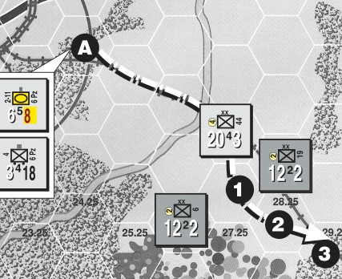

#### **Example: Movement in Zones of Control**

In this diagram, the German units in Hex A are moving. The panzer battalion is using Tracked MPs and the infantry regiment is using Truck MPs. The stack will move along the path shown with the dashed line.

The 44th Infantry Division either began the phase in the hex shown, or has already ceased its move for the turn there. As a result, all ZOC effects in its hex are negated, allowing both of the moving units to pass through it without any movement restrictions.

Because the motorized infantry is using Truck MPs, it must stop when it enters the un-negated EZOC in Hex 1.

The panzer battalion, with its Tracked MPs, does not worry about EZOCs. Its movement is neither slowed nor otherwise affected by the enemy units adjacent to Hex 1 and 2. Therefore it can continue moving to Hex 3 (and beyond).

base, supply dump, Transport Point, or hedgehog) requires an Attack-Capable unit. This may result in destruction or capture, per 9.14.

**_Player Note:_** _Attack-Capable units are no longer required for movement into “empty” enemy villages or cities._

### 4.5 Zone of Control

Attack-Capable units in Combat Mode have a Zone of Control (ZOC) unless currently marked Out of Supply. Units in other modes **do not** have a ZOC. ( **Exception:** Exploitation Mode, 5.9c.)

A unit’s ZOC limits enemy actions in the six hexes adjacent to the unit. This is true regardless of the terrain in those hexes or the hexsides between them.

**4.5a** The following actions **cannot** be taken in an enemy ZOC. An action marked <Negation>, however, is allowed if the ZOC has been negated (4.5b); negation is not possible for the others.

- **A) Truck Movement. <Negation>** A unit with **Truck MP** (mobility types are explained in 3.1a) that **enters** an enemy ZOC must either end its movement or else conduct an overrun. One overrun might lead to another, thus allowing the unit to continue through more than one ZOC. Note that units **starting** a phase in an enemy ZOC

can exit that hex using Truck MP, and that movement using Leg or Track MP is unaffected by ZOCs.

- **B) Supply Lines. <Negation>** An enemy ZOC blocks all kinds of supply paths (e.g., draw, throw, Extenders) traced with **Truck MP** in or out of a hex. Note an HQ or Extender with Leg or Track mobility is unaffected by ZOCs.

- **C) Rail Transport - Literal.** Units using Rail Cap.

- **D) Rail Transport - Trace Supply. <Negation>**

- **E) Rail Conversion operations.**

- **F) Port Operations - Trace Supply. <Negation>**

**_Specific Game Note:_** _In either edition of DAK, units_ **_do not_** _negate EZOCs for Port Operations (F)._

- **G) Port Operations-Literal, Using Sea Cap.**

- **H) Aircraft Refit. <Negation>**

- **I) Reserve Mode.** Units cannot enter Reserve Mode in an enemy ZOC (5.7c). Once in Reserve Mode, they can enter/exit ZOC normally.

- **J) Strat Mode.** Units cannot change to Strat Mode in an enemy ZOC (5.8a), nor can they ever enter a ZOC while in Strat Mode.

- **K) Repl Rebuilds.**

**4.5b Negating ZOC.** Per 4.5a, some ZOC effects can be negated. An enemy ZOC in a hex is negated if that hex contains a friendly combat unit at that moment and, further, the unit doing the negating **will not spend MP later in the current phase** . (It is allowed to leave the hex via actions such as advance after combat or Breakout, which do not require expenditure of MP.) The friendly combat unit doing the negation need not have a ZOC itself. Note that when a unit **starts** the phase in an enemy ZOC, negation is not needed to exit that hex.

**_Example:_** _Aircraft refit can still be done even if a Combat Mode enemy unit is adjacent to the base, provided a friendly combat unit (of any mode) is in the hex._

**4.5c ZOCs and Retreats.** See 9.12e.

**_Design Note:_** _The lack of ZOC effects on Leg and Track movement can cause anomalous events until a player masters the implications of this feature. Players need to think carefully about unit placement, both along the front lines and in the rear area!_

<!-- PDF page 8 -->

### 4.6 Regimental Equivalents

The concept of Regimental Equivalents (RE) is used to figure the size of a unit (important for things like stacking and transport). Only ground combat units have RE sizes, as only they need them.

- Multi-step units have their RE size shown on the counter.

- Battalions are 1/2 RE.

- Repl units and company-sized units are 1/4 RE.

- All other sizes count as 1 RE. (There may be game-specific exceptions.)

A multi-step unit’s RE size is reduced by one for each step loss (9.11). All other combat units are 1 step for loss purposes, regardless of RE size. (Some games have exceptions to this rule.)

**_Design Note:_** _The RE concept has its roots in the GDW EuropA games._

### 4.7 Transportation Equivalents

Combat units, Transport Points, and SP can be transported by rail (13.3), air (14.9), Landing Craft (18.4), and abstract shipping (19.0f). A Transport Point (13.2) can **only** carry SP.

**4.7a** RE and SP are interchangeable transportation equivalents. One point of rail capacity can move either 1 SP or 1 RE (or a combination, such as 2T of supply and 1/2 RE of units).

**4.7b** If a unit’s printed MA in **Move Mode** is from **1 to 6 Leg MP** , inclusive, its transportation equivalent is halved. For all other units, the transportation cost is the same as the RE size.

**4.7c** Transport Points can load (and carry) a number of SP equal to their point value. Transport Points can be carried by landing craft, rail, or shipping (but not by air). Count only the size of the Transport Points when figuring the transportation equivalent—whether loaded with SP or not, it always takes 1 point of capacity to ship 1 Transport Point.

**4.7d** **Movement and Transport.** A unit cannot be moved by more than one type of transport in a phase—for instance, a

unit is not allowed to move by rail to an airbase, and then immediately use air transport. Furthermore, ground units cannot spend any movement points in the phase they make Air Drops (14.10) or Beach Assaults (18.6), or when they move by Shipping (19.0f). Sometimes, however, **half MA** can be spent by units being transported:

- **before** when using rail cap (13.3c).

- **before and/or after** when using Air Transport (14.9d).

- **after** an ALT landing (18.5h) that requires a roll (but never in cases where no ALT roll is made).

### 4.8 Stacking

Stacking is having more than one unit in a hex. **The maximum number of combat units allowed to stack in a hex is 10 RE.** Any number of SP or Transport Points can stack together in a hex, but never more than one port, one air base, and one hedgehog. Stacking in Off-Map Holding Boxes is unlimited. Air and naval stacking is described in 14.2a and 18.1b. There is no movement cost for stacking or unstacking.

Usually only one side’s units can be in a given hex, but on rare occasions friendly and enemy units are allowed to stack together (see 4.8c). Nationality differences among friendly units has no effect on stacking (unless game-specific rules contain restrictions).

**4.8a** Overstacking is having more than 10 RE of combat units in a given hex at the end of **any** segment or phase. There is one exception: stacking is not enforced in the Reinforcement Phase (see 13.6). The owning player is required to reduce any overstacked hexes by eliminating the units of his choice.

Units can temporarily overstack during movement except when conducting an overrun, when the overrunning units and any other friendly units in the hex cannot exceed the 10 RE limit.

**4.8b** **Order of Stacking.** The player can to a certain degree arrange his stacks in any order that makes sense to him, but there are some requirements related to fog of war and ease of play.

- **A)** Mode and Out of Supply markers should **always** be placed on **top** of all such units in the hex. Except where another such marker comes between them, the markers imply that **all** units beneath them in the stack are in that mode (or Out of Supply). Some units can never be in a certain mode or status, and those units simply ignore any such marker above them in the stack. For example, SP and Inactive air units under a DG marker are not in Disorganized Mode.

- **B)** Put Low, Exhausted, or Step Loss markers **beneath** each and every affected unit.

- **C)** If a unit with a ZOC is in a hex, it should be the top combat unit (to make ZOCs obvious).

- **D)** An HQ can be the top combat unit in the hex when no enemy ground units are adjacent (to help the owning player see his logistical net). The enemy player must be told if the hex has a ZOC.

- **E)** Active planes are put on top of any ground units, but on request the enemy player can also see the top combat unit and any hedgehog. If an Active fighter is in the stack, it should be the top air unit (to make Patrol Zones obvious).

- **F)** If a hedgehog is present, it should be the top ground unit (to make Hogs obvious). Again, the enemy player can see the top combat unit on request.

**4.8c Enemy Stacks.** Friendly units can move or retreat into hexes with enemy units in the following cases **only** . There is no extra MP cost. If an unlisted type of enemy unit is in the hex, friendly units **cannot** enter.

- **A)** Attack-Capable units can enter hexes with enemy ships, planes, and non-combat units. Resolve the Specialized Combat per 9.14.

- **B)** Ships can enter hexes with enemy non-combat units and air units. (They coexist.)

- **C)** Planes conducting a mission can enter hexes containing all kinds of enemy units.

<!-- PDF page 9 -->

- **D)** Rail transport and supply paths can be traced through enemy noncombat units, planes, and ships (but cargo cannot detrain in these hexes).

**Reminder:** Non-combat units are SP, Transport Points, hedgehogs, air bases, and ports. See 3.3.

### 4.9 Fog of War

**4.9a** A player can **never** look through an enemy stack. However, the enemy player may always see the **hedgehog, top Combat Mode Attack-Capable unit** (or top combat unit if none have a ZOC), **and top Active plane** in any hex. While the player will know if the top unit is Strat Mode, DG, or Out of Supply, he is not entitled to know about internal stocks status or steps lost.

**4.9b** During combat (both regular and overrun), both players must reveal their Action Rating, AT Effects (9.4e), and total Combat Strength. Neither side is required to show actual units (other than per 4.9a).

**4.9c** During a barrage, the barraging player should reveal his total Barrage Strength, and be informed of all relevant table shifts or Flak Points.

**4.9d** During Air Combat, both players should reveal all aircraft present and which are involved in each round.

**4.9e** Players normally make die rolls in the open, after stating their purpose (such as “this is my Variable Repl roll”). If players agree, they can make certain rolls in secret to increase the fog of war.

## 5.0 Modes

### 5.1 Units Affected by Mode

Ground units use the modes described in this section. Not all ground units can use all six modes; SP, ports, air bases, air units, and hedgehogs do not use any modes at all.

Ships make limited use of Disorganized Mode (18.1d).

### 5.2 General Mode Restrictions

**A unit affected by mode can only be in one mode at any given time.**

Ground units without a mode marker are in either Combat or Move Mode, depending on the side of the counter showing. Markers are placed on **top** of a unit to show the other four modes: Reserve, Strat, Disorganized (DG), and Exploitation. When a mode marker is removed, a unit returns to Combat or Move Mode (depending on its existing orientation).

Units will move and fight according to the values on the side of the counter that is showing (either Move Mode or Combat Mode). Some modes modify these values. A unit with a mode marker uses the base values of Combat or Move Mode (it is said to be “oriented toward” the mode whose side is showing), but is only in the mode indicated by the marker. This means, for example, that a unit in DG Mode could never move by rail, which requires Move Mode, regardless of its counter orientation.

Units of differing modes can stack, and one unit’s mode has no effect on the mode of other units in the stack.

**_Design Note:_** _The implications of these various modes with respect to the turn sequence and each other will be apparent only after repeated play. Suffice it to say they are many and subtle. Good players will orchestrate the differences between these modes to their advantage._

### 5.3 Voluntary vs. Involuntary

**Voluntary Modes** are Combat, Move, Strat, and Reserve. **Involuntary Modes** are DG and Exploitation.

### 5.4 Mode Change

Units in Combat, Move, Reserve, and Strat Mode can change to a different voluntary mode in the Movement Phase. This is done as each individual unit or stack begins to move. For example, a unit in Combat Mode could be changed to Reserve Mode (with either the Move or Combat side up).

Reserve Mode units can be “released” during the Reaction and Exploitation Phases (see 5.7b). No other voluntary mode changes are allowed outside of the Movement Phase.

Mode change does not cost MP.

Involuntary modes are not chosen, they just “happen” as a result of combat, retreat, and barrage. The involuntary mode **replaces** the existing mode. An involuntary mode marker can only be removed during the player’s Clean Up Phase. Note that during the Movement Phase a unit in DG Mode can change its orientation between the Combat and Move sides of the counter.

**5.4a Marker Limits.** The game-specific rules place strict limits on the number of Reserve markers available to each side. To conserve these valuable markers, a player can show the entire portion of a stack that is in Reserve Mode with one marker (4.8b), and the marker need not be placed until **after** units have finished moving their 25%. There are no limits on using the other mode markers, but players should still conserve markers to keep stacks manageable. (They should **not** attempt to deceive their opponent by piling in extra, unneeded markers!)

### 5.5 Combat Mode

Combat Mode is the side of the counter with the greater strength and lesser movement values. These units anticipate contact with the enemy.

**5.5a** Combat Mode units are unable to use rail, air, and shipping transport. ( **Exception:** Rail Repair units, 13.3g.)

**5.5b** Units must be in Combat Mode to convert railroad gauge (13.3f) and perform Engineering functions (13.8a).

**5.5c** Repl units and Transport Points **cannot** enter Combat Mode.

**5.5d** Units must be in Combat or Move Mode when landing via the Amphibious Landing Table (see 18.5c).

**5.5e** A unit must be in Combat Mode to exert a ZOC per 4.5. ( **Exception:** Exploitation Mode, 5.9c.)

<!-- PDF page 10 -->

### 5.6 Move Mode

Move Mode is the side of the counter with lesser strength and greater movement. These units sacrifice some combat capability to enhance speed.

**5.6a** Move Mode is required for rail, air, and shipping transport. ( **Exception:** Rail Repair units, 13.3g.)

**5.6b** Repl units and Transport Points have no Combat Mode side to their counters, so they are always oriented toward Move Mode.

**5.6c** Units must be in Move or Combat Mode when landing via the Amphibious Landing Table (see 18.5c).

### 5.7 Reserve Mode

Units in Reserve Mode can react quickly to events. Mark them with a Reserve marker. Reserve Mode units **cannot** attack, overrun, or barrage until released. **The pool of Reserve Mode markers is limited, per 5.4a.**

Units attacked while in Reserve Mode **defend at half Combat Strength** . Units in Reserve Mode can **move 1/4 MA**

during the regular Movement Phase. They can also move when “released” per 5.7b.

**_Play Note:_** _The 25% movement allowed for Reserves during the Movement Phase can be useful for shifting units in bad terrain (per 6.1c they can ‘always move one hex’) such as in Mountains or Jungle, and also to squeeze an additional 25% movement out of key units._

**5.7a** **Orientation.** A unit that enters Reserve Mode can be flipped to have either side of its counter facing up. This orientation (toward Combat Mode or Move Mode) cannot be changed until the player’s next Movement Phase.

**5.7b** **Releasing Reserves.** Reserve Mode units that are “released” by a player can be used during his Reaction Phase or Exploitation Phase. To release a unit, simply remove the Reserve marker: the unit is now in Combat or Move Mode, depending on its orientation (5.7a). A player can release a unit and have it move and overrun before deciding to release other Reserves.

- **A) Exploitation Phase.** The released reserves have their full movement, barrage, and combat capabilities. They are able to attack or barrage

with other released Reserves or Exploitation Mode units in the subsequent Combat Segment, and can overrun.

- **B) Reaction Phase** . Released reserves move with half their MA, but have full combat values in overruns. Regular combat is not allowed in the Reaction Phase, but released artillery can barrage in the Barrage Segment.

**5.7c Enemy ZOC.** A unit cannot switch into Reserve Mode when in an enemy ZOC. Units already **in** Reserve Mode can enter/exit ZOC normally.

**5.7d Enemy Contact.** Remove Reserve markers from stacks that receive any kind of result (even an **ignored** Do1) when defending in overrun or regular combat. The units are now in Combat or Move Mode, as determined by their orientation (5.7a).

- **5.7e** Reserve Mode units **cannot** use rail, air, and shipping transport.

**5.7f** Transport Points are not allowed to enter Reserve Mode. ( **Exception:** Organic Trucks can do so.)

**5.7g** No unit in Reserve Mode can be stacked with a hedgehog at the end of any Movement Segment.

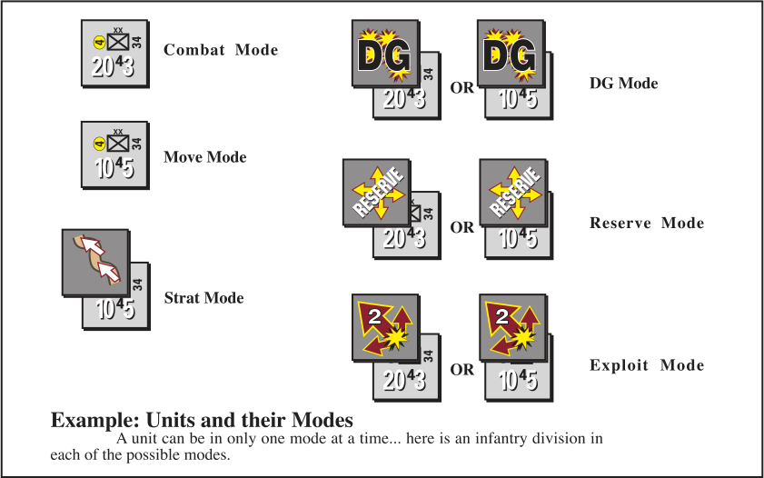

<!-- PDF page 11 -->

### 5.8 Strat Mode

Strat Mode units don’t expect any contact with the enemy. Mark this mode with a Strat marker. **Units in Strat Mode must be oriented to their Move Mode sides.**

The advantage of Strat Mode is that units **move using twice their MA** . The mode does **not** confine them to road movement—they may freely leave the road net.

Strat Mode has several disadvantages: a unit **cannot** attack, overrun, or barrage, and its Combat Strength and Action Rating are both reduced to ZERO.

**5.8a** **Enemy ZOC.** Units cannot enter Strat Mode when in an enemy ZOC. Units in Strat Mode cannot move or retreat into an enemy ZOC. If forced to do so (in a retreat), they are eliminated. (If an enemy unit moves next to them, nothing special occurs.)

**5.8b Supply.** Units in Strat Mode can never “eat off the map” and must end their movement in hexes where trace supply is currently possible. An HQ in Strat Mode cannot throw supplies.

**5.8c** Transport Points cannot enter Strat Mode.

**5.8d** Strat Mode units **cannot** use rail, air, and shipping transport.

### 5.9 Exploitation Mode

This is an involuntary mode awarded to attacking units that achieve great success on the Combat Table. Mark the mode with an Exploit marker (keep the existing orientation toward Move or Combat). Exploitation Mode units (and Released Reserves) can move and fight during the Exploitation Phase (11.0).

Exploitation Mode units **move using half their MA** . Combat and Barrage Ratings are normal.

Remove all Exploit markers during the Clean Up Phase. The units are now in Combat or Move Mode, depending on their existing orientation.

**5.9a** Restrictions on gaining an Exploit marker are found in 9.13b.

**5.9b** Exploit markers have numbers to remind players of the minimum Action Rating (2, 3, or 4) needed for a unit in the stack to take advantage of the involuntary mode change.

**5.9c** Units retain any ZOC they had before gaining the Exploit marker.

### 5.10 Disorganized Mode (DG)

This involuntary mode is an DG adverse result of a combat, retreat, or barrage. Mark this

mode with a DG marker and keep the existing unit orientation toward Move or Combat. Remove any other mode markers from the stack.

Remove DG markers from phasing units during the Clean Up Phase. The units are now in Combat or Move Mode, depending on their existing orientation.

**5.10a Entering DG Mode.** Combat units enter DG Mode when any of the following happens:

- **A)** They suffer a DG result in barrage or combat.

- **B)** They retreat two or more hexes (apply a DG result the instant the unit retreats into its second hex).

- **C)** They retreat into an enemy ZOC. If units that are **already** in DG Mode retreat into an enemy ZOC, inflict one step loss on those units. The owning player decides which unit takes the loss.

At the moment **_any_** of the DG triggers occurs, all combat units in the hex— even those not otherwise involved in a retreat—change to DG Mode. Note a unit that is already DG suffers no further effect, except as noted in “C” above.

**5.10b Effects of DG.** DG Mode units suffer the following effects:

- **A)** They halve their combat, barrage, and movement values.

- **B)** They subtract 1 from their Action Ratings. ( **Exception:** the original/ unmodified Action Rating is used on the Attrition Table.)

- **C)** They are unable to overrun or earn Exploitation Mode.

**5.10c** Transport Points are exempt from DG results and are never in that mode. (An Organic Truck in Reserve Mode does, however, lose its mode marker when the hex receives a DG result.)

**5.10d** DG Mode units **cannot** use rail, air, and shipping transport.

**5.10e Engineering and Rebuilding.** Rail Repair units (13.3g) and EngineerCapable units (13.8a) are still able to perform their special functions when DG, assuming they are oriented toward Combat Mode. This also applies to the road-building and bridging units found in some games, and to HQs rebuilding units (13.5a), but **not** to non-engineer units building hedgehogs.

## 6.0 Ground Movement

A player can move as many (or as few) of his ground units as he likes during the Movement Segment of his Movement Phase. Subject to mode restrictions, a player can also move them during the Movement Segments of his Reaction and Exploitation Phases. A unit can move as many hexes as desired, subject to MA, mode, fuel requirements, and terrain.

### 6.1 How to Move Ground Units

Move units individually or in stacks. Movement must follow a contiguous path of hexes. A unit can move in any direction or series of directions. Finish movement of one unit (or stack) before moving another. Regular combat does not occur during movement, but units can make overruns (a combined form of movement and combat) while moving.

**6.1a** **Movement Points (MP).** Each unit expends MP for each hex entered and hexside crossed according to the Terrain Effects on Movement Chart. Keep a running MP total as each unit/ stack moves.

**6.1b Movement Allowance (MA).** A unit’s MA is how many MP it can spend

<!-- PDF page 12 -->

in a single phase. Modes can modify a unit’s MA. Some units (including SP, ports, air bases, and hedgehogs) have no MA and thus cannot move or retreat.

**6.1c** If eligible to move in a phase, a unit without enough MP can always move a **minimum** of one hex. Units can **never** use this rule to overrun, violate restrictions imposed by their mode, or move into or through prohibited terrain. Only units with an MA greater than zero can do this.

**6.1d** A unit can move from hex A to hex B only if it could **also** move from hex B to hex A. For example, a unit prohibited from entering mountains could not move from a mountain hex to a clear hex through a non-road hexside. Note the possible impact on overruns, which cannot make use of roads (8.1c).

**6.1e** The MA of units in a stack are independent of each other, as are the expenditures of stacked units of different mobility classes. A player cannot transfer MP (even if unused) from unit to unit, or save them for later use.

**6.1f** A stack can begin moving together and then split up by dropping units off as it moves. Once dropped off, a unit **cannot** move further, even if some of its MA remains unused.

**_Player Note:_** _Do_ **_not_** _start moving as a stack if you want the separate units to split off and move elsewhere!_

**6.1g** Players **cannot** move units part of their MA, move some others or conduct an air mission, and then return to finish the movement of the earlier (unfinished) units. Once a unit begins to move, it must continue until it is finished. Note the minor exception for Transport Points in 13.2a.

**6.1h** The MA of units in certain modes can be doubled, halved, or quartered (see 5.7, 5.8, and 5.10). Never round a reduced MA (retain the fraction).

### 6.2 Terrain Effects

Per the Terrain Effects on Movement Chart, each hex and hexside feature costs a specific number of MP. To enter a hex, a moving unit must pay the full required cost. ( **Exception:** minimum moves, 6.1c.) The hex or hexside MP cost will vary depending on the mobility type (3.1a) of the unit: Leg, Tracked, or Truck.

**_In all cases below, the word “road” encompasses every kind of road-like feature (tracks, railroads, and roads of various quality):_**

**6.2a** Roads can be used if moving units are following a continuous road path. **A unit then pays the road movement cost and ignores other features in the hexes or hexsides crossed.** There is no requirement for the roads to intersect **within** a hex in order to leave it via

any of them—roads and railroads are considered to be linked in a common hex even if it is not literally shown as such on the map.

**6.2b** Add the cost of hexside features— these have additive costs (such as ‘+3’) on the Terrain Chart—crossed to that of the hex entered. ( **Exception:** units moving along a road **ignore** hexside features.) Note that Bridging (13.8b) can be used to reduce the cost of rivers.

**6.2c** Ground units cannot enter or cross prohibited hexes and hexsides (unless using a bridge or road). Destroy units forced to do so. See also 6.1d.

√ **6.2d** **Multiple Terrain Types.** Some hexes contain more than one type of terrain. Use the terrain in the hex which is **most costly** for movement (unless following a road, per 6.2a). The amount of symbol in the hex does not matter (so even a little nub of mountain makes it a mountain hex). **Exception:** Ignore city and village nubs.

Water terrain has a few exceptions:

- A moving unit ignores water terrain along a shoreline if there is any land terrain on the hexside crossed.

- A moving unit uses the **cheapest water terrain** along a hexside being crossed, such as when a hexside is part lake and part river.

- Rivers are intended to fully cover hexsides, so ignore nubs.

#### **Example: Laying a Carpet**

This example is mildly different from the earlier “Movement in Zones of Control” example. Here we have a trio of truck-borne infantry regiments wiggling through a tiny slot in the enemy line.

When the moving Group A reaches Hex 1, it must drop off one of the infantry regiments to ‘carpet’ — which is OCS slang for negating an EZOC — that hex.

The remaining two units can continue movement into Hex 2, where another infantry regiment must be dropped off to carpet that EZOC.

The last of the infantry regiments can continue to Hex 3 and beyond. It will need to stop if it runs into another EZOC, but has a dozen MP remaining and let’s only hope its reach doesn’t exceed its grasp!

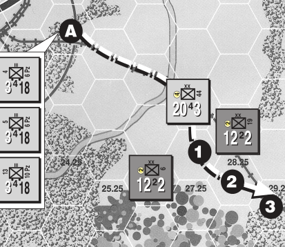

<!-- PDF page 13 -->

### 6.3 Restrictions on Movement

**6.3a** Only the designated player can move his ground units during a given phase. For instance, only the nonphasing player’s units can move during the Reaction Phase.

**6.3b** **Enemy Contact.** Unless negated, an enemy ZOC stops movement of a Truck MP unit (see 4.5a). Units can _sometimes_ move into hexes containing enemy units (see 4.8c).

## 7.0 Reaction Phase

The Reaction Phase is a chance for the non-phasing player to disrupt enemy plans with movement, overruns, and barrages. (There is no Combat Segment.)

**7.0a** The only ground units that can be used in this phase are the non-phasing player’s released Reserve Mode (5.7b) units. ( **Exception** : Ground units can use Air Transport, per 14.9d.) He can release as many or as few reserves as he wants—see 5.7b for complete details. Released artillery can conduct barrages in the phase’s Barrage Segment.

**7.0b** Handle barrages and overruns in the Reaction Phase normally.

**7.0c** The non-phasing player’s ships and Active aircraft are all eligible to be used in this phase.

## 8.0 Overrun

Overrun is a form of combat that occurs during the various Movement Segments. Only use these procedures against hexes with enemy combat units—refer to 9.14 when moving into hexes containing only non-combat units, ships, and/or planes.

#### **Procedure:**

Move the attacking stack adjacent to the target hex and declare the overrun. Overruns are made from the adjacent hex; the attackers do not actually enter the defender’s hex unless the defender vacates it.

Resolve overruns like any other combat (follow the sequence in 9.2). Note the increased chance for Surprise (9.8) in overruns. If the attacker does not retreat and has sufficient MP remaining after an overrun (regardless of whether the defender retreats or is destroyed), he can continue to move and can make further overruns against the same or other targets. If the defender retreats or is destroyed, all of the attacking units **must** enter the hex (at no additional movement cost).

### 8.1 Overrun Restrictions

Only Attack-Capable units that started the phase stacked together can overrun. They must be in Combat, Move, or Exploitation Mode. Units can overrun as many times as their MA allows. There is no limit on the number of times a given defender can be overrun during a single Movement Segment. Resolve each overrun separately.

**8.1a** Moving units spend 3 MP for each overrun. If the combat result allows the attacker to occupy the defender’s hex, there is no additional MP cost to do so. Units with fewer than 3 MP remaining cannot overrun.

**_Example:_** _A unit does two overrun attacks against a hex that would cost 1 MP to enter. It is successful the second time, and advances into the defender’s hex with 6 MP expended._

**8.1b** Overruns are only allowed if the MP cost to enter the hex (the combined hex, hexside, and Trainbusting costs) would be 3 MP _or less_ . A terrain that lists a cost of “All” cannot be overrun.

**8.1c** Units cannot use features such as roads or bridges to bring the hex’s MP cost down, to negate prohibited terrain, or to meet the restriction of 6.1d.

**8.1d** Each overrun is made against a single adjacent enemy hex. A given hex can be overrun several times in a single phase. The same moving stack can make several overruns (against the same or different hexes).

**8.1e** No unit, regardless of the combat result, **ever** gains an Exploitation marker (9.13b) when making an overrun.

**8.1f** Should the attacking units choose to take one or more of their options as retreats from an overrun, they end their movement for the phase. The attackers can continue movement if they do not retreat.

**8.1g** Only units conducting the overrun can move in an overrunning stack.

**8.1h** Other friendly units can be in the hex from which an overrun is made. These units affect stacking limits in that hex (4.8a), but are not involved in the overrun. The overrun’s combat result has no effect on these units whatsoever (regardless of what it is).

## 9.0 Ground Combat

Ground combat is conducted in the Combat Segments of the Combat Phase and Exploitation Phase. Overruns also use the ground combat procedure, but with some differences as outlined in section 8.0. To engage in combat, the attacking units must be adjacent to the hex being attacked. There are some other important considerations:

- Units that are not Attack-Capable (4.4) can never attack.

- HQ (13.1c) and artillery (13.4b) are combat units that do not have a printed Combat Strength **.**

- Artillery, ships, and planes do not attack enemy ground units using regular combat. They “attack” using Barrage (10.0).

- Hexes that do not contain enemy combat units cannot be attacked. Such hexes are dealt with by using Specialized Combats (9.14).

- Supply dumps, Transport Points, air bases, planes, ships, and ports do not take part in regular combat at all—they do not add any strength, cannot absorb any loss, and (except for Organic Trucks) cannot retreat. Whenever enemy Attack-Capable

<!-- PDF page 14 -->

units enter a hex with these units, a Specialized Combat (9.14) occurs.

#### **Procedure:**

The attacker announces the attacking hex(es) and the defending hex. Before determining any odds or modifiers, both sides must put their involved combat units into combat supply by expending SP according to the Supply Table or by expending internal stocks. The attacker does this first and if he cannot do so, the attack is cancelled and the defender does not need to expend any supply. If the defender does not expend supply (or has none), the attack continues, but the defender fights at half Combat Strength. Each side selects a unit whose Action Rating (AR) will “lead” the combat. Subtract the defender’s AR from the attacker’s AR and use this difference as a Dice Roll Modifier (DRM) **affecting both Surprise determination and the combat roll** . Roll two dice for Surprise to check for possible “surprise shifts” to the Combat Table. Determine the base Combat Table odds by comparing the Combat Strengths for each side (making all adjustments for mode, terrain, and supply) as a ratio of Attacker:Defender (rounding fractions per the rounding rule). On the Combat Table, locate the correct odds column on the appropriate terrain category row. If either player has Surprise, adjust the table column accordingly. Roll two dice, modifying the roll by the DRM for Action Rating and any Hedgehog the defender might have. Cross-index the modified roll with the odds column to find the combat result. Apply that result, starting with the unit of each side whose AR was used to determine Surprise.

### 9.1 Restrictions on Combat

**9.1a** Only the phasing player’s units can attack in a Combat Segment, and only the moving player’s units can overrun in a Movement Segment.

**9.1b** Attacking is always voluntary, and just part of a stack can be used if the player wants.

**9.1c** No unit can divide its strength to attack more than one hex, nor can multiple defending hexes be attacked

in one combined combat. Except for stacking (4.8a), there is no limit on the number of units that can engage in an attack from a single hex. There are some important differences between regular combats and overruns (in addition to things covered in 8.0):

- In a Combat Segment, a given unit may attack only once and a given hex can only be attacked once. A hex can be attacked from as many adjacent hexes as the attacking player wants.

- In a Movement Segment, a given unit may perform multiple overruns and there is no limit on how many times a given hex can be attacked via overrun. Only the currently moving stack can overrun, so overruns must come from a single adjacent hex.

**9.1d** Attack all combat units in a hex as a single, combined defending strength. The defender can never withhold units in a hex from combat.

**9.1e** Units can be restricted in their ability to attack by mode (units in Strat Mode and unreleased reserves cannot attack), supply status (requisite SP or internal stocks not available), terrain (see 9.1f), and unit type (parenthesized Combat Strengths can only defend). Fuel is not needed to attack or defend.

**9.1f** A unit can **never** attack a hex that the movement rules (see especially 6.1d and 6.2c) prohibit it from entering. This applies even if the TEC seems to indicate otherwise. Note also that if a hex can be entered in movement, but only by using a road, a regular combat is allowed, but not an overrun (8.1c).

**9.1g** Resolve attacks that begin past, or are shifted past, odds shown on the table using the last available column. Also, attacks with odds which begin off the table have column shifts measured from the last available column.

**_Example:_** _A player makes a 1:12 attack (shame on him). The starting column is the furthest left, or 1:5. Fortunately, Surprise is obtained and a column shift of 6 is rolled. The player shifts six columns from the 1:5 column to 3:1._

### 9.2 Sequence Summary

- 1) The attacker selects the attacking and defending hexes.

- 2) Both players expend the required SP (see Supply Tables). Note if the defender cannot spend supply, or chooses not to do so, he defends at half strength.

- 3) Announce Action Rating values, attacker first then the defender.

- 4) The defender announces terrain choices (9.3b) and players then determine the initial odds.

- 5) Using each side’s Action Rating unit, determine the DRM (9.6).

- 6) Roll two dice to determine any Surprise. Modify the odds column per 9.8.

- 7) Roll two dice and use the DRM in 9.6 to determine the result.

- 8) Execute combat results—attacker first, then the defender—starting with the unit of each side used to determine the Action Rating DRM (9.11c).

- 9) If the defender’s hex is now vacant and the attacker has not retreated as part of an option result, the attacker can advance after combat into the defender’s hex.

**_Design Note:_** _While learning the system, use this summary for each combat and follow the steps rigorously in order. Even after the system is well known, it is a good idea to use this as a check list to keep things straight. The order of the steps is important!_

### 9.3 Terrain and Combat Table

The Combat Table divides terrain into four general terrain categories: Open, Close, Very Close, and Extremely Close. These categories define the row to be indexed with the odds column. Always use the **defender’s hex (or hexsides)** to determine the terrain category.

**9.3a** Units **must** be able to move into a hex being attacked. See 9.1f.

**Important Note:** The Terrain Effects on Combat Chart will usually mark with an asterisk a situation where combat

<!-- PDF page 15 -->

might not be possible if hexes are not connected by a road. But 9.1f **always** applies, whether or not an asterisk is—or is not—on the chart.

**9.3b** **Multiple Terrain Types.** Some hexes include more than one terrain symbol (such as woods and mountains). The **defender** gets to choose which one of these terrain types affects the combat (per 9.4b and 9.4c). The amount of the terrain symbol in the hex does not matter **except** in the case of cities and villages (where spillover is ignored).

**9.3c** The effects of terrain on attacking and defending units, and the terrain’s Combat Table category, are found on each game’s Terrain Effects Chart.

### 9.4 Terrain and Unit Strength

Combat units are divided into three classes (3.2a): Armor, Mech, and Other. The combat strength of units in each class is sometimes modified by terrain. For instance, attacking Armor is usually x2 in Open.

**9.4a** Apply Terrain Effects to every unit independently. (Some might be halved, some quartered, etc.)

**9.4b** The defending player gets to choose the one terrain that will modify each **attacking** stack: either a type in the defender’s hex (such as mountain or woods), or along the hexside (such as river or wadi) the attack crosses. This is a **separate** decision for each attacking stack. Remember: only the hex **or** the hexside can be chosen; these modifiers are **not** cumulative.

**9.4c** The defending player also gets to choose the one terrain that will modify the **defending** stack. This choice is **not** restricted by the selection(s) made in 9.4b. Only hex terrain (not hexside) can be chosen. **This choice also determines the terrain category line to be used on the Combat Table.**

**_Example_** _: A city hex is attacked from three adjacent hexes. Each of the three attacking hexes are across minor river hexsides. Two of the attacking hexes are open terrain, the last is a swamp. The defending player believes his city hex will hurt some of the attacking hexes more than the minor river_

_(seeing armor in each), so he selects the city hex as the terrain for two of the attacking hexes. The remaining attacking hex has infantry showing, so the defender selects the river instead. That done, the defending player selects city for his defense (Very Close in this case). The terrain in the attacking hexes does not matter._

**9.4d** If a Terrain Effect is in brackets ([x2], etc.), that modifier only applies to attacking units. On defense, all such bracketed modifiers are read as x1.

- **9.4e Anti-Tank (AT) Effects.** A “x2” Terrain Effect for attacking Armor or Mech is sometimes reduced to “x1.5”. Do this when the defender’s hex has

- the **same or a higher** level of AT Effects.

- **Heavy AT Effects** are given to all Yellow-coded units, Red-coded units with Tank symbols (such as a Soviet Tank Brigade), units with an AntiTank or Anti-Aircraft symbol, and hedgehogs.

- **Light AT Effects** are given to all Red-coded units which do not have a Tank symbol (such as recon units and panzergrenadiers).

- **No AT Effects** are given to all other unit types.

Consider AT reductions to the attack multiplier on an individual unit basis.

**_Design Note:_** _These Anti-Tank Effects show the reduction in the offensive power of mechanized units when confronted by defenses prepared for their threat. As a side benefit, they bring out the “hard-yet-soft” character of most Red-Mech units. Note the Red-Mech units with a tank symbol (and only that exact symbol) are a special case because they have inherent infantry strength as well as tanks._

**_Example_** _: An attack has some Panzers (Heavy AT) and some Panzergrenadiers (Light AT). Normally, these units would all be x2 when attacking an open terrain hex. If a defending unit provides Light AT Effects (but none provide Heavy AT), the attacking Panzers would still be x2 but the attacking Panzergrenadiers would be x1.5. If the defending hex had Heavy AT Effects, the attackers would all be x1.5._

### 9.5 Supply and Combat

Both combat supply and trace supply are needed to fight at full effectiveness. Being marked Out of Supply affects unit strength independently of the combat supply concerns, and all such reductions (if any) are cumulative.

- **A)** Units **cannot** attack at all without combat supply.

- **B)** Units without combat supply can defend at half strength. A player can choose to withhold combat supply (internal or otherwise) if he so desires.

- **C)** Internal stocks can **only** be used when regular supply is physically unavailable. ( **Exception:** The SP loaded on an Organic Truck is **exempt** from this requirement.)

**_Design Note:_** _This rule prevents players from relying on internal stocks (instead of using SP) in situations where a unit involved is pretty likely to die anyway. That would allow far too much micromanagement—in effect getting a “free” combat. Allowing a unit to defend without supply is a safety valve for tight situations where the defending player might otherwise be the target of “supply soak-off” attacks._

**9.5a** When marked Out of Supply, a unit with combat supply can still attack and defend, but does so at half strength. The same unit with no combat supply cannot attack at all and defends at 1/4 strength. (Modifications are in addition to possible Mode modifications.)

**9.5b** Combat Supply (see 12.4) is paid at the instant of combat using either SP or internal stocks (12.10).

**_Example:_** _A player attacks with three units (each 1 RE) against a lone defender (1/2 RE). To be considered in combat supply, the attacker must expend 3T and the defender must expend 1T. In this case, the attacker cannot expend the 3T—he has only 1T. He must reduce the attack to one unit, use some internal stocks, or not attack at all. He cuts down the attacking force to one unit. The defender is unable to obtain combat supply and has no internal stocks remaining. So his Combat Strength is halved in the resulting battle._

<!-- PDF page 16 -->

### 9.6 Action Rating Modifier

Action Ratings affect combat as Dice Roll Modifiers (DRMs). Each player selects a unit that will determine his side’s Action Rating (AR) in the combat, with the attacker announcing his choice first. Only one unit is chosen per side, and the unit must actively participate in the combat. Calculate the DRM as follows: Attacker’s AR minus Defender’s AR = DRM (this number can be positive or negative). **This DRM is used when determining Surprise (9.8) and during Combat Resolution (9.9).**

**Important Note:** Each side’s first step lost, if any, in a combat result **must** be taken from their Action Rating unit. This does not apply to losses taken in barrages or retreats. In those cases, the owning player can take the loss from **any** of the involved units. See 9.11c for more detail.

**9.6a Mode Considerations.** Mode can reduce Action Ratings.

- DG Mode reduces a unit’s Action Rating by 1.

- Strat Mode reduces a unit’s Action Rating to ZERO.

### 9.7 Odds Determination

To determine the raw combat odds, use the total modified attacking strength and the total modified defending strength. Divide **both** by the **smaller** of them and apply the rounding rule (see 4.2) to each result. Express the result as a ratio of Attacker:Defender.

**9.7a** The Combat Table has a row for each terrain category. Find the odds determined above on the correct row, using the terrain in the defender’s hex. Use the highest column that is **less than or equal** to the determined rounded odds.

**9.7b** Odds are limited to those printed on the table. Resolve attacks that fall outside the odds listed on the table on the last available column and begin any shifts from there (see also 9.1g).

### 9.8 Surprise

After players have identified their Action Rating units and have determined the combat odds, check for Surprise. Roll two dice and add the DRM determined in 9.6. Subtract one from that roll if the defender has any level of hedgehog. Check the modified roll on the Surprise Table to determine which player (if any) gets Surprise. **If Surprise occurs** , roll one die and shift the final odds column on the Combat Table that number of columns. These shifts are to the **right** for attacker Surprise and **left** for defender Surprise. If no Surprise occurs, make no shift.

Note the **type of attack** (overrun or regular) determines the Surprise Roll needed for each side (per tables).

**_Play Hint:_** _Roll three dice at once—the two “Surprise” dice and an off-colored “shift” die—to speed play._

**_Design Note:_** _Surprise mechanics and effects have been the subject of some debate over the years. Some go into a state of shock at the thought that their odds might shift six full columns (infrequent, but it can and does happen). It is instructive to look at the “massive” changes involved in the examples above. In the first, a rather middling three-column shift in the attack’s favor generated the following difference in effect: The attacker’s 3’s get exploit, whereas a 4 AR would have been required before, and the defender gets one additional hard loss and a DG he might have had anyway. In the second example, this time with the_ **_maximum_** _six column shift against the attack, the difference is one step loss for the attacker (but the option disappears) and the defender option is lost._

**_Example:_** _An AR-5 unit tries to overrun an AR-0 unit. This gives a +5 (!) DRM for Surprise. The player rolls an 8, modified to 13, giving attacker Surprise. He then rolls one die and gets a three, which shifts the combat odds three columns to the right. Note that the +5 Action Rating DRM is also applied to the Combat Table roll._

_Let’s assume the overrun’s base odds were 4:1 in the open. The column shifts move the odds to the 9:1 column. The player_

_rolls his dice giving a 7 (modified by +5 giving a 12), and the combat result is Ae3, DL2o2DG. Without the column shift, the same battle would have resulted in an Ae4, DL1o2._

_For the sake of argument, reverse the above (the 0 attacking the 5 in an overrun). By the way, this is not recommended! The Surprise roll is 10 modified by -5 for the Action Ratings involved, giving a 5. That gives defender Surprise in an overrun. A six is rolled for the number of column shifts. Shift left six columns from the 4:1 in the open column to the 1:4 column. A combat roll of 7, modified to a 2 by the Action Rating differential gives a combat result of AL2. Without Surprise, the result would have been AL1o1, Do1._

### 9.9 Combat Resolution

After determining odds, Surprise, and any column shifts, roll two dice. Add the Action Rating DRM (9.6) and subtract the full value of any hedgehog in the defender’s hex. Cross index the **modified** dice roll with the final odds column to find the result. Execute the result according to cases 9.10 to 9.13 below.

**Important Note:** Hedgehogs have a Surprise DRM that is different from their Combat Table DRM. Surprise rolls are –1 regardless of the hedgehog’s level, while Combat rolls are reduced by the full level of the hedgehog.

### 9.10 Results and Options

Combat results are generally a mixture of “losses” and “options.” Losses are given as an “L” followed by a number; Options are given as “o” followed by a number. The loss number is a **required** step loss. The option number presents the affected player with a **choice** .

See 9.11 for information on step losses, and 9.12 for details on retreats.

**9.10a** Option results can be taken as any combination of step losses and retreat hexes, provided the total number is fully executed. For instance, a loss of one step combined with a retreat of one hex satisfies an “o2” result.

<!-- PDF page 17 -->

**9.10b** The attacker always goes first, executing his combat result before the defender decides what he will do. Take hard losses first and then any options.

**9.10c** The defender gets to **ignore** his options if the attacker has retreated or cannot take all of his options. (But the defender can choose to apply his full option when he **wants** to retreat.) The attacker must **always** fulfill his option results.

**9.10d** When a combat result contains both option and exploitation numbers, the attacker must take his entire option **as a loss** to earn an Exploit marker. If the attacker chooses to retreat, ignore the exploitation result entirely.

**_Examples:_**

- _A)  Ao1, DL1o2... attacker retreats, defender’s result becomes DL1._

- _B)  AL1o1, Do1... sole attacker dies by the L1, so defender can ignore his option result._

- _C)  Ao1e4, DL1o2... attacker kills one step (and gets his exploit result), defender must lose 1 and execute two option results._

- _D) AL1, Do1... attacker takes his required step loss, defender must execute his option._

- _E)  Ao1, DL1o1… attacker must take his option (as loss or retreat), lone defending step is destroyed._

### 9.11 Step Losses

Most units have just one step, and are placed in the Dead Pile when they take a loss. A

multi-step unit is less brittle, and has one step per RE. Record their losses with a Step Loss marker placed under the unit. When the marker equals the unit’s total steps, put it in the Dead Pile. No unit can ever absorb more step losses than it has available steps.

**9.11a** The owning player determines which unit or units absorb step losses, within the restrictions of 9.11c.

- **9.11b** Results given as “L” followed by a number **must** be taken as step losses. Ignore inflicted losses beyond the side’s ability to absorb them.

- **9.11c** **Step Loss Distribution.** During combat, the AR unit (9.6) must lose the **first** step of their side. In the case of multiple losses, all units must take one loss before any unit takes two.

These distribution rules do not apply to losses taken during a barrage or retreat; instead the player has full control over which units to lose. So the AR unit need not take the first loss and there is no requirement to spread losses out.

**_Example:_** _A stack suffers 4 step losses, but only possesses 3 steps. The units are all eliminated (and the remaining loss is ignored). In another example, a hex containing a three-step division and a_

#### **Example: Comprehensive Combat**

At the end of the Movement Phase, German forces are arranged as shown. In the Soviet Reaction Phase, the unit at Hex 2 could release from reserve. It would have only 1.5 MPs to use, so could not make any sort of overrun attack to foil the expected attack on Hex 1, and cannot even scurry over to add to the defense. The Soviet player decides not to move the unit and ends his Reaction Phase.

The Combat Phase begins with the Barrage Segment, when the German player conducts a barrage attack on Hex 1 using the artillery regiment at

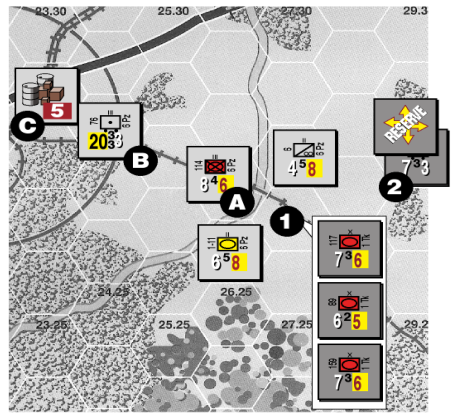

Hex B. On the Barrage Table, the initial column is 17-24 because the barrage strength is 20. He pays 3T (the cost noted on the table for that column) from the dump at Hex C (leaving 4 SP and 1T). There are no applicable shifts. The German player rolls two dice and gets a 6, giving a DG result. The stack is marked accordingly.

In the Combat Segment, the German player announces an attack on Hex 1 using the mech infantry regiment and the motorcycle and panzer battalions. With no HQ in the area to throw supply, the two units that crossed the river cannot draw all the way to the dump and must use internal stocks (and a Low marker is placed under each unit). The mech infantry draws its 1T from Hex C. The Soviet player expends 2T for his defense (from an off-map dump).

The German player announces the use of the motorcycle battalions (a 5) as his Action Rating unit. The Soviet player announces he will use a tank brigade, reduced by DG to a 2, as his. This gives an action rating differential of +3.

The combined attack strength is 17 (4 for the motorcycle, 4 for the mech infantry (halved due to the river), and 9 for the panzers (x1.5 due to the terrain and anti-tank interactions). The defenders are halved to 10 points due to being DG. This gives raw odds of 2:1 (after rounding). The attack begins on the 2:1 column of the Open line on the Combat Table.

With the +3 DRM identified earlier, the German player’s roll of a 8 for surprise is modified to an 11, which gives attacker surprise. He then rolls a die and gets a 2, which is the number of column shifts in his favor. The combat will be resolved on the 4:1 column.

The German player rolls two dice and again gets to add the action rating differential. His roll of 3 becomes a 7, which gives a result of Ao1/Do1. The German player chooses to kill his motorcycle unit (his action rating unit) to satisfy his option (instead of retreating). The defenders retreat a hex to satisfy their option. The remaining Germans can, if they desire, move forward into the defender’s empty hex. Thus ends an attack that needed better luck to succeed.

<!-- PDF page 18 -->

#### **Example: An Overrun Attack with a Hipshoot**

The German player wants his stack at Hex B to overrun the Soviet tank brigade at Hex 2 after preparing the target with a hip shoot air barrage.

First, he needs to establish a spotter for the hip shoot. Taking a quick look at the situation, he decides to use the motorcycle battalion. By moving it to Hex C, the Soviet path to its dump will be cut. This will not affect the defense (the tank brigade can still use internals), but the German player — still thinking ahead — has his eyes on capturing that dump for his own purposes and doesn’t want the Soviet player to use any of it before he gets there. He could have run the motorcycles into the dump right now to grab it, but decided not to since the MP cost of the terrain (heavy forest) would preclude the battalion making it back to Hex C to perform its original spotter function. Since the battalion uses Track MP, it can slip through the EZOC without any problems, but does need fuel to move. The German pays 1T for this.

The spotter in place, the German player conducts a hip shoot with the Stuka. The Soviets roll two dice for Flak, getting no result. The German player now resolves the barrage, which begins on the 17-24 column. Of the possible shifts, only one applies: there is 1 RE in the target hex, so one shift to the left is in order. A roll of an 8 on the 12-16 column means the target is changed to DG Mode. The Stuka returns to a base and becomes Inactive.

Having completed his preparations, the German player now launches his overrun. He pays 2T from his dump at Hex E to fuel the movement of the two attacking units. (He chose to do this instead of fueling the entire division to save every possible token.) Note the unit in Hex F cannot join the overrun because it did not begin the phase stacked with the others. The moving units expend 3 MP to get to Hex D and announce the overrun, which costs an additional 3 MP.

Both sides pay for their combat supply — the overruning units pay another 2T from the dump (which is now down to 3 SP and 3T); the defending unit uses internals because it cannot reach its dump (but the player but doesn’t mark it Low yet, though, since it might die in the combat).

The action rating unit for the Germans is announced as the panzer battalion, a 5. The Soviets have just the one unit, which is now AR2 due to DG, giving the attackers a +3 differential. The German player rolls a 6 for surprise, which after adding the AR differential is just enough for attacker surprise in an overrun. Another die is tossed to determine the number of shifts, in this case 2.

The German units would normally be doubled because of terrain effects (armor and mech types are x2 in Open), but the tank brigade’s AT effects reduce that to x1.5. Modified attack strength is thus 21. The defender is not modified in Open terrain but is halved due to DG Mode, for a modified strength of 3.5.

Raw odds are exactly 6:1, but there is no such column on the Open line so the starting point is 5:1. After applying the two surprise shifts, the 9:1 column will be used to resolve the attack. The German player rolls two dice, getting a 4 which gets modified to a 7 due to the action rating differential: an Ao1 e4, DL1o2 result.

Even though the defender is destroyed by the L1 result, the attacker option result stands. The Germans must choose to lose a step or retreat. Retreat would end the movement of these units, and if a unit is killed it must be the lead unit (the panzers). The player decides he should retreat a hex, since the mech infantry is out of MP anyway. This ends the overrun.

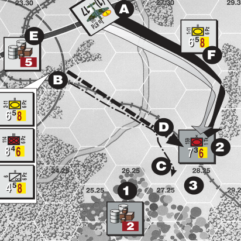

_single-step unit suffers two step losses. The division provided the AR for the attack. The division suffers the first step loss; then the one-step unit, being the only other unit in the hex, is destroyed by the second loss._

**9.11d** **Efects of Step Loss.f** A multi-step unit missing _one or more_ steps halves its Combat Strength when it attacks. If it is missing half or more of its original (printed) steps, its Combat Strength is also halved on defense.

A multi-step division’s current RE size is the unit’s printed RE size minus the steps it has lost.

**_Example:_** _A 14-4-3 rifle division with three steps loses one step. Place a “one” Step Loss marker under the unit. Its attack strength is now 7 and its defense strength is normal. Later, the division loses another_

_step. Flip the one step loss marker to its “two” side. The unit’s Combat Strength is now halved to 7 in both attack_ **_and_** _defense. A further step loss will destroy it._

### 9.12 Retreats & Advances

**√** Option results that are not taken as step losses must be taken as a retreat (unless exempt due to 9.10c). All units involved must retreat a number of hexes equal to the remaining option result. A retreat must end the full distance (as the crow flies) from the hex where it began.

- A retreat path does not have to be a straight line. It can zig-zag to avoid prohibited terrain, but then must be extended to reach a hex satisfying the ‘full distance’ requirement.

- Eliminate units that must retreat through enemy-occupied hexes or prohibited terrain (sometimes this limits how much of an option can be taken as a retreat).

**9.12a** The “DG” result on the Combat Table forces all of the defending units to immediately enter DG Mode. Do this **before** beginning any retreat (important due to 9.12e). A retreat of 2 or more hexes triggers a DG result the instant a combat unit enters the second hex of its retreat.

**9.12b** Units with a zero MA can change to Move Mode before retreating. Units that are unable to move in any Mode are destroyed if forced to retreat (and cannot advance after combat either).

**9.12c Direction.** Players retreat their own units. Retreating units can retreat

<!-- PDF page 19 -->

as a stack or split up. A retreat should be generally away from enemy units involved in the combat, but to avoid losses, retreating units are allowed to bend the definition of what is “locally to the rear.”

**9.12d Tagalongs.** Combat units and Organic Trucks that did not participate in a combat **can** join a retreat from their hex. Other types of units (ships, aircraft, ports, hedgehogs, non-organic trucks, and dumps) **cannot** tag along, and must remain in the hex.

**9.12e Enemy ZOCs.** When a combat unit retreats into a ZOC, it immediately changes to DG Mode, as do any friendly combat units that ‘just happen’ to be in the hex. In addition, if any part of the retreating stack was DG **before** it entered the enemy ZOC, lose one step from the stack (owning player’s choice from among the **retreating** DG units). This ZOC effect cannot be “negated” by friendly combat units and is never affected by terrain.

**_Design Note:_** _The “enemy ZOCs” rule might need some explaining. Retreats are an unplanned form of movement, so even if a unit retreats into a hex “protected” by friendly units, the result is great confusion. This is why both the retreating unit and the units it retreats through become DG._

**√ 9.12f Enemy Units.** A retreat cannot go through a hex that contained enemy combat units at the **start** of the combat (so no retreats through a hex vacated by an attacking unit’s loss or option). Handle retreats through non-combat units, aircraft, and ships as you would when moving (per 9.14).

**9.12g Advance After Combat.** If all of the defenders are destroyed or retreat, attacking units can enter the defender’s hex.

- **A)** Only those units that paid combat supply costs (including those with a strength of zero) can advance.

- **B)** If the attackers take their option as a retreat, no advance is possible.

- **C)** Advance after combat can capture or destroy enemy ships, aircraft, and non-combat units per 9.14.

- **D)** Advance after combat is **required** after a successful overrun, but not after regular combat. The owning player gets to choose which of his attacking units advance (if any).

### 9.13 Exploit Results

Combat results can include a notation “e” and a number, meaning the attacking units with an AR of that number or higher **might** change to Exploit Mode (see 9.13b). Units must have actually been **involved** in the attack, so only Attack-Capable units can ever gain an Exploit marker.

**9.13a** Exploit-marked units can move and fight in the upcoming Exploitation Phase (11.0).

- **9.13b Ignore** exploit results if:

- **A)** Attacking units are in DG Mode. (Non-DG attackers in the same combat treat exploit results normally.)

- **B)** It is an overrun (in any phase) or an attack in the Exploitation Phase.

- **C)** Any two attacking stacks are not mutually adjacent. Thus in order to gain an exploit result, **at most** two stacks can be attacking and they **must** be in adjacent hexes.

### 9.14 Specialized Combats

**9.14a** **Zero Strength Units.** Combats involving units with a ‘zero’ Combat Strength require some special handling. Attacks **against** a zero strength begin on the right-most column of the Combat Table (before applying shifts, if any). Attacks **with** a zero strength must be supplied normally, and begin on the leftmost column. If both sides have a zero strength, call it 1:1 and shake your head.

- **9.14b** **Supply Dump.** When an enemy Attack-Capable unit enters a hex with a supply dump, consult the Capture Table to determine how many SP are

- captured by the enemy player (round to the nearest token). The rest is destroyed.

- **9.14c** **Transport Points.** When enemy Attack-Capable units enter a hex with Transport Points, they might capture some of the Transport Points and the

- rest are displaced (sort of like a retreat).

Roll on the “Trucks” column of the Capture Table to check the combined Transport Points with an MA of more than 10, and then roll on the “Wagons” column to check for all with an MA of 10 or less. Results are explained under the table, and affect Transport Points and any loaded SP equally. When there is a mixture of Transport Points (such as regular trucks and organic trucks, or wagons and mules), the owning player decides which are captured and which are displaced.

Enemy units, ZOCs, and prohibited terrain do not affect displacement—just pick up the Transport Points and place them in their new location. A captured Transport Point can move immediately if captured in the Movement Phase (but not if captured in other phases).

Transport Point captures are usually rounded to the nearest full point—only round to token-size trucks if the game’s counter mix includes them. SP capture is **always** rounded to the nearest token.

**Important Note:** An Extender **never** suffers a loss from the Capture Table, nor does it figure into the total number of trucks or wagons present in a hex when calculating the percentage lost. Instead they “collapse” per 9.14d.

**_Example:_** _In a hex there are three Trucks and 12 SP (three of the SP are loaded on the trucks). During the Movement Phase, a German motorcycle battalion roars into the hex at no additional MP cost. (The Soviet player neglected to garrison this hex; shame, shame.) The German player now consults the Capture Table. First, he rolls for the trucks and supplies thereon using the table’s second column. He rolls a 3 (25%) — that gives 1 Truck Point and 3T to the German war effort. The other 2 Trucks and 9T are displaced by the Soviet player up to ten hexes.) Next the German player rolls for the nine SP on the ground and gets a 5 (50%): another 4 SP and 2T are captured. (The remainder is destroyed.) The motorcycle battalion continues moving_

<!-- PDF page 20 -->

_with its remaining MP, after which the captured truck is moved._

**9.14d** **Extender Collapse.** When an

Attack-Capable unit enters a hex with an Extender, the Extender must collapse. This same procedure is available,

at the player’s option, as an alternative to its regular movement (useful when Extenders have lost trace supply).

Displace a collapsed Extender to any hex within its special draw range that is currently in trace supply. Enemy units, ZOCs, and prohibited terrain have no effect on a displacement, and no loss or capture is possible. Flip the Extender to its **regular** Transport Point side in the new hex.

**Important Note:** If no “legal” hex exists collapse is not possible. Instead flip the Extender where it is and have it check for capture per 9.14c.

**9.14e Hedgehogs.** When an Attack-Capable unit enters a hex with an enemy hedgehog, it is captured.

**9.14f Air Bases.** When enemy Attack-Capable units enter a hex with an air base, it is captured. A captured air base can be used immediately.

**Regardless** of weather conditions (so even if flight is not allowed), roll for each aircraft in the hex using the Air Base Capture Table. Apply the results as shown (which will be either “reduction” or “no result”). All surviving aircraft then displace to any friendly air base within **2x range** and become Inactive (regardless of their status before the roll). They **cannot** remain in the hex; they **must** displace and become Inactive. If no friendly air base exists within double range, destroy the planes.

**9.14g Naval Units.** When an Attack-Capable unit enters a hex with enemy ships (including DUKW operating as Landing Craft), the ships are destroyed.

**9.14h Ports.** When an Attack-Capable unit enters a hex with an enemy port, it is captured. The port can immediately be used for shipping and as a possible source of trace supply.

## 10.0 Barrage

Artillery, ships, and aircraft use barrages to attack enemy units and facilities. Use the barrage table appropriate for the target. Although more than one unit can attack in the same barrage, only units of the same general type—artillery, naval, or air—can combine in a single barrage.

Barrages occur in the Barrage Segments of the Movement, Reaction, Combat, and Exploitation Phases. If a side’s air units are allowed to perform Hip Shoot missions (see 14.7d), these barrages are made during Movement Segments of those phases. Any number of artillery units or ships, or up to four aircraft, can participate in a single barrage.

The following general procedure is used in all types of barrages (air, artillery, and naval) and when using either of the barrage tables. Total the Barrage Strengths firing, determine the correct column on the table, expend supply per the amount listed on that column (for artillery firing only), and adjust the column per the table’s notes. Roll two dice and apply the result.

**Important Note:** It takes at least one point to “get on the table” (before shifts are applied). Zero-point barrages are not allowed!

**10.0a Barrage Table.** Use the Barrage Table to conduct barrages against enemy combat units. The primary goal is to DG them.

The targeted player picks the terrain to be used for possible shifts. He also selects which combat units in the stack absorb any resulting step losses.

Note a single division (even a multi-unit formation) never counts as more than 3 RE for possible density shifts. (Use the actual amount, if less than 3 RE.)

**_Play Hint:_** _Roll three dice at once—the two “barrage” dice plus the off-colored “rounding” die (for possible “1/2” results) to speed barrage resolution and play._

**10.0b** **Spotter Restrictions.** A “correct spotter” for a barrage is any friendly combat unit adjacent to the target hex that is **not** loaded on a landing craft.

- Barrage Table attacks made without a correct spotter are penalized by a 3-column shift.

- Hip Shoots (on **either** table) cannot be made at all unless they have a correct spotter.

- Spotting does not affect the Barrage vs. Facility Table (aside from the Hip Shoot restriction).

**10.0c Barrage vs Facility Table.** Use this table for a barrage against a facilitytype target. The player must pre-designate his specific target: Air Base or Port (or Trainbusting for that specialized air mission). No modifiers or terrain shifts apply to these barrages, and they do not need spotters. Roll a single die to determine the result.

#### **A) Air Base Targets**

- A parenthesized result (“#”) means the attacking player should check **all** enemy planes in the hex for losses. Roll separately for each. If the roll is ≥ the (#), the air unit takes a loss.

On a numbered result (“1” or “2”), reduce the Air Base by that number of levels, down to a minimum of Level 1. Note that Airstrips are never reduced.

#### **B) Port Targets**

Numbered results (“1” and “2”) generate damage; no other result has any effect. Ports accumulate damage, up to a maximum of four hits, which steadily decrease the Port’s capacity (19.0b).

#### **C) Trainbusting**

- A “*” result is needed to place a Trainbusting marker in the hex; other results have no effect. These markers affect enemy rail transport and ground movement, per 14.8c. A Trainbusting marker is removed during the next **enemy** Clean Up Phase.

**10.0d Barraging Mixed Target Hexes.** Hexes will often contain targets that are affected in different ways by different barrage tables. As such, in any barrage the attacking player must announce a general target (such as “combat units” or “Port”) and apply the Barrage Points to that target **only** . An example would

<!-- PDF page 21 -->

be a hex containing combat units, an Air Base, and a Port. The player can use the Barrage Table to attack the combat units **or** the Barrage vs. Facility Table to attack either the Port **or** the Air Base (but not all at once).

**10.0e** **Barrage Limits and Phasing.** Several restrictions are placed on the conduct of barrages by certain units and in certain phases.

- **A)** Regardless of how many different types of targets are in a hex, only **one** barrage per hex is allowed in each phase. ( **Exceptions:** Antiship barrages and Hip Shoots.) Note a declared mission that is completely destroyed/aborted by Flak or Interception _does_ count against this limit.

- **B)** A unit can only barrage once per phase and cannot split its strength between several barrages or fire at less than its printed strength.

- **C)** Only air and naval barrages can be performed during the Movement Phase, mainly during its Barrage Segment (the exceptions are Hip Shoots, which occur during the Movement Segment).

- **D)** Only artillery can barrage during the Combat Phase.

- **E)** All types (air, naval, and artillery) can barrage during the Reaction and Exploitation Phases.

- **F)** A barrage can use only a **single type** of barraging unit: either air, naval, or artillery.

### 10.1 Artillery Barrages

**10.1a** Artillery barrage ranges are given in hexes. These are unaffected by weather and terrain. An artillery unit with a range of ‘3’ can barrage targets from 1 to 3 hexes away.

**10.1b** **Supply Cost.** Expend combat supply to conduct an **artillery** barrage at the moment of the barrage. The cost is given near the top of the appropriate table; use the cost on the barrage’s initial column (before any shifts). If the SP required to fire the barrage is unavail-

able, do not execute the barrage. (There is no penalty—the units selected for a cancelled barrage are not considered to have fired.)

- **A)** Supply for a multi-unit barrage must come from the same HQ, or from the same supply dump if no HQ is used.

- **B)** Artillery units still use their full Barrage Strength when marked Out of Supply (assuming needed combat supply is available).

- **C)** Barrages can **never** be made using internal stocks.

**_Example:_** _Two artillery battalions, within range, barrage a hex. The total Barrage Strength is 16. The firing player identifies the column on the Barrage Table (12-16). That table requires 3T to fire. The player pays 3T to execute the shot. Checking for modifiers, he finds the target hex contains 8 RE and a Level-1 Hedgehog, in close terrain. An appropriate spotter is adjacent to the target hex. The total column shift applied to the initial column is two to the right (4 right for density, one left for the hedgehog, and one left for the terrain). This gives a final table column of 25-40. The player rolls two dice and obtains an 8. The result is [1/2]. In this case, as neither of the conditions for a bracketed result apply (there is a correct spotter and the target is not in a Level-3 or greater Hedgehog), the result is treated as a regular “1/2.” The firing player rolls one die and gets a 3. The target hex does not lose any steps, but is Disorganized._

### 10.2 Air Barrages

An air barrage is similar to an artillery barrage, but has no supply cost. See 14.7 for more details.

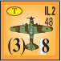

**10.2a Air Barrages and Phasing.** Air units are placed on targets and resolve their barrages in the various Barrage Segments (except for Hip Shoots, which occur during the Movement Segments). The aircraft **must** return to a base and become Inactive immediately afterward (14.1c). Planes conducting a barrage are subject to Interception (14.5) and Flak (14.4) before conducting the barrage.

Hip Shoots (14.7d) are governed by various special rules.

**10.2b Short Range Efectf .** If all aircraft conducting a barrage are at or within 10 hexes of their base, they get an additional shift to the right on the regular Barrage Table. **Exception:** Never apply this shift to Strat Bombers.

**10.2c** There is no supply cost for an air barrage.

### 10.3 Naval Barrages

Barrages by naval units (as well as all forms of anti-ship combat) are covered in 18.3. There is no supply cost.

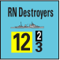

## 11.0 Exploitation Phase

During this phase, units can exploit a breakthrough or finish off a battered defensive position.

**11.0a** The only ground units that can move or fight are Exploitation Mode units and units released from Reserve Mode. ( **Exception** : Ground units can use Air Transport per 14.9d.) The phase consists of a Movement Segment (which allows overruns), a Barrage Segment, and a Combat Segment.

**11.0b** The phasing player can release any Reserves during this phase (5.7b). He is not required to do so and can wait to see how things are proceeding in the phase before releasing additional Reserves. To keep things straight, players can mark released Reserves with Exploit markers. Units actually in Exploitation Mode move only **half** their MA and released Reserves move their **full** MA.

**11.0c** Handle combat (regular, overrun, or barrage) in the Exploitation Phase normally.

**11.0d** The phasing player’s ships and Active aircraft are all eligible to be used in this phase.

**_Play Note_** _: Having Reserves that can be released in the Exploitation Phase is often the critical factor determining the success or failure of an operation._

<!-- PDF page 22 -->

## 12.0 Supply

There are two kinds of supply: on-map supply (represented by SP and Token counters) and trace supply (which is abstracted). On-map supply is a type of non-combat unit primarily used to pay artillery barrage, combat supply, and fuel costs. Trace supply is used to determine whether combat units are “in supply” during their Supply Phase. SP can be used to provide trace supply when combat units do not have a valid supply line, but trace supply can never be substituted when SP are needed.

On-map supply is normally stockpiled in dumps set up behind the front lines. Units sometimes are close enough to “draw” supply directly from the dump, but more commonly supply is “thrown” to them by an HQ unit.

Trace supply is notional. Combat units must trace a path to a supply source, usually a port or a map edge hex. As with on-map supply, HQs are typically used to put the front lines in trace supply. Rail connections and Transport Point “Extenders” are often used to cover long distances back to a supply source.

**Important Note:** Only combat units require supply. Non-combat units, air units, and naval units never consume SP or need trace supply—their supply needs are not explicitly modeled (except for air bases, which require refit supply).

### 12.1 Supply Points

**12.1a** **Mechanical Handling.** Players can break down and add together SP in the same hex by “making change” with SP counters of equal value. Players can further break down SP to Tokens, which are the small change of logistical currency. **One SP equals four Tokens or conversely, one Token equals 1/4 SP.** Combine Tokens into SP whenever possible to reduce stack clutter. The abbreviation used for Token is T, so the shorthand for two Tokens is 2T.

Note the graphic displayed on the SP differs from that on Tokens so that they are easy to tell apart, and the graphic on the Token counter does not imply that Tokens are only used for ammunition.

SP and Tokens are identical aside from their denomination (a Token being a fractional part of an SP).

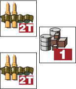

<!-- Start of picture text -->
= <!-- End of picture text -->

**_Example 1_** _: A player must spend 1T to fuel a moving tank unit from a supply dump with a 1 SP counter. He flips the counter to its 3T side to pay for the fuel._

**_Example 2_** _: In paying for a 2T barrage out of a 5 SP dump, the player first realizes that 2T is the same as 1/2 SP. The dump will expend 1/2 SP and have 4 1/2 SP remaining. He flips the 5 SP counter to its 4 SP side, and puts a 2T counter in the hex to add the 1/2 SP._

**12.1b** **Supply Dumps** . Any location containing Supply Points, whether on the ground or loaded on a Transport Point, is called a dump. SP do not have to be unloaded to be used.

**12.1c** **Generic Supply Dumps** . Some supply counters have letter designations instead of the usual numbers. A player can use these to represent supply dumps of any size. Just place the marker on the map and record its number of SP on a scrap of paper. Aside from the paper record, these dumps are handled the same as any other SP in the game. Remove the marker if the dump is ever emptied.

**12.1d** **Ownership of Supply Points.** The generic SP counters are common to both players, so it is important that players keep track of who owns what. An SP belongs to (and can only be used by) the player who brought it onto the map unless it has been captured (see 9.14b).

### 12.2 Transportation of Supply

A player can move SP using Transport Points and his air, naval, and rail assets. The capabilities and limitations of each are in the rules sections governing each

method (13.2, 13.3, 14.9, 14.10, 18.4, and 19.0).

**12.2a Leapfrogging.** A given SP can be moved by only one type of transport (air transport, naval shipping, rail cap, or Transport Point) in a single phase, and no SP can be loaded if it was **unloaded** previously in that same phase.

**12.2b** It is not a violation of the leapfrog rule if an SP is moved across the map and then used immediately.

### 12.3 On-Map Supply

Supply Points are used in various phases to fuel movement, supply combat, refit aircraft, resupply internal ammo stocks, pay for construction, and as a substitute for needed trace supply.

**Important Note:** Players use the **same** mechanics of direct draw and HQ-throw **any** time they need supply (for trace, fuel, combat, construction, restocking internals, or aircraft refit). Fuel is never required to draw, throw, or trace supply. ( **Exception:** Per 18.5e, to draw from SP loaded on a Landing Craft a unit must be in a hex adjacent, and HQs are **not** allowed to “throw” supply drawn from a Landing Craft.)

**12.3a Direct Draw.** To draw supply, units must be within 5 MP of a dump, or a hex that is **adjacent to** the dump (12.3c). Needed supply can be drawn from one or more dumps within range.

Always use Truck MPs when counting the path back to a dump. ( **Exception:** for an HQ with a throw range that is Leg or Track, use that mobility type.) Count the MP just as if moving a unit (see 12.3d).

**12.3b** **Trowing Via HQ.h** An HQ able to draw SP from a dump (per 12.3a) can then pass needed supply forward to the extent of its printed throw range.

An HQ’s throw range, in MP, appears on the counter. Color is used to indicate the throw range’s mobility type (3.1a). To throw supply, count a movement path using this throw range from the HQ to the unit needing supply, or a hex **adjacent to** the unit (12.3c). Count the MP to just as if moving a unit (see 12.3d).

<!-- PDF page 23 -->

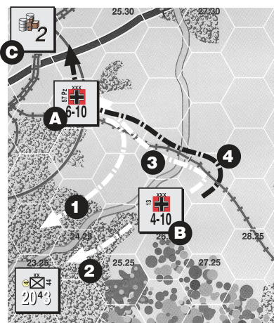

<!-- Start of picture text -->
2 C XXX 6-10 A 4 3 XXX 1 4-10 B XX 2 2043 57 Pz 13 4 44 <!-- End of picture text -->

#### **Example: Maximum Stretch of HQs**

This example shows a number of features about the use of HQs for supply purposes.

The HQ at Hex A can act as its own detrainable hex for establishing trace supply, and has enough range to throw to the hex adjacent to the infantry division via arrowed Path 1. It doesn’t matter that there isn’t enough range to reach the division’s hex; adjacent is always good enough for supply draw and throw.

The HQ at Hex B can also supply the division. It can draw trace supply from Hex A via Path 3, using the detrainable hex created by the other HQ. It has just enough throw range to reach Hex 2 (assuming a cost of 2 MP for each Light Woods hex). Note this HQ is not Engineer-Capable, since it is in Move Mode, so cannot create an HQ-bridge across the river. Fortunately, there is that railroad bridge to use.

If combat supply is needed, both HQs can draw from the dump in Hex C — but note the one in Hex B (using Path 4) will need to take advantage of the “adjacent is good enough” clause.

- **A)** HQs can only throw supply that is used immediately. (To move a dump to a new location requires some form of transport.)

- **B)** HQs can throw to any number of friendly units (but specific games might impose restrictions).

- **C)** HQs in Strat Mode cannot throw supply.

- **D)** HQs cannot “re-throw” supply given to them by another HQ, but can use supply thrown to them for their own needs.

**12.3c Adjacent Is Close Enough.** The “adjacent to” provision of supply paths is very important: regardless of terrain (even if prohibited), it is assumed that the unit will be able to get its hands on supply that can reach an adjacent hex. This applies to all types of supply handling that use direct draw or HQ throw.

**12.3d** **Supply Path Movement** . Any kind of supply path (draw, throw, or trace) is counted as if moving a noncombat unit through the hexes of the supply path. These paths can be traced through enemy non-combat units, ships, and planes, but never through a hex containing an enemy combat unit. All of the movement restrictions contained

in section 6.1 apply when counting out supply paths.

An un-negated enemy ZOC blocks all kinds of supply paths in or out of a hex that are being traced with Truck MP. Note that some HQs and Extenders use Leg MP or Track MP, and the supply paths of these are unaffected by ZOCs.

Always use “normal” terrain costs (the summer/clear variety) for supply paths, ignoring all temporary “bad” ground conditions such as mud and snow, as well as the extra cost of moving through a Trainbusting Zone. ( **Exception:** A unit **can** use movement costs that are temporarily **reduced** by weather.)

**12.3e Holding Boxes and Supply.** A unit in a holding box representing a specific hex draws supply as if it is in that hex on the map (since this type of holding box only exists to give large stacks some elbow room). A unit in a holding box representing an off-map location draws supply from within that holding box (which usually has infinite supply dumps). On-map units cannot draw supply from an off-map holding box.

### 12.4 Combat Supply

Direct Draw (12.3a) and Throwing Via HQ (12.3b) are used to receive and distribute combat supply (9.5). Units can use internal stocks only if on-map supply is unavailable. See 12.10.

- Attacker cost is 1T per attacking step. ( **Exception:** in DAK, 2-step brigades cost 1T.)

- Defender cost is 2T per combat. ( **Exception:** for 1 RE or less, cost is just 1T.)

**Important Note:** Units which do not have their full combat supply available cannot attack at all. Defenders always have the option to withhold combat supply and defend at half strength.

### 12.5 Fuel Supply

Direct Draw (12.3a) and Throwing Via HQ (12.3b) are used to receive needed fuel supply.

**12.5a** Combat units using Truck MP or Tracked MP **cannot expend any MP** unless fuel costs are paid. Full fuel costs must be paid to move even one hex. ( **Exception:** movement following ALT landings, 18.5h.) Fuel is **never** needed for other types of units or functions

<!-- PDF page 24 -->

(such as Leg units, trucks, ships, aircraft, and supply draw/throw).

**12.5b** Combat units needing fuel to move **do not** need fuel to attack, defend, barrage, retreat, or advance after combat. Overrun **requires** the attacker to pay for fuel even if the stack begins movement adjacent to the defender.

**12.5c** According to the cases below, pay fuel costs in any phase a unit incurs them at the instant they are incurred.

- A) **Formation Method.** Pay 1 SP to fuel a multi-unit formation. **This fuel lasts until the next Friendly Clean Up Phase.** To mark this, flip the Formation marker (13.7) to its Fueled side. If all units of the formation needing fuel are not using the same HQ for supplythrow (or using the same dump for direct-draw), apply the single-unit method (below) to fuel units that cannot draw from the common source.

- B) **HQ Method.** Pay 1 SP to fuel an HQ itself plus all **independent** units within its throw range. **This fuel lasts until the next Friendly Clean Up Phase.** Mark this by placing a Fuel marker on top of the HQ. See 12.5e.

- C) **Single-Unit Method.** Pay 1T per unit that needs fuel. This method can be used by **any** unit, regardless of its size or steps, and whether it is independent, a multi-step unit, or part of a formation. **This fuel lasts for the current phase only.** There is usually no reason to mark this type of fuel.

**12.5d** The phasing player must remove Fuel markers from his HQs and flip his Formation markers to their nonfueled sides during his Clean Up Phase. (This sequence means that Fuel markers placed during the Reaction Phase, when releasing Reserves, give the best possible “miles per gallon.”)

**12.5e** An HQ can fuel all **independent** units (defined in 3.2f) in its throw range “for free” (avoiding the single-unit method’s 1T per unit per phase) once the cost of 12.5c(B) has been paid. The

throw range is counted when each independent unit begins to move.

**A fueled HQ is only allowed to throw fuel from a single location each phase.** This affects a moving HQ, which must choose whether to throw fuel from its starting hex or its ending hex.

**12.5f** The placement of reinforcements doesn’t need fuel, but moving beyond the entry hex requires payment of fuel costs (if any)—reinforcements **do not** get “free fuel” on the turn of arrival.

**12.5g** Internal stocks **cannot** be used for fuel costs.

**_Example:_** _In his Reaction Phase, a player wants to move a panzer division and five independent Assault Gun battalions. The player pays 1 SP to fuel an HQ to run the non-divisionals (since the 1 SP is cheaper than the 5T he would have to spend for them individually). The panzer division has been pretty well mauled in earlier battles and has just one panzer battalion and one infantry regiment left. The player determines that he can afford to let the infantry walk (using their Leg MP in Combat Mode) and pays 1T for the panzer battalion. The total fuel cost is 5T (and it might have cost as much as 9T had he not been maximizing efficiency)._

_Play passes into the above player’s own turn. In his regular Player Turn some of the above decisions will affect play—both in the regular Movement Phase and in the Exploitation Phase. The HQ which was fueled for the Assault Guns is still fueled (and will be until the player’s Clean Up Phase) so all non-divisional units in range of that HQ (including other HQs and that HQ itself) can move during the Player Turn without additional costs. The panzer division’s panzer battalion cannot move without further payment, however, because the 1T expended only lasted for the phase in which it was spent. The Leg infantry is unaffected, as it can still walk. To move the panzer battalion about will require further fuel expenditures._

### 12.6 Trace Supply

Combat units need to check for trace supply during their Supply Phase. If unable to obtain trace supply or “eat

off the map” (12.6c), the combat units are marked Out of Supply and must check for Attrition. In addition, units can use Breakout (12.8e) if unable to “make their trace” during the Breakout Segment.

Direct Draw (12.3a) and Throwing Via HQ (12.3b) are used to receive and distribute trace supply.

**12.6a** There are three kinds of Supply Sources:

- **1)** Map-edge railroad hexes that allow Reinforcement entry, plus other supply sources mentioned in the game-specific rules, or

- **2)** Detrainable hexes (see 13.3c), or

- **3)** Hexes with an Extender (12.7) that connect to a detrainable hex or directly to a supply source.

**12.6b** An enemy ZOC in any type of Supply Source hex prevents trace supply from being obtained, but these can be negated per 4.5b.

**12.6c** **Eating off the Map.** Combat units that cannot “make their trace” to a Supply Source can “eat” SP to obtain trace supply. For every 1T spent, up to 2 RE (within draw or throw range of the dump) can be fed. Round all fractions up; for example, 6 1/2 RE would cost 4T.

Units can **only** “eat off the map” if no trace supply is available. See also 12.6e and 12.6f.

**12.6d** Combat units that can **neither** “make their trace” **nor** “eat off the map” are marked Out of Supply and roll for Attrition (see 12.8).

**_Play Note:_** _Units are never forced to “eat off the map,” even when SP are available. At times, letting surrounded troops “starve” to save combat supply is a good gamble._

**12.6e** Strat Mode units are not allowed to “eat off the map” and must end their movement in hexes where trace supply is currently possible. An HQ in Strat Mode cannot throw supplies.

**12.6f** All combat units in a multi-unit formation should “make their trace” to the same HQ or the same direct-draw source. If this is not possible, then select part of the formation to trace “for free”

<!-- PDF page 25 -->

while the rest must eat off the map or become Out of Supply (per 12.6d).

**12.6g** Ground units on a Landing Craft are always considered in trace supply. **12.6h** Units making a planned air drop (14.10b) do not require trace supply on the turn they are dropped.

### 12.7 Extenders

Extenders are used to help bridge gaps in trace supply. Five Transport Points of the same type (usually truck or wagon) in a hex can be converted into an appropriate “Extender” counter by expending half their MA (per 12.7d). Extenders cannot move (or be used for any other Transport Point purpose).

- Organic Trucks can never be used to create an Extender.

- If a game’s counter mix does not include Extenders (always on the back of 5-point Transport Points) they cannot be created at all.

**12.7a** The only purpose of Extenders is to create new locations from which trace supply can be drawn. (They never move SP, help move RR cargo, or increase draw/throw ranges.) Extenders can act as a trace supply…

- **A)** … **source** when it is linked to a detrainable hex or directly to a supply source.

- **B)** … **connection** between two sets of rail hexes, allowing hexes along the “forward”rail line to become detrainable if the “back” one leads to a supply source.

- **C)** … **connection** between a rail hex and a supply source, making hexes along the rail line detrainable.

**12.7b** Extenders have a range that is the maximum distance (in MP) **back** to the connected hex. The Extender is always posted at the “forward” end of this connection (the hex furthest from the ultimate supply source).

**12.7c** An Extender can link to other Extenders in a “daisy chain” to make longer connections.

**12.7d** **Creating Extenders.** Switching into an Extender costs a Transport Point half of its MA. Extenders cannot move unless they flip back to the Transport Points side of the counter, using half their MA to do so. A given Extender may be formed by only one **type** of Transport Point ( _e.g._ truck or wagon, not both). A loaded Transport Point cannot convert into an Extender (it must first unload). An Extender cannot be created in a hex where it cannot connect to a trace supply source at that moment. Extenders that later have their trace cut can stay as Extenders, although they cease to function as such.

**12.7e** Transport Points forming into an Extender can come from different hexes, combining in a common hex (where each spends half of its MA).

**12.7f** After an Extender is switched back into Transport Points, the points can be moved separately to different hexes. They need not move as a stack.

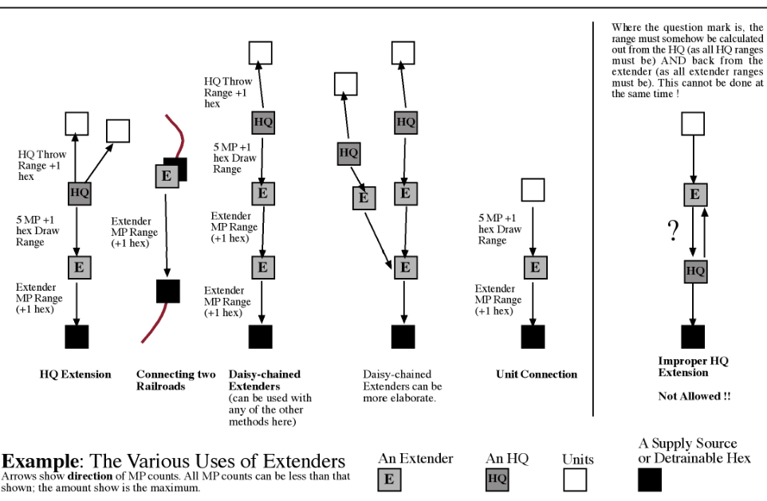

<!-- PDF page 26 -->

**12.7g** Extenders can apply the “adjacent is good enough” rule, as in all other supply-related functions.

**12.7h** Extenders “collapse” when enemy combat units enter their hex, and can also do so voluntarily. See 9.14d.

**_Play Note:_** _Garrison Extenders, or else..._

### 12.8 Attrition & Out of Supply

**12.8a** In the Supply Phase, a friendly stack that cannot “make its trace” or “eat off the map” is marked Out of Supply and checked for Attrition. The marker remains until trace supply is regained in a subsequent friendly Supply Phase. Units marked Out of Supply must check for Attrition at the end of every friendly Supply Phase until back in supply.

**12.8b** Check a stack for Attrition by consulting the Attrition Table. Roll two dice, using the column for the highest Action Rating among the units marked Out of Supply, and counting only the steps in the hex that are Out of Supply. The table result is the number of steps the stack must lose. The owning player chooses how to inflict these losses on the Out of Supply units in the stack. There is no requirement to take the loss from the unit with the highest AR.

**12.8c** When checking for Attrition, do not adjust a unit’s AR for being in DG Mode, but do adjust for Strat Mode (but this should never come up, given 12.6e).

**12.8d** **Out of Supply Effects.** Units marked Out of Supply have no ZOC. If combat supply is available, such units attack and defend at half strength. Without combat supply, Out of Supply units **cannot** attack and defend at 1/4 strength. Given barrage supply, Out of Supply units can barrage normally. Units marked Out of Supply can move normally.

**12.8e Breakout.** During their Breakout Segment, any **combat units** (not noncombat units) that are currently out of trace supply (make a trace-check during this segment) and have a printed MA of at least 1 can attempt Breakout if they meet the following conditions:

- **A)** There must be a path of any length from the unit to a friendly unit in trace supply. That path **must** be free of enemy combat units and of terrain that is prohibited for movement (using the unit’s MA in Move Mode). This path for a Truck MP unit must also be free of un-negated EZOCs.

- **B)** The unit must be at or within 15 hexes of a friendly combat unit in trace supply (straight line distance, ignore enemy units/ZOCs.)

**On the first turn** a unit finds itself out of trace supply (not after it “eats off the map” or uses a special form of trace supply such as a Supply Cache or Tree Bark Soup), the above conditions are waived, the success chance (see below) is improved by a +1 DRM, and Transport Points are also eligible to Breakout (roll for each point separately).

Breakout is _always_ voluntary.

Roll for each unit attempting Breakout:

- If the roll is 1-4, the unit fails. It is placed in the Dead Pile (and can be rebuilt normally).

- If the roll is 5-6, the unit succeeds. It is removed from the map, but will return to play as a Reinforcement. Roll again for each successful unit: it returns that number of turns in the future. A returning unit retains any step loss marker, but loses all other markers (Low ammo, DG, etc.).

**_See Change Notes for more on how to use this rule in older series games._**

**_Play Note:_** _Use the Turn Record Track as a reminder for when units return._

### 12.9 Specialty Supply Levels

**12.9a** Non-combat units (3.3) never require trace supply or fuel.

**12.9b** HQs need supply just like any other combat unit.

**12.9c** Air Bases need on-map supply (obtained via Direct Draw or Throwing Via HQ) to refit aircraft. Aside from this, aircraft do not require supply.

**12.9d** Ships do not require supply.

### 12.10 Internal Stocks

Internal stocks represent the ammo supplies that a unit can draw upon when needed SP are unavailable. They can

be used **only** for combat supply (see 9.5b)—never for barrages, trace supply, fuel, etc. A unit’s Combat Strength is the same whether using internal stocks or on-map supply.

Show usage of internal stocks individually, placing a Low or Exhausted marker under **each** unit.

**12.10a** Internal stocks can be used **only** when a unit cannot obtain (via direct draw or HQ throw) needed SP from on-map stocks. ( **Exception:** internal stocks **can** be used if the only available dump is SP loaded on Organic Trucks.)

**12.10b** When a unit gets combat supply from its internal stocks, mark it Low. If the unit is already marked Low, flip the marker to Exhausted—which means that after this combat its internal stocks are empty.

**12.10c** A unit that is marked Low or Exhausted is still eligible to use regular combat supply. If regular combat supply is not available, a unit with an Exhausted marker cannot attack at all, and must defend without combat supply (at half strength, per 9.5a).

**12.10d** No unit can draw on another’s internal stocks, even when stacked.

**12.10e** **Recovery.** Units marked Low or Exhausted recover internal stocks in the player’s Supply Phase if SP are available (obtained via Direct Draw or Throwing Via HQ). Recovery from Low costs 2T per unit (or RE if a multi-step unit); recovery from Exhausted costs twice that amount.

- **A)** Units **must** recover internals if possible, and this recovery takes priority over using SP as a substitute for trace supply.

- **B)** All supply dumps from which a unit can draw or be thrown SP are subject to the required recovery of internals. ( **Exception:** The SP loaded on Organic Trucks are free from the requirement to provide recovery for internals.)

<!-- PDF page 27 -->

- **C)** If some SP are available, but not enough to fully recover internals, expend whatever supply is available. A single T would be wasted; 2T would recover one “Low” unit or improve an “Exhausted” unit to “Low” (or be wasted if the only recovering units are multi-step).

**12.10f** Out of Supply status does not affect internal stocks (or vice versa).

**12.10g** Internal stocks and SP can be mixed to pay combat supply. ( **Exception:** A single counter—even one with multiple steps, such as a division—can use either internal stocks **or** on-map supply; such a unit cannot mix the two for itself.)

**12.10h** If a multi-step unit chooses to use internal stocks because there is not enough on-map supply available, the on-map supply must still be spent (it is wasted).

**_Example:_** _3 RE (three separate units) attempt an attack. The player has 1T of supply available. The 1T can be used to pay for one unit, and the others would be marked Low. If the same attack was done by a single multi-step unit, it would be marked Low and the 1T would be wasted._

### 12.11 Destruction and Capture

**12.11a** **Blowing Dumps.** All SP in a hex, both those loaded on Transport Points and those on the ground, can be blown if a player fears they may be captured by the enemy. A combat unit need not be present in the hex. This can only be done during the Movement Segments of his Movement, Reaction, and Exploitation Phases. A player can blow a given dump only once per phase, and can attempt to blow all or only some of the SP in a dump.

Roll one die on the Dump Blowing Table to determine the percentage of SP destroyed. Round losses to the nearest Token. Note Transport Points cannot be destroyed in this manner.

**_Example_** _: A player attempts to blow 3 of the 4 SP in a dump. He obtains a 75% result. 3 x .75 = 2.35, so 2 SP and 1T are destroyed._

**12.11b** **Capturing Dumps.** When an Attack-Capable unit enters a hex with enemy SP and/or Transport Points, roll on the appropriate column(s) of the Capture Table. (Enemy combat units in the hex must of course be evicted before an attempt to capture can be made.) See 9.14b and 9.14c for complete details.

## 13.0 Specialized Units

### 13.1 HQ Units

HQs are special combat units that can distribute supplies, rebuild units, and perform engineering tasks. HQs are 1 RE in size, regardless of what is on the unit designation.

**13.1a** **HQs and Modes.** The Combat Mode side of an HQ has the greater throw range. DG Mode (5.10e) does not affect an HQ’s special functions (13.1b). An HQ’s defense strength is determined by mode (per 13.1c). An HQ in Strat Mode cannot throw supply (5.8b).

**_Design Note:_** _Combat Mode represents an HQ having taken up residence; Move Mode shows an HQ with a more mobile status. When in Move Mode, the extra trucks of the HQ are considered to be shuttling around mechanics and bakers instead of supplies._

**13.1b** **HQ Special Functions.**

- An HQ can “throw” SP and trace supply to combat units within its throw range (12.3b).

- An HQ can rebuild units (13.5a).

- An Engineer-Capable HQ (13.8a) can perform special functions such as bridging, detrainable creation, and construction.

**13.1c** **HQs and Combat.** HQs have some ratings that are not printed on the counters. Their Action Rating is 0. In Combat Mode, they have a parenthesized (defensive-only) strength of 5, and in Move Mode this is reduced to 1.

HQs need supply like any other combat unit. They must change to Move Mode when forced to retreat.

**13.1d** **Special HQs.** Games can have HQs of multiple nationalities and/or command levels. HQs are normally able to throw supply to all friendly ground units, without regard to historical chain of command, but there may be limitations in specific games. One exception is series-wide: Divisional HQs can only provide supply to their **own** division’s units or to independent units (defined in 3.2f) of the same nationality.

### 13.2 Transport Points

Transport Points move SPs across the map. Specialized Combats involving these are covered in 9.14c.

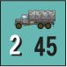

**13.2a** **Sequencing Transport/Supply** . A Transport Point can move, pause to use some of its load, and then continue moving. While “pausing” the carried SP can be used to pay for all kinds of fueling and construction/repair. There are two important restrictions: the Transport Point must finish moving before another unit is moved, and upcoming combat/ barrage costs can never be pre-paid in this fashion. SP need not be unloaded from a Transport Point before being used.

**13.2b Transport Points and Supply.** Transport Points never need fuel and are never Out of Supply.

**13.2c** **Mechanical Handling.** Transport Points can carry up to their size in SP. Transport Points can combine and divide within counter-mix limits. Dividing or combining does not cost MP, can only be done in the friendly Movement Phase and only if all of the involved Transport Points are in one hex. The combined/divided Transport Points can continue to move, but must conform to the limitation imposed by 6.1f (but see 12.7e and 12.7f for some liberties given to Extenders). Different types of Transport Points can never be combined into a single counter, and this restriction includes Organic Trucks, which cannot combine with or divide into regular Trucks. ( **Exception:** Unit Consolidation can be used to convert a regular Truck into an Organic Truck, per 13.9.)

<!-- PDF page 28 -->

**13.2d** **Mode Restrictions.** Transport Points are in Move Mode at all times (never Combat, Strat, Reserve, DG, or Exploit). ( **Exception:** Organic Trucks can enter Reserve Mode, per 13.2g.)

**13.2e** A Transport Point can be shipped by sea or rail, but not by air. ( **Exception:** Mules, found in some games, **can** be shipped via Air Transport.) The shipping cost is always equal to the size of the Transport Point, which can be transported while **loaded with SP** for the **same** shipping cost.

**13.2f** **Loading and Unloading.** Place loaded SP **under** the Transport Points carrying them, and unloaded SP **above** any Transport Points in the stack. A Transport Point cannot be loaded via direct-draw or via thrown SP—it must be in the same hex as the dump. Note SP can (in effect) be unloaded by directdraw as its load is used by nearby units and HQs.

**Loading Requirements:** A Transport Point can load in any hex.

**Unloading Requirements:** A Transport Point can only unload in a hex which contains a friendly combat unit, port, air base, or existing _unloaded_ supply dump.

**Costs:** A Transport Point pays 10% of its printed MA to load/unload any number of SP in a hex. Round the cost normally (so a truck with 45 MA must pay 5 MP to load or unload SP).

**13.2g** **Organic Trucks.** A multi-unit formation sometimes is given special, attached Transport Points. An Organic Truck is handled like other Transport Points, with several exceptions. Organic Trucks…

- **A)** can **never** unload their SP on the map,

- **B)** only allow units of the same multiunit formation to draw their SP,

- **C)** can never be combined to form Extenders,

- **D)** can be put into Reserve Mode (if their hex gets a DG result, remove the Reserve marker),

- **E)** can tag along with other retreating combat units in their stack (but cannot retreat alone),

- **F)** convert when captured into regular Transport Points, and

- **G)** can withhold combat supply (see 12.10a).

Players can use HQs to throw supply from Organic Trucks to units of **that** formation.

**13.2h Full Notation.** Some games have Transport Points that have an “F” in a yellow box on one side and no such notation on the back. The “F” denotes that the Transport Point is full, while the other side shows it is empty (use the empty side plus some tokens for a partially loaded Transport Point).

**13.2i** Transport Points that are captured (see 9.14c) in the Movement Phase can move immediately. If captured in any other phase, no movement is allowed until the capturing side’s next Movement Phase.

### 13.3 Railroads

Railroads are vital for the movement of reinforcements and SP, and are often integral to trace supply. There are usually two types of railroad hexes, multi-track and single-track. Some games also have tracks of differing gauges (see 13.3f).

**13.3a** Combat units, Transport Points, and SP can be moved using Rail Cap (13.3b). These are the only rail cargo allowed—never aircraft, ships, hedgehogs, etc _._ See 4.7 for the Transportation Equivalents of various cargo. Each Rail Cap point can transport **one** SP or RE any distance by rail movement. There are two possible modifications:

- If cargo is moved along a path that includes one or more Trainbusting zones, **double** the Rail Cap cost.

- If cargo is moved along a path that is entirely multi-track rail hexes, **halve** the normal Rail Cap cost.

- **13.3b** Rail Cap is available every turn at levels specified by the scenario rules. It cannot be “saved” for use in another Movement Phase. **Rail Cap can only be used in the Movement Phase** (never during Reaction or Exploitation).

**13.3c** **Detrainable Hexes.** A railroad hex is detrainable if it meets **all** of these requirements:

- It has a village, city (any size), port, or Engineer-Capable HQ (13.8a).

- It is under control (13.3h).

- It has a rail path free of enemy ZOC back to a supply source. Extender links can be part of this for trace supply, but not for moving cargo. Note EZOC **cannot** be negated to move cargo, but **can** to connect with a supply source.

**13.3d** **Railheads.** Some games limit each side’s railroad usage to a certain gauge (or width) of track (13.3f). Show a divide between gauges on the map (as in “German gauge runs to here”) with Railhead markers. (The flip-sides are marked Wrong Gauge to help mark complex junctions.) These markers are **only** moved by the conversion work of Rail Repair units— other ground units moving through rail hexes have no effect on the position of a Railhead.

Some games have only one gauge of railroad track. In these, players can use Railhead markers to show the forward extent of rail hexes under their control. (The initial extent of each side’s rail lines is sometimes given in the scenario rules, but keep in mind that 13.3h usually makes railheads unnecessary.)

**13.3e** Rail movement includes three steps: entrain, move, detrain. All three steps must be done in the same phase.

- **1)** To entrain, the cargo must be in a detrainable railroad hex (13.3c) that is not in an enemy ZOC. A unit moving by rail must be in Move Mode, and can expend up to half its MA in the phase **before** entraining. Reinforcements and new SP can entrain “off-map” if their arrival hex contains a railroad (13.6b).

- **2)** To move, the cargo follows a path of connected rail hexes that does not enter a hex with an enemy combat unit or ZOC. Rail hexes that are wrong gauge (13.3f) or uncontrolled (13.3h) cannot be used.

<!-- PDF page 29 -->

- **3)** To detrain, cargo must be in a detrainable railroad hex which is not in an enemy ZOC. No further movement is allowed by a unit after it detrains (per 4.7d).

**_Design Note:_** _Rail capacity involves the marshaling of rolling stock and a lot of time spent loading and unloading. Rail movement is a strategic asset; it is much more efficient to move loads across long distances rather than in short hops._

**13.3f** **Rail Conversion.** In games with more than one rail gauge, a side can only use its rail capacity or supply line trace along rail lines of a particular gauge. Eligible Rail Repair units (13.3g) are used to convert rail lines to the gauge appropriate to their side. Players keep track of the current extent of each rail gauge using Railhead markers.

- **A)** Railroads cannot be converted in an enemy ZOC (no negation).

- **B)** A Rail Repair unit can convert a rail hex simply by moving into it. Conversion **does not** cost SP or extra movement points.

**13.3g** **Rail Repair Units.** Rail Repair units are combat units that are used to convert railroad hexes. Several special rules govern them:

- **A)** A Rail Repair unit can combine rail movement with conversion in the Movement Phase. ( **Exception:** They **cannot** do so if the hexes being used for rail movement were converted in the current phase. No leapfrogging!)

- **B)** Rail Repair units can move their full MA **after** using rail movement (less any movement done prior to entraining), and can use rail movement in Combat Mode.

- **C)** Rail Repair units can entrain and detrain in any railroad hex (it need not be “detrainable”).

- **D)** Rail Repair units can convert up to 4 hexes (or hexes equal their current MA, if less than 4) during the Movement Phase (not other phases). They must be in Combat Mode, or be in DG Mode and oriented toward Combat Mode (per 5.10e).

**_Play Note:_** _Conversion is not restricted to merely pushing forward the railhead marking where standard and wide gauges meet; Rail Repair units can, for example, use Strat Mode to get ahead of the normal re-gauging to start working on a forward section of track. “No leapfrogging” is a narrow restriction on not having a second repair unit use rail movement on newly converted track to extend the Railhead._

**√ 13.3h** **Railroad Control.** Players can only trace “rail paths” (13.3c) into or through **detrainable hexes** they control. Initial control is based on the front line (use common sense). Control changes when an enemy combat unit enters the hex, or when the hex is now on the enemy side of the front line (this needs to be **clearly** the case; when there is any doubt do not change control).

Note that gauge, enemy units, and ZOC will further limit whether a rail path can actually be used for trace supply or rail transport.

**_Play Note:_** _This supersedes all previous game-specific Railroad Control rules. There is no longer a need to move units through every rail hex — control of detrainable hexes is now the sole concern._

### 13.4 Artillery Units

Artillery units attack targets within range using Barrage. Barrage Strength is shown in

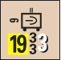

a yellow box (on the lower left of the counter); range is printed below the Action Rating. The Combat Mode side of an artillery unit is the one with the greater Barrage Strength. Artillery units can move and fire in the same phase.

See 10.0 for barrage rules.

**13.4a** Artillery in Reserve or Strat Mode **cannot** barrage. Otherwise, artillery can barrage in any Barrage Segment in which they are eligible to act, given the needed supply is paid.

**13.4b Artillery and Combat** . Artillery units all have a parenthesized (defensiveonly) strength of 1 in both Combat or Move Mode. This number is **not** printed on the counters.

### 13.5 Replacement Units

Players roll on their Variable Replacement Table during each of their Reinforcement Phases. Replacements (Repls) acquired by this roll are additions to the turn’s regular Reinforcements. Repls can be used as soon as they arrive or be saved for later. They come in two types: Equipment (Eq) and Personnel (Pax). These are used to rebuild lost steps or units. Repl counters are not intentionally limited by the counter-mix, and as with SP both players share the same generic counters so must take care to remember who owns which.

Repls can **never** enter Combat Mode, but can enter all other modes. They are 1/4 RE for stacking. Repls are Attack-Capable and can be used to take combat or barrage losses. Repls are independent combat units and must be supplied and fueled normally.

**13.5a** **Replacing Losses.** A Repl used to replace losses must be in Move Mode. Rebuilding costs vary by unit type and size, and are summarized on each game’s Rebuild Table. There are two general kinds of rebuild possible during every Reinforcement Phase.

- **1)** To rebuild a unit in the Dead Pile, the required Repls must be in a single hex at or within 2 hexes of a friendly HQ. The HQ must be in Combat Mode, or else be in DG Mode and oriented toward Combat Mode (per 5.10e). The hex may not be in an enemy ZOC (4.5a). Remove the required Repls and put the rebuilt unit in the hex.

- **2)** To rebuild an on-map unit that has taken step losses, follow the above procedure. In addition, the unit being rebuilt must be stacked with the Repls being used.

**13.5b** A reduced or eliminated multistep unit can have any number of steps rebuilt in a turn (given required Repls). Its supply status and mode have no effect on rebuilding. Rebuilding does not cost MP; place a newly-rebuilt unit in any voluntary mode. Generally, only units in the Dead Pile and on-map reduced units can be rebuilt. Generics like Breakdown

<!-- PDF page 30 -->

units **cannot** usually be rebuilt (they are returned to the pool when destroyed).

**_Play Note:_** _We have found it wise to set up a “training detachment” at a rear area base. Use a “not-so-good” HQ for this, and station incoming Repls adjacent to it. This simplifies the problem of having to hunt down Repls when you need them._

**13.5c** **No-Rebuild Units.** Units with a Yellow dot behind their AR cannot be rebuilt and are removed permanently when destroyed.

**13.5d** **One Repl for Two Units.** Some very small units (which are listed on the Rebuild Table) can be rebuilt in pairs for only one Repl. If only one such unit is available in the Dead Pile, one Repl must still be expended.

**13.5e** **Truck Rebuilds.** Trucks (Organic or regular) can be rebuilt at a cost of 1x Eq per truck. Only trucks that have been destroyed (or captured) by enemy action can be rebuilt in this way, so the player can never have more trucks in play than the scenario provides him. Other Transport Point types (such as wagons and mules) **cannot** be rebuilt in this way.

**13.5f** **Air Replacements.** Some games have tables that provide direct aircraft step replacement. In games with no such result available, players can use Eq to replace air losses. Each Eq can rebuild **two** aircraft steps. Expend the Eq at an HQ and follow the normal rules with this addition to 13.5a: Air units can be rebuilt at any friendly air base (it need not be near the HQ) and arrive Active from the Dead Pile.

- An aircraft can be rebuilt regardless of flight conditions.

- An Eq cannot be “partially” used to rebuild air units (13.5d).

### 13.6 Reinforcements

Reinforcements are new units entering the game via the Arrival Chart or the Variable Reinforcement Table. They are placed in their entry hexes during the friendly Reinforcement Phase. The player **cannot** delay the entry of reinforcements, so “forgotten” units never

arrive unless your opponent is _very_ nice. Reinforcing aircraft arrive Active on any friendly Air Base.

**13.6a** Placement of reinforcements at a port (which cannot be in an enemy ZOC) is limited to its current capacity. Ground units can be overstacked when placed; aircraft arrivals must conform to normal stacking rules (14.2a and 18.2a).

**13.6b** Reinforcements can enter in any voluntary mode. They can be placed in hexes in an enemy ZOC (but note the Port restriction in 13.6a), and can arrive by rail (ignoring the usual “entraining” requirements of 13.3e). If a map-edge arrival hex is blocked by enemy units, the reinforcements can be placed in the nearest unblocked map-edge hex.

**13.6c** Organic Trucks **arrive** loaded. Other Transport Points arrive loaded only if SP are arriving at the same location that turn.

### 13.7 Formation Markers

Each multi-unit formation Petrol has a marker that can be used **21.Pz21.Pz** to show the location of one

or more of the formation’s units. Remove the actual units from the map, and keep them anywhere convenient. This helps to reduce some of the map’s counter density and tall stacks.

**Unless using option 13.7b, players should take pains not to use these markers to “hide” formations from one another.**

Usage notes:

- **A)** At least one of the Formation’s units must be stacked with the marker or the marker cannot be on the map (except as a reminder of Fueling). So “empties” cannot be used as dummy formations.

- **B)** A Formation marker can only be used to represent a stack of **that** formation’s units. The units move and fight normally; the marker just shows their location. Units can freely move into the marker (and for convenience be kept off the map), or from the marker be put back on the map, at no additional MP cost. Eligible units that stack

with a Formation marker are not required to enter it (and be pulled off the map).

- **C)** Units represented by a Formation marker can be in different modes and supply states. The required markers can be put off-map with the units or on-map in the Formation marker’s hex (whichever is easiest). If some units in a hex are in the same mode as some units in the Formation marker, a single marker can usually be used for all. Just remember to think of the off-map units as stacked where the Formation marker is located.

- **D)** Formation markers have regular and fueled sides. Players must use the fueled side when the “formation” method of fuel cost is paid (see 12.5c).

**13.7a Supply Concerns.** Combat units in a multi-unit formation must receive trace and fuel supply from the same HQ or the same direct-draw source. If this is not possible:

- For trace supply, one part of the formation can trace “for free” while the rest must “eat SP” or become Out of Supply (per 12.6d).

- For fueling, part of the formation can use the “formation” method, but the remainder will need to use the “single-unit” method. See 12.5c.

**13.7b Fog of War Option.** If players agree, the Formation markers can be used to heighten the fog of war. Players are allowed to “hide” a tank corps or panzer division by putting its Formation marker under other combat units in a stack. Any such trickery must conform to 4.8b and 4.9a—the Formation needs to be on top if it contains the stack’s only ground units with a ZOC (and one of its units needs to be revealed).

<!-- PDF page 31 -->

### 13.8 Engineer Functions

HQs and Engineers are the **only** units that can perform engineer functions (bridging, construction, and creation of detrainable hexes). Related unit types— such as Rail Repair, Assault Engineers, Pioneers, and Para/Glider Engineers— **cannot** perform the tasks listed in this section.

**13.8a** **Engineer-Capable.** For it to be considered Engineer-Capable, an HQ or Engineer must be in **Combat Mode,** or else be in DG Mode and oriented toward Combat Mode (per 5.10e).

**13.8b** **Bridging.** When **adjacent** to a Major River, an Engineer-Capable unit automatically reduces the MP cost of Major River hexsides to that of Minor River hexsides. Likewise, an EngineerCapable unit downgrades Minor River hexsides to “no additional cost.” There is no SP cost. Only friendly units moving into or out of the Engineer-Capable unit’s hex benefit from these reduced movement costs. Apply bridging effects to frozen rivers as appropriate.

Attacking units **cannot** use the bridging function to cross a hexside to **overrun** across a river. Bridging has no effect on combat terrain modifiers, but can enable an attack where none would be possible without a bridge.

Bridging will disappear the instant a unit is no longer Engineer-Capable. ( **Exception:** An Engineer-Capable unit can use its own bridge to leave the hex after losing its Engineer-Capable status by changing mode or orientation.)

**13.8c** **Detrainable Creation.** This is a special ability of HQ units only, not other engineers. When an EngineerCapable HQ occupies a functioning railroad hex it automatically makes the hex detrainable (13.3c). There is no SP cost.

This special detrainable status disappears the instant a mode change makes the HQ no longer Engineer-Capable. ( **Exception:** An Engineer-Capable HQ can entrain itself before switching to Move Mode.)

**13.8d** **Construction.** In the Movement Phase (only), an Engineer-Capable unit can perform construction within a 2-hex radius (enemy ZOC are ignored, and terrain affects this path as if using Leg MP). Tasks are build/improve/reduce an Air Base (15.3) or Hedgehog (16.0b), and repair/damage a Port (19.0d). An Engineer-Capable unit cannot move in the phase it performs construction.

Construction limits and notes:

- An Engineer-Capable unit can only perform construction in a single hex, and can only perform one type of construction.

- All of the build/improve/repair tasks have an SP cost. The reduce/damage tasks are free of cost.

- Construction is immediate, so for instance a new airfield can be used in the same phase it is built.

**_Design Note:_** _A large portion of engineer capability is tied to HQ units. In real life, these engineers typically spend most of their time doing their assigned tasks. In games, all too frequently, they end up as poor excuses for infantry units and their original task is forgotten. The idea here is to prevent such misuse by eliminating most non-combat engineer units from the counter-mix._

### 13.9 Unit Consolidation

A player can combine crippled formations during his Reinforcement Phase. Units may be consolidated when adjacent to enemy units and when Out of Supply. Ground units being exchanged/ combined must be **identical** on _both_ sides of the counter, and a unit involved in a consolidation cannot have Low or Exhausted internal stocks, or be DG.

There are four types of Consolidation:

- **1)** To consolidate multi-step units, the two units must be in the same hex (or off-map box). Remove one of the units and change the step losses on the remaining unit to reflect the steps added to it. No unit can be rebuilt beyond full strength in this manner—excess steps would be lost.

- **2)** To consolidate multi-unit formations, the player can swap any unit (including an Organic Truck) for the equivalent unit of a different multi-unit formation that is in the Dead Pile. Modes and markers stay the same, and SP loaded on an Organic Truck remain loaded (which does allow the supply to be passed to the other division).

- **3)** An independent unit (including regular Transport Points) can be made part of a multi-unit formation (similar to #2 above), but a unit from a multi-unit formation can never be converted into an independent unit.

- **4)** Two reduced aircraft of the same type, values, and status (Active or Inactive) can combine into a full strength aircraft if they are in the same hex (or off-map box). This can be done during any phase (not just the Reinforcement Phase).

## 14.0 Air Power

In very general terms, “Active” aircraft execute missions from their Air Bases to hexes within their range. A player’s Active aircraft can perform missions in friendly Movement, Exploitation, and Reaction Phases. Air units never need Reserve markers.

Mission types include Barrage (hitting enemy facilities or units), Fighter Sweeps (cleaning out enemy aircraft), Interception (disrupting enemy missions), Air Transport (hauling ground units to another Air Base), Air Drop (doing the same to a hex without a base), and Transfer (moving to a new base).

When executing a mission, follow the sequence given in 14.2f and then have the planes become “Inactive” at an Air Base before executing the next mission. During a future Refit Phase, Inactive planes can become Active once more.

<!-- PDF page 32 -->

### 14.1 Aircraft & Basic Handling

Air units represent groups of specific planes (such as Bf-109s) that are rated for Type, Range, Air Combat Rating, Barrage Strength, and (sometimes) Air Transport Capacity. While an aircraft unit represents roughly 45 aircraft, it is assumed the operational rate of these is well under 100%. The game uses five types of aircraft:

**Fighters (F)** are the only air units able to fly Interception missions and attack during Air Combat. Active Fighters also exert a “Patrol Zone” that interferes with enemy air missions.

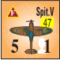

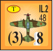

**Tactical Bombers (T)** are used mainly for Air Barrage.

**Strategic Bombers (S)** are used mainly for Air Barrage, but suffer from limitations that include the inability to Hip Shoot. See 14.1e.

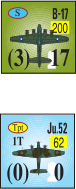

**Transports (Tpt)** are able to move cargo. A Transport uses its capacity to fly units and supplies from an airbase to a new location.

**Combo Types** are two types in one, usually T and Tpt. These units can function as either listed type.

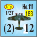

**14.1a** **Active and Inactive Aircraft.**

Aircraft have two modes: Active or Inactive. An aircraft’s mode is shown by it being above (Active) or below (Inactive) the Air Base counter. Basically, Active aircraft can conduct missions and Inactive ones cannot. Active aircraft in a friendly Air Base hex can remain Active indefinitely.

**14.1b** **Aircraft Step Losses.** Aircraft have **two** steps each. Use the reverse (reduced) side of the counter to show a step loss. Aircraft which take a second step loss are eliminated and placed in the Dead Pile.

**14.1c** **Aborts & Return to Base.** Air units that execute a mission (see 14.2f) or “abort” from air combat must return to a friendly air base within their range and become Inactive. ( **Exceptions:** A

Fighter remains Active after completing a successful Interception (14.5), and after a Base Transfer (14.11) done at normal range.)

- Aircraft that abort before/during an Air Combat over a friendly air base must return to **that** base. ( **Exception:** see 14.5 for special handling of Interceptors.)

**14.1d Refit.** Refit (15.0) is needed to keep aircraft in action (think of it as fueling and routine maintenance). It is how Inactive aircraft become Active. Refit is the only time aircraft need or consume supply.

**14.1e** **Strategic Bombers.** Missions that include Strategic Bombers suffer several limitations due to their high-altitude operations:

- **A)** Barrages are always considered to be unspotted.

- **B)** Hip Shoots and anti-ship barrage missions are never allowed.

- **C)** The short-range barrage shift is never received.

**14.1f** **Weather.** Weather can inhibit air operations, restricting missions to certain phases and sometimes allowing “no flight” at all. During weather when missions cannot be flown, Active air units remain Active and aircraft **can** be refit.

**14.1g Phasing.** Active planes can fly missions during friendly Movement, Exploitation, and Reaction Phases.

### 14.2 Aircraft Movement

Aircraft have stacking limits and move by being lifted directly from their air base to the mission’s target hex. Aircraft move in various phases and segments, depending on the mission.

**14.2a Aircraft Stacking** . Count each air unit (whether reduced or full-strength) as one unit for stacking. A maximum of four **Active** aircraft can execute a mission together. On a friendly Air Base, a maximum of four friendly aircraft **plus** the Air Base Level can be Active at one time (so, a Level 3 Air Base can have a total of seven Active aircraft). There is no

limit to the number of Inactive aircraft that can stack at a base.

**14.2b** A player can voluntarily abort planes in a hex to avoid an Air Combat before it starts, but at least one air unit **must** stay Active and fight. See 14.3d.

**14.2c Aircraft Movement.** An Active air unit voluntarily moves only when conducting a mission. When an Air Base is captured by enemy ground units, all air units at the base are displaced (and possibly suffer a loss) per 9.14f.

**14.2d** An aircraft’s range is the limit it can travel (in hexes) when flying either to a mission hex or returning from one. Aircraft move by simply placing them in any hex within range, without regard to terrain or enemy units. There is no need to trace a specific path.

**14.2e Air Missions.** Active planes can perform the following missions. Aircraft can not perform a combined air mission (such as “Sweep then Barrage”) and can only fly a single mission per phase. For each mission, follow the Air Movement Sequence (14.2f).

**Important Notes:** “Mission aircraft” means the air units that are performing a mission. Missions are never restricted to aircraft of a certain type. For instance, a Fighter is allowed to take part in an Air Transport mission.

- **Interception (14.5).** The ability to ‘jump’ enemy air units before they perform their mission.

- **Fighter Sweep (14.6).** A Fighter Sweep is designed to engage enemy planes in air combat. Fighter Sweeps are executed in the various Movement Segments.

- **Barrage (14.7).** A Barrage is an air attack on enemy facilities or ground units. Barrage missions are executed in the various Barrage Segments.

- **Hip Shoot (14.7d).** A Hip Shoot is a special type of barrage made during a Movement Segment instead of a Barrage Segment. Hip Shoots also allow the same hex to be hit more than once in a single phase. Only certain air forces can do Hip Shoots, however, and this will be noted in game-specific rules.

<!-- PDF page 33 -->

- **Trainbusting (14.8).** This allows aircraft to interdict enemy ground and rail movement. Trainbusting missions are executed during the various Barrage Segments.

- **Air Transportation (14.9) and Air Drop (14.10).** The delivery of cargo (combat units or SP) by air, either by unloading them at an Air Base or dropping them in some other hex. Air Transport and Air Drop Missions are executed in the various Movement Segments.

- **Base Transfer (14.11).** Movement of your aircraft from one Air Base to another. Transfers are executed in the various Movement Segments.

**Important Note:** There are no limits placed on the number of non-barrage missions that can be flown to the same hex in a phase. For instance, a player wanting to Air Drop 1T of supply to a surrounded tank division could keep flying mission after mission until he successfully lands the needed supplies. A player could also Hip Shoot a hex several times in the phase. Other barrages are limited to one to a hex each phase.

**14.2f Air Mission Sequence.** Follow this complete sequence when executing a mission. Aircraft from more than one Air Base (up to a combined limit of four air units) can execute a mission together, with air units from each base moving separately (there is no need to “link up” before reaching target hex):

- **A)** Declare the mission type (such as Trainbusting or Barrage).

- **B)** Move aircraft from one or more bases to the mission hex.

- **C)** Resolve any Air Combat (14.3) if both players have Active aircraft in the mission hex.

- **D)** Resolve any Interception (14.5).

- **E)** Resolve any Flak (14.4).

- **F)** Resolve the mission.

- **G)** The aircraft return to base (14.1c) and usually become Inactive.

**_Play Note:_** _Planes can no longer be added to a mission after Step C, so remember to perform needed Fighter Sweeps during the Movement Segment!_

### 14.3 Air Combat

When both sides have Active planes in a hex, Air Combat is immediately resolved. This will only happen when the mission hex has an enemy air base with Active aircraft, or during Interception (14.5). An Air Combat consists of a series of rounds during which each player selects one unit to use. The result of the round will be the abort (see 14.1c) and possible loss of one or both of the selected aircraft. These rounds continue until one side or the other is alone in the hex (or there are no Active planes left with a non-parenthesized Air Combat Rating).

Ignore all Inactive aircraft during Air Combat; they do not take part at all.

**14.3a Parenthesized Ratings.** Aircraft with parenthesized Air Combat Ratings **cannot** initiate Air Combat. They can still enter a hex with enemy aircraft, however. If all the aircraft in a hex (both sides) have parenthesized Air Combat Ratings, the aircraft ignore one another (and there is no Air Combat).

**14.3b Modifiers to Air Combat.** There are none except when using the Long Range option (21.4).

**14.3c Attacker Identification.** In Air Combat the “attacker” will normally be the player initiating the battle (mission player or Interceptor). The roles switch if the erstwhile “attacker” only has air units with Parenthesized Ratings, and the combat ends completely if all Active planes in the hex have Parenthesized Ratings—the remaining planes ignore each other and the mission continues.

**14.3d Voluntary Aborts.** Voluntarily Aborting from an Air Combat (thus becoming Inactive) is sometimes useful:

- **A)** Either player has the option to abort some of his aircraft in the hex before the Air Combat starts, but at least one air unit **must** be kept Active and fight.

- **B)** Neither player has the option to abort after an Air Combat starts. (It continues until only one player has Active aircraft in the hex, or both sides run out of non-parenthesized aircraft.)

- **C)** Active air units can voluntarily abort after completely finishing an Air Combat.

**14.3e Air Combat Procedure** .

- **A)** Both players lay out their aircraft in plain view. Voluntary aborts (14.3d) are made now.

- **B)** The attacker (14.3c) selects one of his **non-parenthesized** air units, then the defender selects **any** of his air units. These are the aircraft used in the current combat round.

- **C)** The attacker rolls two dice, adding it to his Air Combat Rating, and then subtracting the defending Air Combat Rating. Use this modified roll on the Air Combat Table to identify which aircraft, either one or both, must abort. Finally, roll a third die—the “loss” die—to determine if the aborted unit(s) must also take a step loss. This happens on a roll of 5 or 6.

- **D)** Repeat B and C (each couplet is a round of combat) with the same or different aircraft until one side or the other remains alone in the hex (or until neither player has any Active Fighters left).

**_Play Hint:_** _Roll three dice at once—two “combat” dice and an off-colored “loss” die—to speed Air Combat resolution._

**_Example:_** _One LaGG-3 (Air Combat Rating of 2) and one IL-2 Air Combat Rating of (2)) move into a German Air Base hex occupied by one Active Bf 109f (Air Combat Rating of 4) and two Stukas (Air Combat Rating of (1)) along with several Inactive aircraft. All of the above are at full strength. The Soviets are the attackers._

_Each player selects the aircraft of his choice for the first round of Air Combat. The Soviets select the LaGG-3; the Germans pick the Bf 109f. The defending Germans could also have picked one of the Stukas (not a bright move, but allowed). The attacking Soviets could not have picked the IL-2 because of its parenthesized Air Combat Rating. The Soviet player rolls two dice (getting a 9) to which he adds his aircraft’s rating (2) and subtracts the German unit’s rating (4) for a modified_

<!-- PDF page 34 -->

_roll of 7. The Air Combat Table gives “Both Abort.” The Soviet player rolls one die and no losses result, so both players send their aircraft back to base where they become Inactive._

_This leaves the two Stukas facing the IL-2. None of these can attack, so the combat ends and the two forces ignore each other. The Soviets can then barrage the Air Base._

### 14.4 Flak

In Step E of the Air Mission Sequence (14.2f), the enemy player checks to see if his abstracted air defenses (“Flak”) disrupt the mission. Normal Flak reflects only ground-to-air fires—most combat units have some anti-aircraft ability, and the design also assumes nominal Flak assets are deployed at important potential targets. The intensity of ground Flak is increased if the mission is flown into an enemy Patrol Zone (14.4a).

**14.4a Missions Subject to Flak** .

- Always: Barrage, Hip Shoot, and Trainbusting.

- Only if in an enemy Patrol Zone: Air Transport, Air Drop, and Base Transfer.

- Never: Fighter Sweep and Interception, and all non-mission activity (such as placing air reinforcements and returning to an air base).

**14.4b** Supply considerations never affect Flak, nor is there any SP cost for Flak rolls.

**14.4c Patrol Zone.** A Patrol Zone (PZ) is a defensive area created by any Air Base with one or more Active Fighters, and extends 10 hexes in all directions. Enemy air missions that target a hex in a PZ are subject to Interception (14.5) and heavier Flak.

**14.4d Non-Mission Aircraft** . Extra air

units will sometimes be stacked with mission aircraft. For instance, an Active aircraft might be at a friendly Air Base receiving a Transport mission. Only mission aircraft are affected by Flak. (But note any “extra” planes would be affected by Interception, taking part in the Air Combat along with the mission

aircraft.)

**14.4e Flak Resolution.** Roll two dice. If the modified result is 11 or more, one mission aircraft step is lost. Otherwise, the Flak has no effect and resolution is complete.

The dice roll is modified by the Flak Points affecting the mission, per the charts and tables.

**14.4f Flak Losses.** If a loss is inflicted, one of the mission aircraft takes a loss **before** conducting the mission. Otherwise, the Flak has no effect. Determine which air unit in a stack takes the loss by using the Mission Loss Table. Remove an eliminated aircraft; those with one step remaining finish the mission using their reduced values.

**14.4g Cargo Losses.** If there is a change in a Transport mission’s cargo capacity because of Flak, recalculate the available load (keeping in mind range effects of 14.9e) and destroy a portion of the cargo (player’s choice) that exceeds the new capacity. Round in **favor** of cargo survival (e.g. if 1T is being transported and the aircraft drops from 1T to 1/2T capability, the 1T survives and arrives successfully).

### 14.5 Interception

In Step D of the Air Mission Sequence (14.2f), a player will sometimes have the option to intercept an enemy mission. Only a mission that is subject to Flak (per 14.4a) can be intercepted, and then only if the mission hex is in a Patrol Zone. The player can intercept with a single Active Fighter with a Patrol Zone into the mission hex. The player is not required to intercept (it is his option) and can only do so once per mission.

**Important Note:** Interception missions are never prevented by game-specific weather and/or phase restrictions.

Interception is resolved as Air Combat. If non-mission aircraft are present, see 14.4d. Handle the intercepting Fighter after the combat as a special case:

- If the interceptor loses, it becomes Inactive at the air base from which it came.

- **√** If the interceptor wins, it stays Active at the air base from which it

came **.** The plane is **not** considered to have flown a mission and thus is eligible to intercept another enemy mission later in the same phase.

### 14.6 Fighter Sweep

Fighter Sweep missions are done during Movement Segments. In these a Fighter is moved to a hex with Active enemy aircraft and engages in Air Combat. Win or lose, the mission Fighter is aborted to an air base within range when the rounds of combat conclude. A hex can be the target of any number of Fighter Sweeps in the same segment.

**_Play Note:_** _There is no reason to have more than one fighter per Sweep mission, since multiple Sweeps can be flown against the same hex._

### 14.7 Barrage & Hip Shoots

Aircraft make use of Barrage missions to attack enemy ships, ground units, and facilities. What follows are the specifics of Barrage missions; 10.0 covers the more general rules of Barrage and 18.3 describes anti-ship barrages. All the usual modifiers for Barrage (including spotters) apply to air barrages as well.

A given hex can normally be barraged just once in a phase, but Hip Shoots do not count against this limit.

**14.7a** Aircraft **can never combine** with artillery or ships in a single barrage. An Air Barrage never has any supply cost of its own.

**14.7b Air Barrage and Phasing.** Air units move to a mission hex during a Barrage Segment. Follow the sequence given in 14.2f. Aircraft are subject to Flak (see 14.4) before the barrage, and **must** return to an air base and become Inactive immediately after the barrage is resolved.

**14.7c Short Range Barrage Modifier.** Range effects apply when all aircraft conducting the barrage are at or within 10 hexes of the base from which they flew. These barrages get an additional rightward shift on the Barrage Table. **Never** apply this shift to Strat Bombers.

<!-- PDF page 35 -->

**14.7d Hip Shoots.** Hip Shoots are done during Movement Segments. They are resolved like normal Barrages (14.7), with some exceptions and restrictions:

- **A)** Hip Shoots do not count against the limit of one barrage against a hex in a phase. This means a hex can be barraged by multiple Hip Shoots in a phase, and also be subjected to a “regular” barrage during the same phase.

- **B)** A Hip Shoot must be made by a **single** aircraft and its nationality **must** be listed in the game-specific rulebook as having the special Hip Shoot capability.

- **C)** A Hip Shoot **_requires_** a correct spotter (10.0b).

- D) Given the above, a Hip Shoot can hit any **type** of target. ( **Exception:** Trainbusting cannot be performed as a Hip Shoot.)

### 14.8 Trainbusting

Trainbusting missions disrupt enemy rail traffic as well as columns of troops, vehicles, and pack animals moving in an area. Only one Trainbusting mission per hex per phase is allowed, and only

one Trainbusting marker can be placed in any hex. These missions cannot be executed as Hip Shoots.

**14.8a** **Execution.** Move the mission stack to the target hex. Resolve Flak (see 14.4) and then attack the hex using the Barrage vs. Facility Table. If the result contains an asterisk, place a Trainbusting marker in the hex (otherwise there is no effect). Regardless of success, the aircraft return to base and become Inactive.

**14.8b** **Trainbusting Zone.** A Trainbusting Zone (TZ) is the hex with a Trainbusting marker plus the six adjacent hexes. ( **Exception** : For movement using Leg MP, a Trainbusting Zone is limited to just the marker’s hex.)

**14.8c Trainbusting Efectsf .** The Trainbusting Zone affects enemy ground unit movement and rail costs.

- Ground units must add 1 MP to the terrain cost of every hex entered that is in a TZ.

- Rail cargo passing through a TZ uses double the normal Rail Cap. The increase in cost is applied only once, even if the cargo is transported in and/or out of multiple TZ.

- Ships, aircraft, sea cap, and supply paths are unaffected by a TZ.

Note there is never an additional effect on a hex due to overlapping TZ, and a TZ has no effect on retreats.

**14.8d Phasing.** Trainbusting barrages can be made in the barrage segment of any phase allowing a player’s aircraft to conduct missions. The markers are removed in the next **enemy** Clean Up Phase and their effects are continuous until then.

### 14.9 Air Transport

Air Transport allows the player to use his Transports to move supplies and units around the map.

Air Transport can occur in any friendly Movement Segment.

**14.9a** Transports have a printed transport capacity. They can carry any load up to that capacity. (See 4.7 for Transportation Equivalents.) Transports at the same air base can combine their transport capacity to carry cargo. For instance, two aircraft with a capacity of “1/2T” could carry a parachute battalion that has a transport equivalence of 1T.

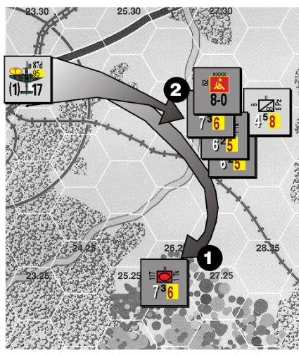

#### **Example: Air Barrage Missions**

In this example, the pictured Stuka has two possible targets. In a real game, it could only hit one, but for illustrative purposes here we will work through both attacks. There are no enemy fighters in the area, so no interception is possible. In both cases, the Stuka returns to base and becomes inactive after the mission.

**Target 1: An unspotted unit in terrain.** The Stuka hits the lone tank brigade in the forest hex (close terrain) which has no German units adjacent to act as spotters. There are no Flak modifiers, so the Russian player rolls two dice looking for an 11 or more. He rolls an 8, a miss, so the Stuka drones on to its target. The barrage begins on the 17-24 column, but several shifts are applicable: left 1 for close terrain, left 3 for no spotter, and left 1 for 1 RE in the target hex. With five total shifts, the barrage is resolved on the 2 column. The German player lucks out with a roll of 10, which DGs the target.

**Target 2: Spotted units in the open with an HQ.** The Stuka hits a hex with three brigades and an HQ. The German motorcycle battalion is adjacent, so there is a spotter. The Flak roll is +1 due to the HQ, and after a modified roll of 11 the Stuka takes a loss and is flipped to its reduced side. Now with a strength of 9, the barrage begins on the 8-11 column. One modifier applies: the stack has a total of 4 RE (remember that an HQ is a 1 RE unit), so there is a right 1 shift. The German player rolls a 10, which on the 12-16 column yields a [1/2] result. This bracketed result is reduced to a DG because it is an air barrage. The Flak loss was really important in this case, because a full-strength Stuka would have gotten a straight 1/2 result, which entails a loss-check roll — on a 4-6 one of the attacked units (Soviet player’s choice) would be sent to the Dead Pile.

<!-- PDF page 36 -->

**14.9b** Some Transports have a transport capacity of 1/2T. These units must usually use rule 14.9a, combining to move 1T amounts. Alternatively, they can move 1T when making a double capacity trip using 14.9e. **In no case** can the 1/2T amount be saved for later or be rounded up to 1T. ( **Exception:** cargo survival, 14.4h).

**14.9c Cargo Types.** Supply Points can be transported by air, as can combat units that are in **Move Mode** with an MA of **10 or less Leg MP** .

**14.9d** Combat units can move up to 1/2 their MA during the phase it is carried by Air Transport (per 4.7d). This can be done before or after the Air Transport mission (or both) provided no more than 1/2 MA is expended.

There are important mode and phasing considerations. SP cannot be moved before/after a mission due to “leapfrog” restrictions. Combat units can change to Move Mode prior to Air Transport in Movement Phase, but are not able to “flip” orientation during Reaction or Exploitation. Combat units must be released reserves to move (and possibly attack) before/after a mission during Reaction or Exploitation. All other units being air transported in these phases essentially have an MA of zero (and cannot attack). Note that units moving before/after the mission in Reaction have their MA halved twice, for a total of x1/4 MA.

**14.9e** Air Transport missions are flown to any friendly air base. Treating each plane separately, the mission hex can…

- **A)** …be at twice the plane’s range, provided it is made Inactive at the destination air base, or

- **B)** …be at the plane’s normal range, in which case it returns to any air base within normal range after the mission, or

- **C)** …be at half the plane’s range, in which case its transport capacity is **doubled** and it returns to any air base within half of its range after the mission.

**14.9f** A given air base can only unload 2T times the base Level per Movement Segment using Air Transport. However,

**any** amount of cargo can be unloaded **if** the Transports in excess of this limit become Inactive in the destination hex.

### 14.10 Air Drop

An Air Drop is a form of Air Transport that does not require a friendly air base at the destination. Air Drops also differ in that sometimes they must be planned in advance and the cargo may be destroyed in the attempt. Air Drop can be done either by parachute or glider landings. The rules in Section 14.9 apply to Air Drops except where they differ with the rules below.

**14.10a Unit Eligibility.** Only SP and combat units with the “Para” symbol can Air Drop. ( **Exception:** Any combat unit that can be air transported can land via glider, per 14.10e.)

**14.10b Prior Planning.** Air Drops of **combat units** have special restrictions. They can only be made in the Movement Phase and require a Drop Plan—a written record of the hex where each combat unit will be dropped and the specific turn the mission will take place. You must make this plan either before the game begins **or** at least two turns in advance of the scheduled drop. Plan these drops in the Aircraft Refit Phase. No unit can ever be on more than one Drop Plan at a time.

#### **Important Notes:**

- Units making planned air drops do not require trace supply on the turn they are dropped (12.6h).

- Supply drops never need prior planning nor do they have any phase restrictions.

**14.10c** **Cancellation and Delay.** All or part of a Drop Plan can be cancelled or delayed. (Some units could drop as scheduled, some be delayed, and some cancelled.) Make this decision during any Aircraft Refit Phase. If delayed, the exact same drop is now pushed back to the next turn. If cancelled, the plan ceases to exist (and even if the same plan is drawn up in the future, planning must start from scratch).

**14.10d Air Drop Procedure.** Resolve Flak and then check for losses using

the Air Transport Success Table. Roll two dice for each combat unit or 1T of supply separately, based on the type of terrain in the mission hex and drop method (glider or paradrop). Apply the table’s modifiers. If the roll is successful, the unit is placed in the drop hex (and its movement is finished for the phase). Otherwise, it is destroyed. Also destroy any cargo that attempts to land **on** an enemy combat unit (but if the hex only contains enemy non-combat units, apply relevant parts of rule 9.14).

**14.10e** **Gliders.** Gliders increase the capacity of Transport aircraft. Gliders do not count against mission and basing limits and are always considered Active. Gliders are generic “change” that can combine and break down like SP.

- **A)** It costs one Eq to build two Glider Points (as if rebuilding aircraft). Gliders cannot be built in games where they are not provided. A glider cannot be reused—place it in the Dead Pile after use.

- **B)** Gliders can only move when they are part of an Air Transport or Air Drop mission. When an air base is captured, gliders are destroyed.

- **C)** A full-strength Transport plane (any capacity) can tow one Glider Point. The capacity of a Transport/Glider combination is 2T (all of which is loaded on the glider). A Transport that doubles its capacity (per 14.9e) can carry 4T if two Glider Points are used, or alternatively it can carry 2T on one Glider Point and carry its printed capacity for a paradrop.

- **D)** In Air Transport missions, cargo on gliders is not counted against off-loading limits (15.0b).

- **E)** In Air Drop missions, cargo on gliders has an increased chance for success, as shown on the Air Transport Success Table.

- **F)** Gliders do not check for Flak, but their tow aircraft do. The capacity of the Transport/Glider combination is reduced to 1T if the towing aircraft takes a loss. Handle losses to cargo per 14.4g.

<!-- PDF page 37 -->

- **G)** Gliders do not take part in Air Combat. While being towed, a loss is handled per 14.4g.

**14.10f Integral Gliders.** As opposed to the separate counter version above, some games have Transport planes that contain a glider component as part of the counter itself. Basically, these are special Transports with an improved transport capacity because they **always** tow gliders (which make them **exempt** from base unloading limitations). Rule 14.9e modifies their capacity by range.

**_Specific Game Note:_** _The CAsE BluE transports with Integral Gliders can only perform Air Transport and Base Transfer missions (_ **_never Air Drop missions_** _)._

### 14.11 Base Transfer

A Base Transfer is a simple way to move an aircraft from one base to another without performing any other functions. Air units can **double** their range when moving from base to base.

When a Fighter unit performs a Base Transfer **within** normal range, it stays Active. Otherwise, it goes Inactive (as do all other plane types making Base Transfers).

**_Play Note:_** _Players may find that aborting after a mission is often a more useful way to change base, since then the aircraft can “do something” along the way.)_

**_Complex Aircraft Mission Example:_** _During his Movement Phase’s Barrage Segment, the Allied player tries a Barrage on an Axis stack with a Reserve marker showing. The strike consists of a Blenheim V bomber and two Hurricane II fighters. The mission hex is inside the Patrol Zone. The mission has a +2 Flak Mod operating against it (+1 for a Patrol Zone (since a Fighter is present), +1 for three mission aircraft)._

_First, the Axis player resolves Flak against the mission. He chooses to avoid literally intercepting and forcing an actual Air Combat. The Axis player rolls two dice and gets a 10 which is modified to 12 resulting in a loss. The Allied player uses the Mission Loss Table to randomly select_

_one of his aircraft to take the loss and it is the Blenheim. It is reduced and the mission continues._

_The Allied player now totals the Barrage Strength of the three mission aircraft. The Fighters are worth a combined 6 Barrage Points. The now reduced bomber adds 3 more, for a total of 9 points. The initial Barrage Table column is 8-11. There is no barrage supply cost since this is an Air Barrage. No Allied combat unit is adjacent to the target (no spotter: three columns left) and it turns out there are 4 RE in the hex (one shift right). No further column shifts apply. The total Barrage Table shift is two left, to the 3-4 column. The Allied player rolls two dice and gets a 12, giving a 1/2 result. He then rolls a 5 with one die, so it “rounds up.” The Axis player must remove one step of his choice and the mode of the stack is changed from Reserve to DG. The Allied aircraft now return to any friendly base within range._

## 15.0 Air Bases

Air Base units are the ground support establishments (fuel tanks, runways, and hangers) for air units. Each air base has a Level representing its size, and in some games a small triangle to allow a player to displace the counter from its actual hex in congested areas.

Air bases are non-combat units, so it takes an Attack-Capable enemy unit to enter these hexes. **See 9.14f for air base capture.**

**15.0a** No more than one air base can ever exist in a single hex.

**15.0b** Air Base Level effects:

- **A)** Each Level allows the refit of two aircraft per Aircraft Refit Phase. For instance, a Level-3 Air Base can refit up to six air units.

- **B)** Air bases have Flak Points equal to their Level.

- **C)** Only 2T times the Level can be unloaded per Movement Segment (unlimited if the Transports in excess of this amount go Inactive

at the base, or if it is an Air Drop or glider operation).There is no limit on loading.

- **D)** The stacking limit of **Active** air units in an air base hex is 4 + the Level. (There is no limit on Inactive aircraft.)

**15.0c** When attacked on the Barrage vs. Facility Table, an air bases may take hits which reduce their Level. **However, no air base can be reduced below Level 1 (even in games using Air Strips).**

**15.0d** Air Bases never need trace supply and never suffer attrition.

### 15.1 Refitting Aircraft

- **A)** An air base can refit once during the Aircraft Refit Phase.

- **B)** Refit costs 1T at each base (regardless of Air Base Level or number of aircraft involved). An air base can refit up to **double** its Level in aircraft. The player chooses which Inactive aircraft to refit. Every air unit counts as one for refit, even when at reduced strength.

- **C)** An air base cannot refit aircraft in an un-negated enemy ZOC.

- **D)** Weather conditions never prohibit refit, and never prevent aircraft from being Active. (This series rule intentionally modifies the weather rules in some older games!)

### 15.2 Air Strips

Air Strips are _very small_ air bases that can be built/used only if specifically allowed in a game’s rules. Air Strips have some special characteristics:

- **A)** They are built for 1T, following the procedure in 15.3. An air strip can be upgraded to a Level-1 Air Base by paying 3T.

- **B)** They can only refit one aircraft per Aircraft Refit Phase.

- **C)** They have a unloading capacity of 2T per Movement Segment.

- **D)** They have a stacking limit of 4 Active air units.

<!-- PDF page 38 -->

- **E)** They are never reduced by damage or voluntary reduction.

- **F)** They do not add any Flak.

### 15.3 Building Air Bases

Air bases can be built/improved only during the Movement Phase, and only by Engineer-Capable units performing Construction (13.8d). The cost is 1 SP.

- An Air Base’s Level can **increase** by only one per turn (such as from none to Level-1, or from Level-1 to Level-2). It thus takes three turns and 3 SP to build a Level-3 Air Base.

- Air bases can **never** be improved above Level-3.

### 15.4 Reduction of Air Bases

Air bases can be reduced only during the Movement Phase. One RE of units, that are in Combat Mode and do not move, can reduce an air base by one Level. An Engineer-Capable unit can also do the work (13.8d). There is no SP cost.

- A given friendly air base can only be reduced **once** per phase.

- An air base can **never** be reduced below Level-1.

- Note that a Facility Table Barrage can also reduce air bases (see 10.0c).

## 16.0 Hedgehogs

Hedgehogs (called “Hogs”) represent field works, wire, mines, and other obstacles that help protect a hex from combat and barrage attacks. Hedgehogs cannot move and never require supply.

Hedgehogs are non-combat units, so enemy units can only enter these hexes if they are Attack-Capable. See 9.14e regarding hedgehog capture.

**16.0a** Hedgehogs come in four levels of increasing quality. No hedgehog can ever exceed Level-4.

**16.0b Construction.** Hedgehogs can be built or improved only during the Movement Phase. One RE of units, that are in Combat Mode and do not move,

can build/improve a Level of hedgehog in their hex. Alternately, an EngineerCapable unit can do the work (13.8d). The cost is 2 SP.

- A hex can only have its Hedgehog Level **increase** by one per turn (such as from none to Level-1). It thus takes four turns and 8 SP to build a Level-4 Hedgehog.

**16.0c Reduction.** Hedgehogs can be reduced during the Movement Phase only. One RE of units, that must be in Combat Mode and not move, can reduce a hedgehog by one Level. An Engineer-Capable unit can also do the work (13.8d). There is no SP cost.

- A hex can only have its Hedgehog Level **decrease** by one per turn (such as from Level-3 to Level-2).

- Remove a hedgehog reduced below Level-1.

**16.0d** **Combat Effects.** A hedgehog aids **defensive** combat with a die roll modifier equal to its Level (so a Level-3 Hedgehog gives a -3 DRM) _._ A defender’s hedgehog also affects Surprise with a -1 DRM (this does not change by Level).

**16.0e** **AT Effects.** Hedgehogs provide Heavy AT (9.4e) to combat units in the hex.

**16.0f** Reserve Mode units cannot end a phase in a Hedgehog (5.7g).

**16.0g** There can never be more than one hedgehog in a hex.

**16.0h** Combat and barrage results never reduce or eliminate a hedgehog.

## 17.0 Weather

Roll for weather during the Weather Determination Segment.

**17.0a** Weather affects play according to the effects (if any) listed with the gamespecific Weather Table.

**17.0b** Weather generally affects each player equally (in some games it can affect one side or the other differently).

**17.0c** Weather conditions that **increase** the normal movement costs are ignored when tracing supply paths (12.3d).

**17.0d** In a change to some older game rules, weather can **never** prohibit refit, or prevent aircraft from being Active at their base.

## 18.0 Naval Power

#### **_Skip this entire section if the game being played does not include ships!_**

Naval warfare is handled fairly simply, because the series is built around land and air combat. However, some detail in naval operations is needed to allow for campaigns with an important naval component (specifically naval gunfire support and amphibious landings).

### 18.1 General Naval Rules

**18.1a** **Supply.** Ships never need supply. **18.1b** **Stacking.** There is no limit to the number of ships that can stack in a hex. Ships cannot stack with enemy ships. Ships can enter hexes with enemy non-combat units, but cannot stack with enemy combat units (see 4.8c).

**√ 18.1c Naval Movement.** Most ships can only enter all-sea hexes. Landing Craft can additionally move in coastal hexes and in either hex bordering an **estuary** (see note below), even if it looks like they are crossing all-land hexsides.

**_Play Note:_** _An Estuary is a sea hexside near the coast. It is often, but not always, marked with a prohibited hexside. The rule allowing landing craft to move along an estuary_ **_does not_** _apply to rivers or canals!_

**_Specific Game Note:_** _In ThE BliTzKriEg lEgEnD Destroyers are allowed move into a port. This is an exception to normal rules. A large ship is automatically DG in a port, which makes it more susceptible to damage (since another DG converts to a loss)._

**18.1d** **Naval DG.** Ships do not have modes, but they do use DG markers to show an increased vulnerability to damage (see 18.3d). DG markers are removed from ships during the player’s Clean Up Phase. Note that ship values are not affected.

<!-- PDF page 39 -->

**18.1e Phasing.** Ships can move during friendly Movement, Exploitation, and Reaction Phases, and expend 1 MP per hex. Every ship can move in all three phases (no need for Reserve markers).

**18.1f Speed.** Most ships can move 20 hexes per phase. **Slow** ships (designated with a **white stripe)** can only move 10 hexes per phase. A damaged single-ship counter converts to slow speed, but a damaged multi-ship counter (destroyers and cruisers) retains its normal speed. These changes are reflected on a counter’s damaged side.

**_Design Note:_** _The speeds above are indeed “slow” given regular steaming rates. They exist here not as a measure of how fast the ships can go, but rather as a measure of flexibility. Ships dedicated to an operation cannot instantly shift focus as would be the case if they had a movement rate matching their potential steaming distance._

### 18.2 Aircraft Carriers

**18.2a** **Capacity.** Carriers are limited in the number and type of aircraft they carry. In some games, only planes with the carrier’s name on them can use that carrier. In other games, each carrier has a number on it for how many aircraft it can support (counting **both** Inactive and Active aircraft).

**18.2b** **Refit.** Carriers can refit **all** of their planes in the Aircraft Refit Phase. **Exception:** Damaged carriers can only refit 2 planes (regardless of their normal rating). There is no SP cost.

**18.2c** **Carrier Planes.** Air units on a carrier perform missions and project Patrol Zones from the carrier’s hex. A carrier can move in the same segment, either before or after, its planes perform missions. Aircraft stay with a carrier as it moves—and this includes a “move” to the Dead Pile. (Note tagging along with a moving carrier is **not** treated as a mission.) Otherwise, carrier planes operate as regular aircraft.

**18.2d** Surface ship gunfire **cannot** be directed at a carrier if any non-carrier surface ships are in range. This rule does

**not** apply to coastal artillery gunfire (18.3g).

**_Design Note:_** _This rule shows the effort by members of a carrier group to defend the carrier. A surface attack will not get to the carrier until the screen is eliminated._

### 18.3 Naval Combat

Ships attack enemy naval and ground targets using barrage. Anti-ship attacks of all kinds are also resolved via barrage.

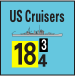

**18.3a Ship Barrages.** A ship is able to barrage **once** per friendly Barrage Segment, choosing either a ground or naval target in range. There are some restrictions:

- **A)** A ship can fire at naval targets in **every** friendly Barrage Segment it does not fire at a ground target.

- **B)** A ship can fire at enemy ground targets only **once** per game turn. For example, a ship that barrages an enemy air base in its Reaction Phase is unable to fire at a target during Movement or Exploitation.

**18.3b Ground Targets** . Naval barrages against ground units have reduced effects as noted on the Barrage Table; barrages vs. Facilities have no special reduction. Ships firing together do not need to be stacked together. See 18.3g for special handling of Coastal Artillery.

**18.3c Naval Targets.** Enemy ships can only be barraged by naval units, planes, and Coastal Artillery. These barrages are made against individual ships, not entire stacks. There is no limit on the number of barrage missions that can be directed against ships in a single hex in a Barrage Segment, but no ship can be targeted by more than one barrage in a phase.

After announcing a barrage against a stack of ships, the firing player is allowed to see all the available ships (but not their cargoes, if any) before selecting individual targets. For example, a stack of two aircraft could combine against one ship or each attack a different ship. (The strength of a barraging unit cannot be split, however.) Resolve each barrage independently, using the regular Barrage

Table. Several special rules apply when barraging ships:

- **A)** The **only** possible shifts are those related to an attacking aircraft’s distance from its base.

- **B) Multiply** the Barrage Strength of all attacking planes by x2.

- **C) Divide** the Barrage Strength of all attacking units by the target’s Protection Rating (treat as ‘1’ if none is printed on the counter).

- **D)** All Landing Craft in a stack are treated as “one individual ship” for target and DG purposes.

**18.3d Naval Damage** . A ship is affected by hits and DG results generated by the Barrage Table. Damaged ships **cannot** be repaired.

- **A)** Hits on Ships. A hit flips a ship to its damaged side; a second sinks it. Also apply a DG result to the ship (see below).

- **B)** Hits on Landing Craft. Each hit eliminates one point of the unit— use a counter of a reduced value to reflect the hit. ( **Exception:** When an LST takes a hit, **convert** the counter to Landing Craft of the reduced point value.) Also apply a DG result (see below) to **all** the Landing Craft in the hex.

- **C)** DG results. These results affect the target only, not the entire hex or any cargo. The first DG does not cause damage, but on a second DG remove the marker and then apply a hit (per “A” or “B”).

**Important Note:** A player conducting a barrage selects its target if shooting against ships. If firing against Landing Craft, **randomly** determine the target. Eliminated cargo is also randomly determined. For example: a 2-point DUKW carrying a regiment and an SP takes a loss. Reduce the DUKW to 1 point, and then roll to see if the SP or the regiment is lost.

**18.3e Torpedo Bombers.** Air units with a Barrage Strength in parentheses are Torpedo Bombers. They can **only** barrage ships; they can **never** barrage land targets of any kind.

<!-- PDF page 40 -->

**18.3f** **Ship Flak.** The Flak value of a ship (if any) is given on the counter. This adds to the Flak rolls made against all Air Barrage missions in the hex (not just those targeting that particular ship).

**18.3g** **Coastal Artillery.** Coastal Artillery can fire as “land-based ships” using the rules for ship barrages (this includes being exempted from supply use). **They are the only ground units that can barrage ships.**

- **A)** Coastal Artillery can fire at ships in **every** friendly Barrage Segment it does not fire at ground targets. Resolve the barrages using 18.3c. These have no supply cost.

- **B)** Coastal Artillery can **sometimes** fire at ground targets in friendly Barrage Segments. They cannot fire at enemy ships in the same phase, however, and all normal rules for artillery barrage apply— including mode/phase restrictions and limits. These have the normal supply cost.

- **C)** Ships can fire at Coastal Artillery as a **naval target** , independent of other units in the hex. (Or they could do a regular barrage against the hex, per 18.3b.) Always treat these as “spotted” barrages, with Barrage Table results adjusted as follows: a step loss eliminates the Coastal Artillery unit and a DG result is ignored.

**_Design Note:_** _It is important that players realize the abstractions represented in ship vs. ship exchanges. Ship location at this level is not all that precise—range changes and gunfire exchanges happen in the hours significantly “below” the resolution of this system. This is_ **_not_** _a tactical naval system!_

### 18.4 Landing Craft

Landing Craft, DUKWs, and LSTs are collectively called “Landing Craft.” These are naval units used to deliver cargo (troops and supplies) to invasion beaches. Landing Craft do not have a Flak value or Barrage Strength.

**18.4a Capacity.** Landing Craft have a capacity number on the counter and function much like Transport Points. They do not count for stacking.

**18.4b Movement.** Landing Craft are slow ships (18.1f). **Exception:** DUKW can only move 8 hexes per phase.

**18.4c Loading.** Landing Craft can carry combat units, SP, and Transport Points up to the limit of their capacity (see 4.7 for Transportation Equivalents). Loading has no movement cost, can only be done in port hexes (subject to current capacity), and the cargo cannot have been moved **before** being loaded.

**Important Note:** Unloading is done using Amphibious Landing (18.5) or Beach Assault (18.6) procedures.

**18.4d Handling** . Handle Landing Craft like SP and Transport Points—they can be split up and combined in various combinations of points. When taking losses, either from ALT results or from barrage, just replace the current counter with a Landing Craft of the reduced number of points. LSTs are an exception (see 18.3d).

**18.4e DUKWs.** In addition to being Landing Craft, DUKWs can operate as Transport Points (see 13.2; captured as a Truck per 9.14c). When moving as Transport Points, DUKWs lose their ability to move in all three Movement Segments, but their MA is **tripled** to 24. The switch between Landing Craft and Transport Point (and vice versa) can occur at any time during the Movement Phase—just triple the remaining MA when it starts to move by land (or divide by 3 when it starts to move by water). In addition…

- **A)** Make an ALT roll (see 18.5f) each time the DUKW switches movement type from Landing Craft to Transport Point ( **not** vice versa). This **can** be the same roll used to unload cargo (but this will end movement, per 18.5e).

- **B)** When acting as Landing Craft, DUKWs can only carry the cargo types allowed on Air Transport Missions (restricted as per 14.9c). Treat as a Landing Craft if overrun

(9.14g). Unloaded ground units can move after landing (18.5h).

- **C)** When acting as Transport Points, DUKWs can only carry SP. Treat as a truck when overrun (9.14c). Loading/unloading cost is 2 MP (per 4.7d and 13.2f).

**18.4f LSTs.** In addition to being a type of Landing Craft, an LST in a coastal or estuary hex can be converted into a port (by flipping to its port side). This ‘conversion’ requires an ALT roll (see 18.5f). Any cargo on the LST unloads when it deploys as a port, using the same ALT roll as the port deployment. (The cargo is landed before the port exists in the hex, so note the restrictions of 18.5e **do** apply.)

Some special rules apply to LST ports:

- **A)** Unlike regular ports, they **cannot** be targeted by barrage (the **hex** can be barraged, but the port ignores any result).

- **B)** They are destroyed when an enemy Attack-Capable unit enters its hex. They can never be destroyed or captured by any other method.

- **C)** They can never move or convert back into an LST.

- **D)** They are a 1 SP port, which makes them a supply source.

- **E)** LST ports are **not** functional in the phase they deploy. (So in that phase no shipping is allowed into the port and the port does not assist other ALT rolls.)

- **F)** An LST cannot convert into a port in a hex with another port.

### 18.5 Amphibious Landings

Landing Craft can unload the combat units they are transporting when they end movement in coastal hexes. The risk attached to such landings is reflected by the required roll on the Amphibious Landing Table (ALT). These landings are limited to undefended coastal hexes. For hexes occupied by enemy combat units, see Beach Assaults (18.6).

**18.5a** There is no movement cost for unloading; just drop off the units when

<!-- PDF page 41 -->

the Landing Craft enters the coastal hex. **The Landing Craft must end its move at that point.**

**18.5b** Any number of Landing Craft points can unload in a given hex in one phase.

**18.5c** Combat units must unload in either Combat or Move Mode.

**18.5d** Landings requiring an ALT roll can **only** be done during the player’s **Movement Phase** . Note that landings in ports which do not require an ALT roll can also be done in Reaction and Exploitation Phases (see 18.5g) — this is a way to get extra cargo ashore!

**18.5e** Transport Points and SP **cannot** be landed by ALT roll (but see 18.5g). SP loaded on Landing Craft can **only** be used by units in the same or an adjacent hex (even if off-shore), and HQs are **not** allowed to “throw” supply drawn from a Landing Craft.

**18.5f The ALT Roll.** Make ALT rolls after **all** Landing Craft have finished moving for the phase. Roll two dice per hex containing units that landed during the phase. Add applicable modifiers and execute the result.

- **A)** When there are several types of terrain in the hex, use the most difficult on the ALT.

- **B)** Roll and carry out ALT results separately for every group of 3 RE landed in a hex. Make as few rolls as possible, but otherwise a player can arrange units into these groups as desired.

- **C)** When partial losses are required by the ALT result, randomly choose the lost Landing Craft and cargo.

- **D)** Wait to do “after landing” moves (18.5h) until **all** of the player’s ALT rolls have been made.

- **E)** When entering a hex with enemy non-combat units, resolve Specialized Combats (9.14) after making the ALT roll.

**√ 18.5g Ports.** Do not make an ALT roll for Landing Craft that unload cargo using a friendly port’s capacity (19.0a). (Additional units can be landed in a port hex, but these **do** require an ALT roll.) When no ALT roll is required,

SP and loaded Transport Points **can** be unloaded.

**√ 18.5h After Landing.** Combat units can move 1/2 their MA during that same Movement Phase **after** an ALT landing (per 4.7d). Such units are fueled **before** landing for free (at no SP cost) via the “single-unit method” (see 12.5c(C)). DUKW can move a proportion of their remaining MA (per 18.4e).

- Units that come ashore without an ALT roll (via 18.5g) do not get any after-landing movement.

### 18.6 Beach Assaults

Landing Craft can position units for an assault on a coastal hex that contains enemy combat units. Think of Beach Assaults (BA) as a last resort, when landings via the ALT are not possible.

**18.6a** Resolve Beach Assaults during the friendly Combat Phase. Several special rules apply:

- **A)** The attacking units in a BA must be in Combat Mode, stacked in the same hex, and total no more than 3 RE.

- **B)** Combat supply for a BA can be drawn only from Landing Craft carrying Supply Points in the same or an adjacent hex.

- **C)** All attacker option results **must** be taken as step losses.

- **D)** Units making a BA can keep any Exploit marker they might earn.

- **E)** If the BA does not dislodge the defenders from the hex, destroy all attacking units and also their Landing Craft.

- **F)** There is a nominal hexside terrain that makes all units x1/2 when attacking in a BA. The defender can choose that or the hex terrain in 9.4b.

- **G)** BA combats **cannot** be made in conjunction with attacking units that have already landed.

- **H)** If all of the defenders are destroyed by a barrage, resolve the assault on the ALT instead (but there is no “after landing” movement).

**18.6b** Just before the execution of a BA, the defending player can opt to resolve the landing as an ALT instead of as a BA. (This can be done if the odds are overwhelming and an ALT roll has a better chance of inflicting losses.) The decision cannot be changed once made, and must be made before any dice are rolled, units exposed, or combat supply paid. Spend no supply for a BA resolved on the ALT.

If the defender makes this choice, the normal ALT procedure is modified as follows:

- Regardless of the ALT result, the defenders are destroyed.

- Unloaded units advance into the vacated hex, but there is no “after landing” movement (per 4.7d).

## 19.0 Ports & Shipping

Ports are printed on the map with an anchor symbol and capacity. Ports are non-combat units, so it takes an Attack-Capable enemy unit to enter these hexes. See 9.14h for port capture.

**19.0a** **Capacity.** Port capacity is the maximum number of SP allowed to load and/or unload in a single phase. For example, a port with a 1T capacity could load **or** unload 1T in a phase, but not both. Units and supplies coming into the port without an ALT roll via 18.5g count against the capacity of a port, as does normal shipping (19.0f).

Ports with a capacity above zero **can** choose to use their **full** capacity to load or unload a **single** combat unit whose Transport Equivalent size exceeds the port’s current capacity. This can be the only loading/unloading performed at the port during the phase.

A port is “shut down” when in an enemy ZOC. Per 4.5a, negation is possible for trace supply operations, but not for Sea Cap. Ports which are shut down have their capacity treated as zero. The port instantly recovers its normal capacity when the enemy is driven away (or for trace supply only, the ZOC is negated).

<!-- PDF page 42 -->

**_Play Note:_** _A port continues to function when enemy combat units or ZOC block the hexes that lie between it and the sea (unless this is overridden by a game-specific rule)._

**19.0b Damage.** Ports can accumulate “hits” when attacked by the Barrage vs. Facility Table. These hits affect the port’s capacity as noted near the table (round to nearest Token of capacity). Whether damaged by the Barrage vs. Facility Table or Voluntary Reduction (below), a port can never accumulate more than 4 hits. Some ports have a Damage Track specific to them on the map; for these apply the Port Capacities listed and not the generic hit effects.

**19.0c Voluntary Reduction** . During the Movement Phase (only), at least 1 RE of combat units that are in Combat Mode and do not move can inflict 1 hit on a port in that hex. Engineers can also perform the work, per 13.8d. No more than 1 hit per turn can be inflicted in this way.

**√ 19.0d Repair** . Ports can be repaired in the Movement Phase (only) using construction (13.8d). Each EngineerCapable unit can repair one hit at a cost of 1 SP. Only one hit per port can be repaired in a given turn.

**19.0e Ports and Trace Supply.** The game-specific rules will specify which ports, if any, are supply sources. A port that is available to the player as a supply source loses that ability if the port falls below a 1 SP capacity.

**19.0f** **Shipping.** Game-specific rules define each side’s Shipping Allowance (if any), which is sometimes called Sea Cap. Naval units are not used for this abstracted form of transport, used to move ground units from port to port.

- **A)** Shipped units must be in Move Mode.

- **B)** Sea Cap can only be used during the Movement Phase.

- **C)** No movement is allowed before or after a unit is shipped.

- **D)** Any combination of SP, combat units, and Transport Points can be shipped. The limitations of each port’s capacity must be observed.

- **E)** Each point of shipping allowance can move 1 SP of cargo (see 4.7 for Transportation Equivalents).

- **F)** Enemy ZOC prevent use of Sea Cap (4.5a) at a port.

## 20.0 Breakdowns

Breakdowns are generic units that are detached from multi-step units, typically infantry divisions. They allow these divisions, which cannot otherwise split up, to occupy more ground. Breakdowns are 1 RE units with either a “Brkdwn” identification or none at all. They are not usually limited to the counter mix (if players don’t mind making extras).

A multi-step unit creates a Breakdown in its hex by detaching one of its steps. Use a Step Loss marker to record this (it is essentially just like a combat loss). Note a unit’s last step can **never** become a Breakdown.

**Multi-step units that are “Armor” or “Mech” (3.2a) are not able to create or absorb Breakdowns. Only “Other” type units may do so.**

**20.0a** Multi-step units can create one or more Breakdowns when they begin to move or to advance/retreat after combat. These are the **only** times Breakdowns can be created.

**20.0b** A multi-step unit can only **create** a Breakdown with an AR equal to or less than its own, and may only **absorb** a Breakdown with an AR greater than or equal to its own.

**20.0c** When being created or absorbed, the multi-step unit must have the same “marker & mode” status (such as Low Ammo or DG) as the Breakdown.

**20.0d** Reduced multi-step units **must** absorb eligible Breakdowns (within the restrictions of 20.0b and 20.0c) they are stacked with at the end of any phase. This is the **only** time when Breakdowns are absorbed.

**20.0e** There is no MP cost to create or absorb a Breakdown, and a Breakdown

- can move in the phase it is created or absorbed.

**20.0f** Breakdowns are 1 RE and have one step. They are independent units. **20.0g** Generally, all multi-step units of the same nationality use the same pool of Brkdwn counters (the unit type need not exactly match). Note that there are some game-specific exceptions to this.

**_Specific Game Note:_** _The German pool of infantry-symbol Breakdowns in CAsE BluE and gBii are created and absorbed by all of that nation’s multi-step infantry, jaeger, mountain, SS, and LW divisions. Their security divisions can neither create nor absorb breakdowns. Axis allies— Italians, Romanians, and Hungarians—have their own Breakdown pools, and can neither create nor absorb the German Breakdowns._

## 21.0 Optional Rules

You can use these or not, depending on what you want out of your game. Be warned that some might alter balance slightly, and take note that in general the options tend to be used sparingly. We have rated them with a letter grade to show their overall popularity.

### 21.1 Recon - D

This option is for those who want to incorporate some of the special attributes of recon units. For this option, a “recon unit” is any unit (regiment or smaller) with a recon, motorcycle, armored car, cavalry, or commando symbol.

During any phase in which it moves, a recon unit can spend 1/4 its printed MA and 1T to recon an adjacent hex. The other player must then reveal the total number of steps and whether Heavy or Light AT is present (as in 9.4e).

### 21.2 Proportional Loss - A

Adjust strength proportionally when a multi-step unit has taken losses, rather than 9.11d. The formula is (Strength x

<!-- PDF page 43 -->

Current Steps / Printed Steps). Round these strengths immediately.

**_Example_** _: An 11-strength division with two of three steps has a new strength of 7._

### 21.3 Independents - D

In any attack by independent units that does not also include an attacking divisional unit, double the attacker’s supply cost (to 2T per step). Furthermore, independent units **cannot** use internal stocks when attacking.

Attacks that combine independent units with divisional units must use a divisional unit for the Action Rating. This does not apply to defense.

### 21.4 Long Range Air - B

Apply the following to aircraft moving **more than 1/2** their printed range:

- **A)** Air Combat Rating is reduced by one.

- **B)** Barrages suffer an additional shift of one column left. This applies regardless of the number of aircraft in the barrage that are affected.

- **C)** Fighters that do a Base Transfer must become Inactive (a change to 14.11).

### 21.5 Re-Basing Limits - C

Allow only one unit per base Level per turn to apply the Base Transfer mission’s “Fighters can remain Active” clause, or to enter as Active reinforcements at a given base. Count an Air Strip as a Level-1 Air Base for this rule.

### 21.6 Convention Tempo - D

This rule makes for an ahistorical high rate of operations. It can be used in any scenario and any of the games to make a more intense gaming experience. In a multi-player convention setting it keeps everyone active, and it can also help new players (who have not optimized their play) adjust to the system’s demands.

**21.6a** Double all at-start, on-map SP, excluding Organic Trucks that might be loaded.

**21.6b** Double the rail capacity, and all Transport Points at start.

**21.6c** Increase reinforcement supply amounts and all shipping capacities by 50%.

**21.6d** Players get to roll twice on their Variable Replacement Tables during every Reinforcement Phase.

### 21.7 Revised Rebuilds - B

There are several changes to 13.5:

- **Limited Hoarding.** Repls sometimes represent remnants of eliminated units that have been reorganized and returned to action. As such, at least 1/2 of Pax and 1/2 of Eq must be used on the turn they are received. (So no saving them for later unless at least two are received on a given turn.)

- **Easier Rebuilds.** Reinforcing Repls can arrive in the hex with any HQ that is in trace supply (not “eating off map,” etc.). There is no longer a need to march or rail them forward.

- **One-Repl Rebuilds.** All steps can now be replaced with either 1x Pax or 1x Eq, regardless of previous cost. (But “no rebuild” units still cannot return from the dead, nor can units that don’t have a rebuild cost.) For instance, it now costs just 1x Pax regardless of whether the old cost was 1x, 2x, or 3x Pax. If the game’s Rebuild Table shows a mix of Eq and Pax being required, the cost is now 1x Pax **except** in the case of units with Track MP (on either side of the counter), in which case the cost is now 1x Eq.

### 21.8 Attacking Empties - B

Some players are puzzled as to why a unit could move 100% of its MA and attack an enemy unit to move at least one hex further, while another unit can’t attack the empty hex to do the same thing. This option also helps sooth guys who are disturbed by being penalized for

having a “too successful” preparatory barrage (and not getting to attack at all).

**21.8a** Any unit otherwise able to attack in a Combat Segment can do so, even if no enemy units are in the target hex.

**21.8b** Do not assign the empty hex a zero Combat Strength. Instead, the attacker pays his attack SP normally for all units involved and the units paid for can advance into the target hex. No Combat Table roll is needed and no exploit result is possible.

**21.8c** Air-dropped combat units can “attack empties” on the turn they land at no supply cost. (Our thanks to Dick Horneffer for this suggestion to give the paras some post-landing movement.)

### 21.9 Reactive Artillery - C

By popular demand, a test rule from v4.0 that did not make the final cut…

**21.9a** Allow artillery that is in Combat or Move Mode to fire in the player’s Reaction Phase even when not marked in Reserve.

**21.9b** This rule does not allow the artillery to move in Reaction, or do anything beyond the normal rules in Exploitation.

**21.9c** Artillery in Hedgehogs **can** take advantage of this rule.

**21.9d** Ric Van Dyke cannot use this rule.

#### **√** 21.10 Supply Caches - new

The Supply Cache is a new type of marker that players hold off-map until “spent”

at any friendly HQ as **either** Forage or Shells. The markers address the perceived tilt in mechanics favoring airpower at the expense of the big guns, and also serve an “anti-raider” role.

**21.10a** **Shells.** A player can spend a Supply Cache marker to pay the cost of an artillery barrage being thrown supply by an HQ. Shells are available even if the HQ is not in trace supply.

- Shells pay 2T of an arty barrage’s cost per marker spent. No “change” is given if the cost is reduced below zero.

<!-- PDF page 44 -->

- Shells also allow artillery units to fire partial factors. For instance, a 26-1-1 could barrage with just ten points — essentially a free barrage after the marker’s cost reduction.

**21.10b Forage.** In the Supply Phase, a player can spend a Supply Cache marker to allow an HQ to provide all combat units within its Throw Range with trace supply. Some restrictions:

- Forage can only be used when enemy action cuts the HQ’s trace supply. It cannot be used by spearheads!

- Forage can only be used on the first turn an HQ is out of trace supply. After that, if still out of supply, it must breakout, eat off the map, or risk attrition.

**_See Change Notes for more on how to use this rule in older series games._**

### 21.11 Construction - B

This rule adds a bit more detail to the rules for hedgehog construction and port repair.

**√ 21.11a Big Hogs.** Engineer-Capable units are required to improve an existing hedgehog—Level-1 is the limit of what can be done by regular troops.

**21.11b Small Ports.** The cost of Port Repair (19.0d) is reduced to the port’s current capacity if damage has reduced that capacity to under 1 SP. Example: if the current (damaged) capacity is 2T, it costs 2T to repair a level.

2 **1.11c Hog Reduction.** A hedgehog is reduced by one level when captured. (Note this applies only to hogs shown by counters—hogs printed on the map are handled normally.)

### 21.12 Transport - B

This first pair of rules adds a bit more detail to the rules for Air and Sea Transport. The next two are to ensure that Strat Mode is used for redeployment, not penetration.

**21.12a XYZ Transport Missions.** An Air Transport mission is normally flown from Base X to the “mission hex” at Base Y, and from there to Base Z (where

plane goes inactive). Cargo is loaded at X, unloaded at Y, and the transports return empty to Z. The air units in a mission can come from different X’s and return to different Z’s, but in general this is the procedure.

Under this enhancement, cargo can be loaded at **both** X and Y (to full capacity of aircraft at both stops), and cargo can be unloaded at **both** Y and Z. Range of an XYZ mission is figured as whichever leg is longest (either X to Y or Y to Z). Aircraft can return to different Base Z’s, and come from different Base X’s.

In XYZ missions, Base Y and Base Z are both “mission hexes” for the purpose of flak and interception (so possibly two of each), assuming loading/unloading activity occurs.

**21.12b Cloak of Night.** Ports in an EZOC are not completely shutdown for Sea Cap. Under this option, a player can still ship to/from these ports up to their current capacity, but spends 4x the normal Sea Cap to do so. This represents night deliveries, etc.

**21.12c Strat Column Spacing.** Only a maximum of 3 RE of units in Strat Mode can end a segment in a given hex. There can still be a total of 10 RE in the stack; the new limit is just on Strat Mode units. Units found in excess of this limit are destroyed (owning player’s choice). ( **Exception** : a single multi-step unit or multi-unit formation, even if it is larger than 3 RE, can always end a segment in Strat Mode in a hex.)

**21.12d Strat Direct Draw.** All units in Strat Mode must end movement in a hex where they can receive trace supply via Direct Draw (not by “eating off the map” or “HQ-Throw”).

**_Game-Specific Note:_** _Don’t use Strat Direct Draw (21.12d) in BAlTiC gAp, which was designed for aggressive use of Strat Mode._

**√ 21.12e. Air Transport DRMs.** Add a terrain DRM to Air Transport Table:

- -1 if hex contains Very Close, OR

- -2 if hex contains Extremely Close.

## House Rules

These House Rules are **not** offered as a set of “super-advanced, most-realistic” rules, so don’t feel like you have to dive into the deep end! At the very least, some might enhance solo study, and as such are worth including. As with the optionals, each rule has a letter grade to show its popularity.

**HR-1. Initiative Rolls (2.3) - C** The player who went first the previous turn wins tied rolls.

_Commentary: This adds an interesting new wrinkle to the decision-making._

**HR-2. Increased FOW (4.9) - B** Allow peeking under the top unit in an enemy stack (to see what is under a marker or air unit) **only** if an Attack-Capable unit is adjacent to the hex. _Comment: This is more like v3.0 rules._

**HR-3. Decreased FOW (4.9) - B** For ease of play, spread out aircraft to one side of the base, Active planes faced one way and Inactive planes the other.

_Commentary: This style was often used at Homercon. It violates the spirit of limited intel, but is more playable._

**HR-4. Reserves & Hogs (5.7g) - B** Let Reserves operate out of hedgehogs. _Commentary: The restriction bothers some people, and this also gets rid of a fiddly exception._

**HR-5. Tiger Tanks (9.4e) - B** Tiger tanks get special treatment:

- Attacking Tigers never have a “x2” terrain multiplier reduced by enemy AT Effects (9.4e).

- Defending Tigers reduce an enemy terrain multiplier of “x2” down to “x1” (better than usual “x1.5”).

- Moving Tigers become DG at the **end** of any segment in which they spend more than 1/2 MA.

_Commentary: This is a fun little rule. I wish I’d thought of it!_

**HR-6. Effects of Losses (9.11d) - C** A 4-step division down to its last step is x1/4 attacking and x1/2 defending.

<!-- PDF page 45 -->

_Commentary: It bothers a fair number of players that a 4-step division has the same strength whether at -2 or -3 losses. This fixes that._

**√ HR-7. Artillery Factors (10.1) - A** Allow an artillery unit to fire less than its full barrage factors (to save on cost).

_Commentary: Many players want the option to fire cheaper barrages. This might scratch that itch._

**HR-8. Barrage Losses (10.0) - B** Roll a die to randomize which step is lost.

_Commentary: This can get awkward from a playability standpoint. But some gamers play this way, and for them it seems more realistic._

**HR-9. Aircraft Barrages (10.2) - C** Only allow three planes to be subject to flak and to actually drop bombs (there can still be a fourth plane in the mission, serving as a fighter escort).

_Commentary: Barrages were made more effective in v4, so this is a big change but not off the charts. It has a playability_

_advantage: flak loss easier to randomize._

**HR-10. Minimal Fueling (12.5c) - C** An HQ or Formation is fueled for 2T (not 1 SP) if units multiply their MA by x1/4. Furthermore, the fuel marker is removed at the end of the phase.

_Commentary: Gives the option to shuffle a sector using minimal fuel costs._

**HR-11. Air Combat (14.3e) - C** For aircraft engaged in air combat over a **friendly** air base, the loss roll is a 6 (not a 5-6).

_Commentary: This restores some of the old air combat advantage of defending over an air base._

**HR-12. Late-War Flak (14.4e) - A** Starting in June ‘43, change the Flak to:

- On a ‘9’ or more, a random plane is aborted before resolving the mission.

- On an ’11’ or more, that plane also takes a loss.

- On a ‘13’ or more, a 2nd plane is randomly selected to abort before the mission is completed.

Also, a combat unit with a flak symbol is now +1 Flak.

_Commentary: Mostly just the return of the old abort result. Makes a Flak roll more likely to do something significant._

**√ HR-13. Hip Shoots (14.7) - new** The mission size is no longer limited to a single unit, but there is a new phasing limit of only one hip shoot per segment against any given hex.

_Commentary: This speeds resolution and makes the hip shoot less magical._

**HR-14. Refit (15.1) - C** Halve the refit rate at an air base in Very Close or Extremely Close terrain.

_Commentary: This discourages players building bases in mountains, etc. If a scenario setup has an air base in this sort of terrain, allow it to displace to an adjacent hex before play begins._

**√ HR-15. Air Strips (15.2) - new** A hex with an Engineer-Capable HQ has a temporary Air Strip. These cannot be upgraded. When the HQ moves, air units still at the Air Strip must follow the Air Base Capture (9.14f) procedure.

_Commentary: Roland wants, Roland gets! Seriously, this seems like a good way to let players establish Patrol Zones._

**HR-16. ALT Landings (18.5) - B** On a Failure or Mixed result, landed combat units change to DG Mode.

_Commentary: Very minimal impact._

**√ HR-17. SP Arty (21.10) - new** Artillery with a Track MA can barrage during Reaction and Exploitation even if not in Reserve Mode.

_Commentary: This makes self-propelled arty a blessing rather than just a fuelchugging curse!_

### Contact Information

To order other MMP games, visit: multimanpublishing.com

For game errata and downloads, visit: www.gamersarchive.net

To ask a rules question, email: kisnerjohn@mac.com

## Terms and Definitions

**Abort:** The requirement of aircraft to return to a base and become Inactive.

**Action Rating:** How good a unit is at fighting. Training, experience, doctrine and leadership

**Active Aircraft:** An aircraft which has been refitted and is capable of flying air missions.

**Air Base Level:** The size of an Air Base’s facilities.

**Armor Unit:** A unit that is very heavy in AFVs with little or no organic infantry. These units are marked by yellow backgrounds on their unit symbols.

**Attack-Capable Unit:** A combat unit that has a non-parenthesized Combat Strength of zero or more.

**Barrage:** An attack made by artillery, ships, or aircraft.

**Break-Down Regiment:** A portion of a multi-step unit detached to allow the division to cover more than one hex.

**Bridging:** The use of Engineer-Capable units to lessen the MP cost of crossing river features.

**Burrito as Big as Your Head:** A food item sold by a local establishment which was about a foot long and four inches wide. Many a design decision in this series was made over these three pound burritos. (That way we knew what to blame...)

**Close Terrain:** Terrain types providing limited mobility to AFVs as well as some cover. Such terrain in the defender’s hex would require the use of the Close Terrain line of the Combat Table.

**Combat Mode:** A unit mode with a lower movement allowance and a higher combat value. In this mode, the unit is deployed for action.

**Combat Supply:** The supply required to fight using the regular Combat Table and required by artillery units to fire their Barrage Strengths.

**Combat Unit:** A ground unit with a Combat Strength of zero or more.

**Combo Type Aircraft:** A plane that can fulfill two of the basic aircraft roles.

<!-- PDF page 46 -->

Usually, this will be limited to aircraft which can function as either Tactical Bombers or Transports.

**Consolidation:** Realignment of units so that a single stronger formation is generated from two or more crippled ones.

**Construction:** The creation or repair of facilities (air bases, ports, hedgehogs) using Engineer-Capable units.

**Dead Pile:** Each player should keep his eliminated units organized for possible rebuilding.

**Detrain:** The act of ending a rail move. **Detrainable Hex:** A railroad hex that contains either a village, minor city, major city, port, or Combat Mode HQ.

**Die or Dice Roll Modifier (DRM):** Any one of a number of additions or subtractions from the die (or dice) rolled on the game’s tables.

**Direct Draw:** The act of using SP that are within the supply draw range of a unit (for whatever purpose) without using the assistance of an HQ.

**Disorganized Mode (DG):** A state of chaos generated by enemy activity which inhibits a unit’s smooth functioning.

**Divisional Unit:** A unit which is either a division itself, or part of a multi-unit formation.

**DUKW:** D = year of manufacture (the 4th year of the war); U = utility vehicle, K = all-wheel drive, W = wheel driven... basically amphibious trucks. Built by General Motors with the full designation DUKW-353

**Dumps:** Any stack of SP on the map, whether on the ground or loaded on a Transport Point, etc.

**Engineer-Capable Unit:** An engineer or HQ unit in Combat Mode. (Note that related types such as Rail Repair, Assault Engineers, Pioneers, and Para/ Glider Engineers are **not** considered engineer capable.)

**Entrain:** The act of loading something onto a train in order to use rail capacity.

**Eq Repl:** A replacement unit consisting of heavy vehicles, aircraft, or weapons needed to rebuild heavy units.

**Exhausted:** Internal stocks have had both of their two allotments used. **Exploitation Mode:** A combat result that allows units to move and attack in the Exploitation Phase.

**Exploitation Result (e):** Combat results which might put some attacking units into Exploitation Mode.

**Extender:** A 5-point Transport Point dedicated to providing connections for trace supply purposes.

**Extremely Close Terrain:** A heavily built-up urban area or mountainous terrain which is easily defended by few units.

**Fighters (F-Type):** A fighter type air unit.

**Flak:** The ability of ground units and ships to resist air attack.

**Formation Marker:** A counter used to replace any number of units from the same higher formation (generally a division, or a Soviet Corps) so as to eliminate big stacks and create some limits on intelligence.

**Fortifications:** Features permanently printed on the map which assist ground units in defense.

**Fuel:** Supply which is used to move tracked or truck units about.

**Fully-Motorized:** A combat unit with two wheels under its unit symbol—one with enough transport for all to ride.

**Game Turn:** Game play corresponding to a half-week or quarter-week of real time consisting of two Player Turns.

**Hedgehog:** A moderate degree of fieldworks in a hex to assist ground units in defense.

**Hip Shoot:** An air Barrage that behaves much like an Overrun. Named for the technique of stopping a mortar unit while on the road to deploy and shoot with no warning.

**HQ:** A headquarters and its support systems. Each HQ also represents many smaller service units, and the logistical capacity to support a group of units.

**Inactive Aircraft:** An aircraft which has expended its capabilities and has yet to refit. Such units cannot fly at all.

**Inactivation:** The process making an Active aircraft become Inactive after it is “used.”

**Independent Units:** Combat units that are neither multi-step units nor part of a multi-unit formation.

**Internal Stocks:** Combat Supply a unit carries about by itself.

**In Supply:** A unit which has successfully traced supply or had on-map supply expended for it.

**Involuntary Mode:** A mode that players cannot select, that is inflicted as a result of combat.

**Landing Craft:** Small boats used for transporting units and SP from larger ships to landing beaches or ports.

**Leapfrogging:** The prohibited act of loading something, moving it, loading it onto another transport unit and moving it again.

**Leg MP:** Movement points generated by foot or hoof which are shown on the counter in white.

**Low:** Internal stocks have had one of their two allotments used. **LST:** Landing Ship, Tank. A large ship supporting amphibious operations. **MA:** Abbreviation used for Movement Allowance.

**Mech Unit:** A unit with both a heavy AFV component and a large infantry component. These units provide their own combined arms teams. Such units have a red unit symbol background. **Move Mode:** A unit mode with a lower combat value and a higher movement allowance. The unit has sacrificed some security for speed.

**Multi-Track Railroad:** A modern RR featuring two or more track sets, many sidings, and support facilities. Top of the line rail transport support.

**Non-Combat Unit:** Any ground unit without a Combat Strength such as SP, Air Bases, or Transport Points.

**Non-Divisional Unit:** Any unit which is neither a division itself nor part of a multi-counter formation. **Non-Motorized:** A unit that requires shoe leather or horses to get around.

<!-- PDF page 47 -->

**Non-Phasing Player:** The guy whose player turn it isn’t. **Offensive Aircraft:** Planes that have non-parenthesized Air Combat Ratings. **Open Terrain:** Terrain essentially free of obstruction.

**Option Number or Option Result:** A portion of a combat result which gives the player a choice between step losses or hexes of retreat.

**Organic Truck:** A Transport Point that is assigned to a specific formation. These represent the internal transportation in these units. While generically referred to as ‘trucks’ other types of Transport Point might actually be used (as shown on the counter).

**“Other type” Unit:** A unit which is neither mech nor armor.

**Overruns:** Attacks made by units during movement.

**Patrol Zone:** The area within 10 hexes of an Active Fighter on its Air Base. This represents the normal operation of Fighters to contest the use of that air space.

**Pax Repl:** A replacement unit made up of little more than warm bodies.

**Phasing Player:** The guy whose player turn it is.

**Player Turn:** One half of a Game Turn, in which one player goes through the sequence of play from his Aircraft Refit through his Clean Up.

**Rail Capacity:** The total number of SP of rail transport a player can use in a single player turn.

**Railhead:** A boundary between usable and unusable railroad hexes.

**Rail Repair (aka RR) Units:** Combat units capable of railroad conversion.

**Refitting:** The act of converting Inactive aircraft into Active ones. Essentially, the aircraft are being over-hauled, rearmed, and refueled to participate in future air operations.

**Regimental Equivalents (RE):** A quick and dirty measure of unit size.

**Replacement Units (Repls):** Combat units that can be combined in different ways to rebuild dead or damaged units.

**Replenishment:** The refilling of used internal stocks.

**Reserve Mode:** Shows a unit which is awaiting orders or otherwise in readiness for quick action.

**Reserve Release:** When a player decides to remove a unit from Reserve Mode and deploy it into action.

**Road:** This term is used when a rule is meant to apply to all road-like features in the game (roads of different caliber, tracks, and railroads).

**Rounding Rule:** The standard method of dealing with fractions in any Gamers brand game.

**Strat Bomber (S):** A strategic bomber.

**Semi-Motorized:** A combat unit with some trucks and other transport, but not enough to be fully motorized. These units have one wheel under their unit symbol.

**Single-Track Railroads:** The standard railroad feature in the game.

**Steps, Step Loss:** A portion of a unit’s strength and size used to keep track of the attrition effects of combat.

**Strat Mode:** A combat unit that is in full road movement posture. Most security precautions have been dumped to allow fast movement.

**Supply Points (SP):** The measure of bulk supply. Stockpiled by the “great quartermaster in the sky” in just the right proportions of everything units need at different times—luckily for us, right?

**Surprise:** Units being caught tactically unprepared; the gaming equivalent of bringing a knife to a gun fight.

**Tactical Bombers (T-type):** These air units fight at lower altitudes than do strategic bombers, often in close support of ground units.

**Throw Range:** The distance HQs are able to provide SP and Trace Supply to units which need them.

**Trainbusting Zone:** The area affected by a successful Trainbusting mission.

**Transports (Tpt):** A Transport aircraft. **Trace Supply:** The basic handling of subsistence supply.

**Transportation Equivalents:** This is a determination of the SP “weight” of units to allow a quick assessment of the capacity needed to transport them.

**Track MP:** Movement points of allterrain vehicles (tracked or wheeled) which are shown on the counter in red.

**Truck MP:** Movement points of less maneuverable vehicles (usually trucks) that are shown on the counter in black.

**Very Close Terrain:** Terrain which is extremely tight for vehicles and which provides much cover and concealment.

**Via HQ Supply:** A supply path using an HQ’s throw range.

**Voluntary Mode:** Modes which a player can select during the Movement Phase. **Zones of Control (ZOCs):** The effect of combat units projected into hexes adjacent to their location. While the game has no ZOCs for most purposes, some things (supply trace, truck MP movement, etc.) are influenced by the presence of enemy units.

### Change Notes

The minor changes from v4.0 to v4.3 are important. Here is a short summary:

**Air Drops.** Now a planned air drop (the ones carrying combat units) can only be done during the Movement Phase. Units dropped are also automatically in trace supply on the drop turn.

**Air Mission Phasing** . There is no longer an “add aircraft to the mission” step in the sequence, so you can no longer have what essentially begins as a Sweep evolve into a Barrage. The procedure was simplified: rather than fly from one base at a time, mission planes arrive together.

**√ Anti-Raider Rules** . These optionals were eliminated, essentially having been replaced with the Supply Cache rule.

**Breakdowns** . Both a breakdown and its parent must have the same marker/mode status when created/absorbed.

**Breakout** . In initial breakout situations, breakout success is increased and there are fewer restrictions.

<!-- PDF page 48 -->

_Here is where units return in the older games (it isn’t always obvious):_

- _BAlTiC gAp — Soviets at Entry A-C and Germans at Entry G. Handle Estonians, Latvians, and Lithuanians per 1.9a._

_ThE BliTzKriEg lEgEnD — Per 1.9d._

- _BurmA — Japanese at Mandalay; Allies at Ledo or Silchar._

_CAsE BluE — Per 1.8._

_DAK and DAK ii — Commonwealth at Alexandria; Axis at Tripoli._

_EnEmy AT ThE gATEs — Per 1.6a & 1.6b._

_guDEriAn’s BliTzKriEg ii — Per 1.4c & 1.7._

_huBE’s poCKET — Per 2.1 and 3.1._

_KorEA — Communists per 2.4; UN at Pusan or Seoul._

- _rEluCTAnT EnEmiEs — CW at Entry A, B, or C; Vichy at Entry 1, 2, or 3._

_siCily — Any supply sources._

_TunisiA — Any supply sources._

**Divisional Lines** . This optional rule has been eliminated. Players with a copy of the old rules and markers can, of course, continue to use it.

**Engineering and Repair** . The rule that says “an HQ ignores DG Mode when engineering” was extended to include Rail Repair and non-HQ engineers.

**Enhanced Construction Options** . A grab-bag of new options related to port repair and hedgehog construction.

**√ Enhanced Transport Options** . These new options relate to air transport, sea cap, and Strat Mode. In v4.3, a new DRM for Air Drops was added. (Note also the new table looks different, but is functionally the same as before.)

**√ Independents** . The “fuel expenses” part of this option has been deleted (it rated very low in the voting).

**√ Flak and Interception** . These have been split into two separate rules sections so that Interception, which is a mission type, can have its own section. But no real changes (aside from an official way to randomize loss in 4-plane missions, per charts). In v4.3, Fighters are once

again able to intecept multiple missions in the same phase (assuming they keep winning). This is an important change back to the way it used to be.

**Fueled HQs** . An HQ that has a fuel marker can now only throw fuel from a single hex in a given phase. So if an HQ with a fuel marker is moving, it must now choose to throw the “free” fuel from either its starting or ending hex.

**Hedgehogs** . An Engineer can now build hogs within its 2-hex radius.

**Hip Shoots** . Must always have a spotter. **√ Landing Craft** . Play of Sicily II led to a heightened focus on rules related to ALT, and some aspects were found to be in need of clarification. Look carefully at the marked sections!

**Railroad Conversion** . Conversion is now done when a RR unit moves into the hex (not when it leaves).

**√ Railroad Control** . In v4.3, 13.3h is changed due to anomolies that cropped up when applying the older wording.

**Revised Rebuilds** . This radical option is probably best for long campaigns where the Repl rates often seem insufficient to recreate history.

**√ Retreats** **_._** The wording of section 9.12 has been polished. Pay attention to the marked sections!

**Stacking** . It is specified that a Fighter must now be the top air unit (to make PZ obvious).

**Supply Cache Markers.** These replace the Anti-Raider rules (giving HQs some emergency supply) and provide a bit of special artillery ammo.

_New games in the series will include notes on Supply Cache use. To backfit these to older games, players will need to roll an extra die in each Reinforcement Phase. If the roll is less than or equal to the number below, a Supply Cache marker is received. The number also determines how many of the markers each side holds initially. (Note these numbers should perhaps be reduced if playing a scenario that isn’t full-sized; make your own judgement.)_

- _‘1’ TunisiA, siCily, KorEA, rEluCTAnT EnEmiEs, BurmA, and DAK._

- _‘2’ ThE BliTzKriEg lEgEnD, BAlTiC gAp, huBE’s poCKET, and EnEmy AT ThE gATEs._

- _‘4’ BEyonD ThE rhinE._

- _‘?’ guDEriAn’s BliTzKriEg ii and CAsE BluE. The number is based on mapsets in play. ‘3’ for GBII, ‘2’ for EatG, and ‘1’ for CB and/or if the Schwerpunkt is present._

_Example: In BEyonD ThE rhinE, each side starts the game with four markers and gets another marker during every Reinforcement Phase on a roll of 1-4._

**Voluntary Aborts** . This is now **always** an option (before it couldn’t be done during Interception combats).

**ZOCs and Ports** . Negation is no longer allowed for literal shipping into a port. DAK still has its special exception.

### Designer Notes

#### Where to begin?

**OCS v4.0** grew out of necessity. Due to a number of reasons not important enough to go into, I had only the **v3.0** rules on hand (I never had the actual files for the **v3.1** rules). So, **OCS v4.0** started as an innocent effort to take the **v3.0** rules and incorporate the known errata (in other words, rebuild **v3.1** and leave out some of the things that were done there that I did not agree with… I called the effort **v3.2** ).

**John Kisner** volunteered to help with the project, to which we then added an effort to make sure that answers were provided, in the rules, to all the questions we could find over the years on various discussion forums, plus to preempt additional questions by addressing any passages that guys tended to find confusing. During this process, he began a painstaking look at every rule checking wording, identifying conflicts, standardizing terminology and in general making the rules tighter and cleaner. His efforts cannot be overstated.

Somewhere in that process, I decided it was time to address all known system abuses (and things guys didn’t consider

<!-- PDF page 49 -->

abuses, but were play not in the spirit I intended). The idea was to deal with them once and for all… as a result, discussions, sometimes heated, raged for months on items small and large that explored alternatives simple and extreme for dealing with each. Many worked into the rules, while others where the fix was deemed worse than the disease ended up in the optionals.

Suggestions came from all over, **Elias Nordling** single-handedly suggested the revised method of doing air strikes, which was basically the way we had been playing for years and is now the “rules as written” way as well.

Subject to a six month or so discussion/ argument was the Flak System. I have no memory of how many different ways were tried to cook that particular egg. I do know I threw my hands up in frustration a number of times (apologies to those subject to my wrath… especially poor John who took the brunt of it) as no system seemed to have all the desired items. Finally, **Andrew Fischer** said something to the effect of “Why don’t you just do it this way?” and at the drop of a hat fixed the whole bloody mess. With only minor modifications, Andrew’s method remains the one in the final rules. Thank you, Andrew.

As the project grew in scope, leaving no stone unturned as it were, the decision was made to rename it **v4.0** instead of **v3.2** . Volunteers from all over played the older **OCS** games using the ever changing **v4.0** rules to give informed opinions. Every effort was made to make sure we were fixing known issues in the old games, not creating new ones. Noteworthy among the volunteer testers were Stephen Poitinger and E.R. Bickford. Mr. Bickford is of special note in particular as he played the entire **DAKII** campaign using _every_ variation of the **v4.0** rules. That way lies madness.

At one point along the way, locked in a hotel room for a week for other reasons, I went through the entire rulebook looking to kill words, sentences, and rules. The former just to shorten the reading length of the rules (many thousands of words were eliminated by rephrasing sentences). I eliminated

jargon where I could. Most importantly, I eliminated numerous niggling little rules that had crept into the rulebook over the years while we tried to legislate numerous things that just weren’t important enough to worry about. Besides, getting older I always forgot those rules when I played. I’ll venture to say many others did, too.

#### So, What’s Different?

I’ll only cover a few highlights here. I’ll answer two questions right off the bat: 1) Whatever alternative you might be thinking of, we probably tried it along the way, and it was found wanting for reasons I probably can’t remember off-hand and 2) Yes, there was a reason (possibly many) for every change. Remember this is the end of a six year intensive effort.

Making it so that only Combat Mode units give ZOC effects made for some more interesting tactical puzzles and put a higher premium on “pre-located” units as opposed to “just in time” Move Mode ones coming in from far away. It also helped address what we were calling “Raider” issues as a unit might have to wait a turn before it could influence something else with its ZOC.

Making HQs suffer DG (like any other unit) and allowing each artillery unit to be 1 strength in defense eliminates some special rules cases and (at times) gamey tactics. No longer will a city with several DG-proof HQs form a “good” defense.

I simplified the daylights out of the air system mechanically, air combat, flak, and special rules. Losses were bumped up a touch as **v3.1** was showing to be too docile (these went back to older system values). I eliminated Advantage from Air Combat as it was very rules heavy and represented a kind of double-dipping on the part of more numerous fighter forces. I reduced the Both Abort zone on the Air Combat roll to make for fewer indecisive air combats. The new flak system is, well, the result of months of blood, sweat, and tears to come up with a system that did a large number of jobs, where the various effects we were

after were shown and in the simplest manner possible.

The Barrage Table was modified a little so that “gunning for blood” was less productive than before, while smaller barrage values still gave decent bangfor-the-buck in creating DG results for ground units to use.

Changes to the handling of dumps, trucks and extenders (elimination of the Barrage vs Dump/Truck Table and handling of extenders with respect to enemy units entering their hex) exist to eliminate play techniques based on either eye-balling enemy stacks or memorization of set up data. Some have incorrectly ascribed this to a change in the “guard your extenders or else” theory that has been a keystone of **OCS** since the very beginning. Not so as I’m sure you’ll find out.

Over the last six years working on these rules, we have looked and looked again at all manner of alternatives. Concepts came, were examined, and put away when found to be not the best. Only the cleanest and most robust survived. Some will be happy to find their pet peeve addressed and (possibly) changed to their liking, others will not recognize that their issue was addressed and found to be not worth the change, out of scale, or otherwise not a positive inclusion. I’m sure there will be those who feel **their** idea couldn’t possibly have been examined. It (or something just like it) was, I can assure you.

No stone was left unturned. The effort drove many around me to wonder **why** I was looking at this or that yet again. It was done so I could set aside these rules as the pinnacle of **OCS** development and I could move on to new design projects. They are and I am.

### Player Notes

Warning: this game system takes time to play. Game turns take longer to get through than you think (and much longer than it seems, since time seems to fly). It is not designed for beginners. The best bet in larger games in this series

<!-- PDF page 50 -->

is to play sessions when you can and let the game stand between them. Suffice it to say, you’ll need your “A” game in this arena.

I hope to give you a few pointers here to stave off catastrophe long enough for most players to get used to the system. Some of the things here are “tricks of the trade” learned over the years, others are critically important “do them if you want to live” things. To help let you know which is which, I have annotated each one as “Technique” or “Critical” as appropriate.

**1) Rear Area Security (Critical).** Garrison everything you hold dear: SP, important railheads, air bases, HQs. Failure to do so will (with the limited ZOC effects) cause you to lose them— and lack of supply dooms armies in this game. Solid combat units should be stacked with each of these important items. This should also make it clear that you need to keep them organized and consolidated so your whole army isn’t off defending your rear services. Beware of allowing enemy columns to rove freely in your rear. You have a large number of units (usually) whose job for you will be rear area security (Police and, of course, Security units, for example). If you find yourself making use of them in the frontlines, be careful: You are inviting a disaster someplace where you least expect it. Usually a step or two of such units is plenty to garrison a node in your supply network (major replacement centers and supply hubs will have lots of units floating about to add to the defense in a pinch), so there is no reason to think you need to send combat infantry divisions to do this job—the only goal is to make sure the hex cannot be taken on the fly by minimal forces (not to stave off an attack by an Armored Corps!).

**2) Use of Reserves (Technique).** The proper employment of reserves is vital to the efficient use of your resources in this game. On the attack, reserve mode can be used to get a little extra movement out of units during the Movement Phase and full use of the Exploitation Phase after you have made a breach in the Movement and Combat Phases. In the defense, reserves can be used to

disrupt enemy attacks during the Reaction Phase using overruns (or by reinforcing defensive hexes), and provide Barrages. Beware of the localized nature of reserve use in the Reaction Phase and the rewards the system gives for being the active player (the one who generates situations) instead of the reactive player (the one who waits for things to happen). Layering your attacks so that you have waves designated to create a breach and others to exploit (literally) it afterward can multiply the effectiveness of your offensive (even more so if your Action Ratings are high and you can Hip Shoot with your air force—then you’ll be in a prime position to see what an Expanding Torrent **really** looks like.

**3) Armor in the Defense (Technique).** The Terrain Effects on Combat mods are designed to give pure armor units an advantage in the attack, but not in the defense. I feel the proper role of armor in defensive operations is the limited counterattack against the attacking enemy units. In other words, when used correctly, armor in the defense should be in Reserve Mode ready to attack in the Reaction Phase. Targets? I would aim at weak links in the enemy attack. Depending on the way an enemy attack is organized, you may very well be able to substantially reduce its effectiveness if not derail it entirely. You’ll know by the muttering your opponent emits which one you got.

**4) Combined Arms (Technique).** The comments above bring up combined arms as it is shown in _OCS_ . Traditional wargames give a magical “combined arms benefit” for units of different types which stack together, regardless of terrain. I don’t agree with that assessment at all. So in this game, a combined arms unit (such as a German Panzer Division) has the ability to make use of differing terrain types because each of its component parts will be able to take full advantage of each terrain type in turn. Tanks in bad tank country are limited, period. Giving infantry to the tanks allows them to be more protected from ambush, but in no way makes the tanks more powerful. Suffice to say that combined arms works in this game because these units will be able to func-

tion better overall in differing terrain than could units of only one arm.

**5) Surprise and Set-Piece Battle (Technique).** The surprise rule (one of my favorites) is designed to favor surprise in Overrun situations. Good troops vs. bad troops in an Overrun have the best chance of achieving surprise. Bad troops attempting an Overrun against good ones will most likely screw up and suffer defender surprise. Set-piece battles (those in a Combat Segment) have a much smaller surprise component. Poor troops, given time to prepare, will be able to pull off a credible show. Good troops which take their own sweet time in getting ready will have a bigger chance of getting compromised and losing attacking surprise. As a result, surprise plays a much greater role in Overruns. In set-piece actions surprise is much harder to obtain and plays a smaller role. To make a long story short, if you have good troops, attack using Overruns. If you have poor troops, attack in the Combat Segments. Make these selections and you’ll maximize the abilities of the army you have been dealt. Choose poorly and you’ll at best waste advantages or at worst get crushed.

**6) Disorganize and then Destroy (Technique).** A successful barrage has a dramatic effect on a subsequent attack. DG Mode confers four disadvantages on the defender. First, it halves the stack’s Combat Strength, which means a 4:1 attack jumps to an 8:1. Second, it lowers the stack’s AR by 1, which alters both the surprise chances and the combat roll. Third, a stack that is already DG will lose a step when it retreats (on an option result) into a ZOC. Fourth, DG Mode halves MA, so during the enemy player’s next Movement Phase it’s that much harder to reform a shattered line. Air barrages are usually the cheapest method (in terms of supply cost), but don’t discount the big guns and their increased chance for inflicting losses.

**7) Supply Organization (Critical).** Unless you own stock in an aspirin company, keep your supply system organized, neat, and under control. The supply rules are not difficult to use, but they do require players to both plan ahead and keep their forces organized.

<!-- PDF page 51 -->

If you let them get out of control, it will be a while before you get them straight again, and in the meantime the enemy will be dancing on your head. Set up a few, well-developed supply lines. Build up enough of a stockpile at the front to make up for any interruptions that might occur—be prepared, it will save you much grief if your lines get cut for a turn or two. Keep multi-unit formations together so they draw from only one source. Remember: You will never have all the SP you think you need, so use what you get wisely.

### Honcho Notes

My practical instincts for playing OCS are famously lacking: I send in those last reserves when hindsight reveals it would have been smarter to hold them back, and too often I let my opponent dictate the overall flow of events. But I am nonetheless able to grasp the theoretical implications (and importance) of time management in these games.

The game’s clock is measured in player turns following a banal move-combatexploit sequence, with defensive reaction tossed in before combat to give the non-phasing player a chance to make limited responses to developing threats. Nothing too earth-shaking, with the possible exception of allowing only a limited number of designated “reserves” to operate in the special reaction and exploitation phases.

Reserve is one of the options a player has for which “mode” to assign a unit as it begins its movement phase. There is just a handful of reserve markers available, so it often comes down to a toss between Move or Combat. I think of the latter as being a unit’s normal mode; what changes in Move Mode is the speed goes up and the combat goes down, both by roughly a factor of two. Modes cannot be switched until your next movement phase, so a unit remains in a weakened state during the enemy turn if it chooses Move Mode. There’s the rub. Your inner Hamlet will have a tough time deciding whether 'tis nobler to choose agility or

power, prudence or audacity. Conscience makes cowards of us all.

Time can be warped by a few mechanics that shift the normal order of events. An overrun is combat moved forward in time. It can clear an enemy-held hex to allow units to immediately penetrate a defensive line and attack from the flank or rear. A time-shift also happens when a player creates a Reserve Mode stack, in that he can essentially “save” its normal movement and combat opportunity for later. Within a turn some fairly complicated time-shifts are available, and their various possible combinations represent the advantages of maneuver speed.

The system’s highest-level clock is ruled by an initiative system that determines which player goes first in the player- turn sequence. This can change from one turn to the next. Going first has obvious situational advantages, like to save your bacon when one of your HQs is about to be fried. It’s when going second that things really start to sizzle, because you’re setting up the possibility of going twice in a row. Ideally, you open a new offensive when going second, use all those time-shifting tricks I mentioned above to create a massive breakthrough, and then start the next turn knowing you might get another one of those complex moves in before your poor opponent can respond. A player cannot really control this high-level time management, since the “who gets choice” initiative rolls are random things. But he can use the threat of a double turn to hamstring the enemy, and make him constantly feel like he needs to “go first” to avoid disaster.

Dean Essig tailored the system to present a unified thesis bringing to tabletops the essential elements of maneuver warfare. In OCS a unit can be put into several modes (combat, move, reserve, strat) because these are useful as a shorthand “orders system” and they express the trade-off between speed and concentration. Supply points are physically moved around the map because in a modern war logistics strain to keep pace with a blitzkrieg; if they don’t the moving columns crash to a halt. There is also a modest degree of “fog of war” because, with very little muss or fuss, the simple prohibition against peeking at enemy

stacks produces blunders and surprises like those filling our history books.

Appreciating OCS as a great simulation is part of the intellectual fun, of course, but I am mostly impressed that Dean’s been mindful that the mechanics must create a great playing experience. This is doubly important given that these games take a great deal of time to complete, making the time well spent.

## Index **by Dave Mignerey**

**Action Rating** 3.2c Attrition 12.8b, 12.8c Break-Down Regiments 20.0b Combat DRM 9.6 Combat losses 9.11c Combat sequence 9.2 DG Mode 5.10b HQs 13.1c No-Rebuild Indicator 13.5c Strat Mode 5.8 Surprise 9.8 **Air Bases** 15.0 Air Strips 15.2 Aircraft Carriers 18.2 Barrages vs. Facility 10.0c Building 15.3 Cards (option) 15.5 Non-Combat Units 3.3 Reduction 15.4 Refit 15.1 Special Combats 9.14f **Air Combat** 14.3 Attacker Identification 14.3c Fighter Sweep 14.6 Long Range Effects (option) 21.4 Parenthesized Ratings 14.3a Procedure 14.3e Voluntary Aborts 14.3d **Air Barrage** 14.7 Barrages vs. Facility 10.0c Barrage Limits 10.0e Flak 14.4 Hip Shoots 14.7 Long Range Shift (option) 21.4 Mixed Target Hexes 10.0d Naval Targets 18.3c Phasing 10.2a Short Range Shift 10.2b, 14.7c Spotter Restrictions 10.0b Strategic Bombers 14.1e Supply cost (none) 10.2c

<!-- PDF page 52 -->

Trainbusting 14.8 **Air Drops** 14.10 Cancellation and Delay 14.10c Gliders 14.10e Prior Planning 14.10b Procedure 14.10d Unit Eligibility 14.10a **Air Interdiction (see Trainbusting) Air Transport** 14.9 Airbase Unloading 14.9f Cargo Movement 14.9d Combining Capacity 14.9b Eligible Cargo 14.9c Range & Capacity 14.9e Transportation Equivalents 4.7 Transport Capacity 14.9a XYZ Missions option 21.12a **Air Unit Movement** 14.2 Eligible Phases 14.0 Mission Sequence 14.2f Stacking 14.2a Voluntary Aborts 14.2b, 14,3d **Aircraft Refit** 15.1 Air Strips 15.2 Aircraft Carriers 18.2b Supply Cost 15.1 Weather Effects 14.1f, 15.1(D) ZOC Restrictions 4.5a **Aircraft Refit Phase** 2.3 **Air Units** 3.5 Active/Inactive 14.1a **Amphibious Landings** 18.5 After Landing 18.5h ALT Results 18.5f Phase Restrictions 18.5d Ports 18.5g Procedure 18.5a Required Mode 18.5c Unloading Limits 18.5b **Armor Type Units** 3.2a Terrain Effects Classes 9.4 Anti-Tank Effects 9.4e **Artillery** 13.4 Combat 13.4b Coastal Artillery 18.3g **Artillery Barrage** 10.1 Barrage Limits 10.0e Mode Limits 13.4a Range 10.1a Reaction Phase 7.0d Reactive Artillery (option) 21.9 Supply Costs & Restrictions 10.1b Supply Cache (option) 21.10 **Attack Capable Units** 4.4 **Attrition** 12.8 **Barrage** 10.0 Air (see Air Barrage) 14.7

Arty (see Arty Barrage) 10.1 Attacking Empties (option) 21.8 Barrage Limits 10.0e Barrage Table 10.0a Barrage vs. Facility Table 10.0c Exploitation Phase 11.0 Mixed Target Hexes 10.0d Naval (see Naval Barrage) 18.3 Reaction Phase 7.0 Reactive Artillery (option) 21.9 Spotter Restrictions 10.0b **Breakdown Regiments** 20.0 No Rebuilding 13.5b **Breakout** 12.8e **Barrage Segment** 2.2 **Building (see Engineer Functions) Clean Up Phase** 2.3 **Combat** 9.0 Action Rating DRM 9.6 Attacking Empties (option) 21.8 Exploitation Marking 9.13 Exploitation Phase 11.0 Odds Determination 9.7 Overrun 8.0 Restrictions 9.1 Resolution 9.9 Retreat/Loss Option 9.10 Retreats & Advances 9.12 Sequence Summary 9.2 Specialized Combats 9.14 Supply Cost 9.5 Surprise 9.8 Step Losses 9.11 Terrain and Combat Table 9.3 Terrain and Strength 9.4 **Combat Mode** 5.5 Air Base Reduction 15.4 Artillery Units 13.4b Beach Assaults 18.6a HQs 13.1a Port Reduction 19.0c Railroad Repair Units 13.3g **Combat Phase** 2.3 **Combat Segment** 2.2 **Combat Strength** 3.2 Attack Capable 4.4 Defense Only 3.2b DG Mode 5.10b Out of Supply 12.8d Proportional Loss (option) 21.2 Reserve Mode 5.7 Rounding 4.2 Step Loss Effects 9.11d Strat Mode 5.8 Terrain Effects 9.4 Zero Strength 9.14a **Combat Supply** 9.5

Internal Stocks 12.10 Organic Truck Exception 12.10a Out of Supply 12.8d Saving Ammo 12.4

**Combat Units** 3.2 Attack Capable 4.4 Enemy Stacks 4.8c Independent Units 3.2f Movement Class 3.1a Rebuilding 13.5a Regimental Equivalents 4.6 Specialized Units 3.2e Stacking 4.8 Transportation Equivalents 4.7 Types (Armor, Mech, Other) 3.2a

**Consolidation** 13.9 **Construction (see Engineers) Convention Tempo (option) 21.6 Cumulative Effects** 4.3 **Detrainable Hexes** 13.3c

Extenders 12.7 Rail Movement 13.3e RR Repair Units 13.3g Trace Supply 12.6a **Die Roll Modifiers (see Modifiers) Disorganized Mode (DG)** 5.10

Combat Results 9.12a Effects 5.10b Entering 5.10a Transport Points Exempt 5.10c Naval DG 18.1d

**DUKW** 18.4e Damage 18.3d **Dumps (see Supply Dumps) Engineers** 13.8 Airbase Construction 15.3 Bridging 13.8b Construction 13.8d Detrainable Hexes 13.8c Engineer-Capable 13.8a Hedgehogs 16.0b Port Repair 19.0d **Exploitation Mode** 5.9 Exploitation Marking 9.13 **Exploitation Phase** 2.3, 11.0 **Extenders** 12.7 Collapse 9.14c **First Player Determination** 2.3 **Flak** 14.4 Cargo Losses 14.4g Flak Losses 14.4f Interception 14.5 Mission Sequence 14.2f Missions Subject to 14.4a Patrol Zones 14.4c Resolution 14.4d Ship Flak Ratings 18.3f

<!-- PDF page 53 -->

**Fog of War** 4.9 Terrain Effects Classes 9.4 Enemy Stacks 4.8c **Forage** 21.10b Anti-Tank Effects 9.4e General Rules 18.1 **Formation Markers** 13.7 **Mode** 5.0 Landing Craft 18.4 Increase Fog of War (option) 13.7b Aircraft “Modes” 14.1a Naval Combat 18.3 **Fuel Supply** 12.5 Combat Mode 5.5 Ports & Shipping 19.0 After ALT 18.5h Disorganized Mode (DG) 5.10 Ships 3.4 Clean Up 12.5d Exploitation Mode 5.9 Special Combats 9.14g Fuel Costs 12.5c General Restrictions 5.2 **Non-Combat Units** 3.3 Internals Aren’t Fuel 12.5g Markers 3.7b Attack-Capable units and 9.14 Mobility Classes 3.1a Mode and MA 6.1b Enemy Stacks 4.8c Needed to Move 12.5a Mode Change 5.4 Overrunning 4.4c Not Needed to Fight/Retreat 12.5b Move Mode 5.6 **“Other” Type Units** 3.2a On-Map Supply 12.3 Naval DG Mode 18.1d Anti-Tank Effects 9.4e Reinforcements 12.5f Reserve Mode 5.7 Terrain Effects Classes 9.4 Specialty Supply 12.9 Set Up Modes IV **Out of Supply** 12.8 **Hedgehogs** 16.0 Stacking & Markers 4.8b Artillery Barrage 10.1b Anti-Tank Effects 9.4e Strat Mode 5.8 Breakout 12.8e Big Hogs option 21.11a Units Affected 5.1 Combat Effects 9.5a Cannot Be Cargo 13.3a Voluntary vs. Involuntary 5.3 No ZOC 4.4b Cannot Retreat 9.12 **Move Mode** 5.6 Out of Supply Effects 12.8d Capturing 9.14e Zero MA and Retreating 9.12b Specialty Supply Levels 12.9 Combat Effects 16.0d **Movement** 6.0 Stacking and Markers 4.8b Construction 16.0b Attack Capable Required 4.4c **Overrun** 8.0 Non-Combat Units 3.3 Enemy Stacks 4.8c Ground Combat 9.0 Reactive Artillery option 21.9 Fuel Needs 12.5a Fuel Supply 12.5b Reduction 16.0c Mode Change 5.4 No Minimum Move 6.1c Reserve Restriction 5.7g MA Rounding 4.2 Restrictions 8.1 **Hip Shoots** 14.7d MP Class 3.1a Special Combats 9.14 Air Barrage and Phasing 10.2a Moving Ground Units 6.1 **Overstacking** 4.8a Air Missions 14.2e Off Map Movement I.C Retreats after Combat 9.12 **HQ** 13.1 Overrun 8.0 Reinforcements 13.6a Combat 13.1c Prohibited Terrain & Combat 9.3a **Patrol Zone** 14.4c Detrainable Creation 13.8c Restrictions 6.3 Carrier-based Air 18.2c Engineer Functions 13.8 Setup Limits IV.I Interception 14.5 Flak Points 14.4d Supply Path Movement 12.3d Missions Subject to Flak 14.4d Fueled Markers 12.5c, 12.5d Terrain Effects 6.2 **Phasing Player** 2.1 Mode Effects 13.1a Trainbusting Effects 14.8b **Ports** 19.0 No Throw From LC 12.3c Zone of Control Effects 4.5 ALT Landings 18.5g Order of Stacking 4.8b **Movement Allowance** 6.1b Barraging Facilities 10.0c Replacements 13.5a Ground Units 3.1 Capacity 19.0a Special HQs 13.1d No Rounding 4.2 Capture 9.14h Supply Functions 13.1b **Movement Phase** 2.3 Cloak of Night option 21.12b Supply Needs 12.9b **Movement Segment** 2.2 Damage 19.0b Throwing Supply 12.3b **Naval Barrage** 18.3 LST Ports 18.4f **Interception** 14.5 Barrage 10.0 Naval Movement 18.1c Air Missions 14.2e Coastal Artillery 18.3g Repair 19.0d Mission Sequence 14.2f Ground Targets 18.3b Small Port Repair option 21.11b Patrol Zones 14.4c Landing Craft Targets 18.4d Trace Supply 19.0e **Leg MP** 3.1a Naval Barrages 18.3a Voluntary Reduction 19.0c Air Transport Cargo 14.9c Naval Damage 18.3d ZOC Effect 4.5a No Fuel Needed 12.5a Naval DG Mode 18.1d **Railroads** 13.3 No ZOC Effect 4.5a Naval Targets 18.3c Control 13.3h Reduced Cargo Cost 4.7b Torpedo Bombers 18.3e Conversion 13.3f Terrain Effects 6.2 **Naval Power** 18.0 Detrainable Hexes 13.3c Trainbusting Effects 14.8b Aircraft Carriers 18.2 Enemy Stacks 4.8c **Limited Intelligence 4.9** Amphibious Landings 18.5 Extender Links 12.7a **Mech Type Units** 3.2a Beach Assaults 18.6 In-Hex Links 6.2a

<!-- PDF page 54 -->

Rail Cap 13.3a, 13.3b Rail Movement Steps 13.3c Rail Supply Sources 12.6a Railheads 13.3d Repair Units 13.3g Single/Double Tracks 13.3a Trainbusting Effects 14.8b Transportation Equivalents 4.7 ZOC Effects 4.5 **Reaction Phase** 2.3, 7.0 **Replacements** 13.5 Air Replacements 13.5f No Rebuild Units 13.5c Replacing Losses 13.5a Revised Rebuilds option 21.7 Small Units 13.5d Truck Rebuilds 13.5e **Recon (option)** 21.1 **Regimental Equivalents** 4.6 **Reinforcement Phase** 2.3 **Reinforcements** 13.6

After Breakout 12.8e Need Fuel 12.5f Not Subject to Flak 14.4a **Reserve Mode** 5.7 Enemy Contact 5.7d Entering 5.7a Exploitation Phase 11.0 No Enemy ZOC 5.7c No Hedgehog 5.7g Transport Points 5.7f Reaction Phase 7.0 Release 5.7b

**Retreats** 9.12 Air Bases 9.14f Direction 9.12c Enemy Units 4.8c, 9.12d Enemy ZOCs 9.12e No Fuel Needed 12.5b Non-Combat Tagalong 9.12d Organic Trucks 13.2g Overrun 8.1e Ports 9.14h Units With Zero MA 9.12b

**Rounding** 4.1 Fractions 4.2 Odds Determination 9.7 **Sea (see Naval Power) Set Up Notes** IV **Sequence of Play** 2.0 **Shells** 21.10a **Shipping (aka Sea Cap)** 19.0f **Stacking** 4.8 Aircraft 14.2a Combat Restrictions 9.1c Enemy Stacks 4.8c Gliders 14.10e

Naval 18.1b Order of Stacking 4.8b Overrun Stack 8.1 Regimental Equivalents 4.6 When Enforced 4.8a **Step Losses** 9.11 Air Combat Losses 14.3e Aircraft Losses 14.1b Barrage Losses 10.0a Beach Assaults 18.6 Distribution 9.11c Effects 9.11d Flak Losses 14.4f Naval Damage 18.3d Never Non-Combat Units 3.3 Replacing Losses 13.5a Retreat Losses 9.12e Retreat/Step Loss Option 9.10 Unit Consolidation 13.9

**Strat Mode** 5.8 Enemy ZOCs 5.8a HQs and Modes 13.1a Must Direct-Draw Trace 12.6e Setup Restrictions IV Spacing option 21.12c Strat Direct Draw option 21.12c Supply 5.8b Transport Points 5.8c, 13.2d **Supply Caches** 21.10 **Supply Dumps** 12.1b Blowing Dumps 12.11a Capturing Dumps 12.11b Generic Supply Dumps 12.1c

**Supply Phase** 2.3 **Supply Points** 12.1

“Adjacent To” Provision 12.3c Direct Draw 12.3a Generic Dumps 12.1c Leapfrogging 12.2a Mechanical Handling 12.1a Non-Combat Units 3.3 Ownership 12.1d Setup Loaded IV Supply Dumps 12.1b Supply Path Movement 12.3d Throwing Via HQ 12.3b Transportation 12.2

**Surprise** 9.8 Sequence Summary 9.2 **Terrain Effects …** on Combat Table 9.3

… on Combat Strength 9.4

… on Movement 6.2

**Trace Supply** 12.6

“Adjacent To” Provision 12.3c Supply Cache (option) 21.10 Attrition 12.8b

Breakout 12.8e Direct Draw 12.3a Eating SP 12.6c Extenders 12.7 Internal Stocks not allowed 12.10 Landing Craft 12.6g Multi-Unit Formation 12.6f Rail Conversion 13.3f Specialty Supply 12.9 Strat Mode Restrictions 5.8b Supply Path Movement 12.3d Supply Source 12.6a Throwing Via HQ 12.3b ZOC Effects 4.5a

**Track MP** 3.1a

Fuel Needed 12.5a Negating ZOC 4.5b No ZOC Effect 4.5a Terrain Effects 6.2 Trainbusting Effects 14.8b **Trainbusting** 14.8 Air Missions 14.2e Effects 14.8b Execution 14.8a Phasing 14.8c **Transportation Equivalents** 4.7 **Transport Points** 13.2 ALT Landing not allowed 18.5e Arrive Loaded/Unloaded 13.6c Extenders 12.7 Fuel not required 13.2b “Full” Notation 13.2h Loading/Unloading 13.2f Mode Restrictions 13.2d Non-Combat Units 3.3 Organic Trucks 13.2g Sequencing Transport 13.2a Setup Loaded IV Caught in Combats 9.14c Transport Capacity 13.2c Transport Of 13.2e Transportation Equivalents 4.7 Transportation of Supply 12.2 **Truck MP** 3.1a Fuel Needed 12.5a Negating ZOC 4.5b Terrain Effects 6.2 Trainbusting Effects 14.8b ZOC Effect 4.5a

**Unit Consolidation** 13.9 **Weather** 17.0 **Weather Phase** 2.3 **Zones of Control** 4.5 Negating 4.5b Mode Effects 5.7c, 5.8a Retreats 9.12e

<!-- PDF page 55 -->

## Summaries

### Landing Craft Summary

The three kinds of Landing Craft are Landing Craft, DUKW, and LST. The generic term “Landing Craft” applies to all three types; some rules are specific to only DUKW (18.4e) or LST (18.4f).

DUKW have a unique MA of 8 per phase; the other two types of Landing Craft are slow ships (18.1f) that move 10 per phase.

**The Floating Forces/Sea Box** is where Landing Craft will typically load cargo. Landing Craft move to and from the map via Naval Release Points (NRP) or Air Entry Points (AEP). There is no cost to make this move, but a Landing Craft can only go one direction — into the box or out of it — in any given phase.

- Loading in this box can only be done in the Movement Phase, before the Landing Craft starts to move.

**Cargo** can be ground units and SPs. Loading is usually done in the Floating Forces/Sea Box, but can also be done at on-map ports. There is no cost to load or unload cargo, but a Landing Craft stops its movement after unloading. There are three types of Amphibious Landings:

- A) If the hex is occupied by an enemy combat unit, it is a Beach Assault (see 18.6). Very uncommon!

- B) When not using a friendly port, an ALT Roll is needed to unload

### Miscellaneous

**Transport Equivalents (4.7).** Generally, RE size is the transportation cost. But if a unit’s printed MA in **Move Mode** is from **1 to 6 Leg MP** , inclusive, its transportation cost is halved.

**Moving & Transport (4.7d).** In these cases only, half MA can be spent…

- **before** when using rail cap (13.3e).

- **before and/or after** when using Air Transport (14.9d).

- **after** an ALT landing (18.5h) that requires a roll (but never in cases where no ALT roll is made).

cargo. This can only be done in the Movement Phase. Make one roll per 3 RE unloaded in a hex. Make ALT rolls after all Landing Craft have finished moving. A ground unit can land in either Combat or Move Mode, and can move 1/2 MA after landing. Exception: SP and Transport Points cannot be unloaded.

- C) When using a port, an ALT Roll is not needed — just unload cargo using the port’s capacity. This can be done during the Movement, Reaction, or Exploitation Phase. A ground unit can land in either Combat or Move Mode, but no movement is allowed after landing. Note that SP and Transport Points can unload when using ports, and that ports with a capacity above zero can use their full capacity to load/unload any one combat unit.

**_Play Note:_** _Use regular Sea Cap to move SP ashore during the Movement Phase. Then use “extra” Landing Craft to bring in SP at ports in Exploit and Reaction Phase._

**DUKW** move 8 per phase when acting as a ship, and can only carry “light” cargo (the kind that can be moved via Air Transport missions). They can be converted to act as a truck when they make an ALT roll (and this can be the same roll that unloads cargo), and at this point their MA is 24. They stop if

**Stacking Order (4.8).** The enemy can always see top F-type, hedgehog, and combat unit with a ZOC. Put a single mode and/or OOS marker on top of all such units in a stack; put Loss/Low/ Exhausted markers under each unit.

**Enemy Non-Combat Units (9.14).** See also the Capture Table.

**Blowing Dumps (12.11).** This can only be done during a friendly Movement, Reaction, or Exploitation Phase.

**Loading and Unloading (13.2f).** It costs 10% of Transport’s MA to load or unload. Loading can be done in any hex. Transport points can only unload in hexes which contain a friendly combat

they unloaded cargo as part of this roll; otherwise they multiply remaining MA by 3 if converting from ship-to-truck (and divide remaining MA by 3 when converting the other direction).

- When in truck mode, a DUKW spends 2 MP to load/unload.

_Example: A DUKW loaded with 1 SP spends 3 MP moving from an NRP to the coastal hex where it wants to convert to a truck. An ALT roll is made, and if successful the DUKW gets to make an “after landing” move using a proportion of remaining movement. Figure this by multiplying remaining MA by 3, so in this case 5 x 3 = 15 MP. It can thus move a couple of hexes and then unload the SP.)_

- ALT roll is not needed to convert from truck to ship!

- The main use of DUKW is bringing SP ashore in non-port hexes!

**LST** have the unique ability to create a new 1 SP port. This can be done by making a successful ALT roll (and this can be the one used to unload cargo). These ports cannot be damaged (but are destroyed when an enemy combat unit overruns the hex). LST are downgraded to regular Landing Craft when a loss is taken, so keep them in Floating Forces until you want to create an LST Port — they are too valuable to risk!

- An LST port cannot be put in the same hex with another port!

unit, port, air base, and/or an existing unloaded supply dump.

**Engineer-Capable (13.8a).** An HQ or Engineer in **Combat Mode,** or else in DG Mode and oriented toward Combat Mode (per 5.10e).

**Refit Air Base (15.1).** Inactive aircraft refit at rate of two units per Air Base Level. Cost is 1T per base.

**Air Base Construction (15.3).** To build or improve one Level costs 1 SP.

**Hedgehog Construction (16.0b).** To build or improve one Level costs 2 SP. **Port Repair (19.0d).** To repair one Hit costs 1 SP.

<!-- PDF page 56 -->

### Shipping Summary

#### Sea Cap

**Capacity.** In some games, each side has a shipping capacity given in the scenario rules. Modify RE size of cargo per the Equivalents rule (4.7).

**Path.** A naval movement path (18.1c) is needed between the two ports. The capacity of each port limits what can be shipped in and out in a single phase. **Exception:** A port with a capacity above zero (19.0a) can use its full capacity to load/unload any single ground unit. Note an unnegated EZOC reduces a port’s capacity to zero.

**Phasing.** Shipping is done during the Movement Phase only. Paths are checked at the instant the shipping takes place. There is no movement allowed before or after being shipped, and combat units must be in Move Mode.

### Supply Summary

Mostly it is just a player’s Combat units that need supply. Air units only need supply for Refit (15.1). Non-combat units and ships never need supply.

**Combat Supply (9.5).** Pay supply to attack or defend:

- Attacker pays 1T per attacking step (except DAK 2-step brigades only 1T). Units which do not have full combat supply cannot attack.

- Defender pays 2T per combat (but if 1 RE or less, cost is 1T). Defenders always have the option to withhold combat supply and defend at x1/2.

**Internal Stocks. (12.10).** Usable only if normal combat supply is unavailable. Low (or Exhausted) units must pay 2T (or 4T) to remove these markers in the soonest possible Supply Phase.

**Barrage Supply (10.1b).** For artillery barrages only (not naval or air), pay cost given near the top of the appropriate table (using the initial column, before shifts). Internal stocks cannot be used.

#### Rail Cap

**Capacity.** Each side has a Rail Cap per scenario rules. Modify RE size of cargo per the Equivalents rule (4.7).

**Rail Connections.** Rail transport begins and ends in detrainable hexes (13.3c). Rails blocked by enemy combat units or ZOCs (or of the wrong gauge) cannot be used for Rail Cap movement.

**Phasing.** Rail Transport is during the Movement Phase only. Combat units can move up to half their MA before entraining, and must be in Move Mode. No movement is allowed afterward.

**RR Repair (13.3g).** These units can entrain/detrain in **any** rail hex, can do so in Combat Mode, and can move after a rail move. They can convert the gauge of up to four hexes per turn during the Movement Phase only.

**Draw (12.3a).** Always traced 5 Truck MPs **back** to the needed supplies.

**Throw (12.3b).** HQs use Draw to gain supply and then use Throw to send it where needed. Distance is MPs equal to the HQ’s Throw Range. Use mobility type indicated on HQ (usually Truck).

**Supply Paths (12.3d):** Pay the normal terrain costs when tracing a draw or throw path (but never apply weather effects that _increase_ this cost). A path can be through enemy ships or non-combat units, but not combat units. EZOCs block paths (but can be negated).

**Adjacent is Close Enough (12.3c).** A supply path only needs to reach a hex adjacent to the supplies for Draw, and only needs to reach a hex adjacent to the destination for Throw.

**Fuel Supply (12.5).** Required to move combat units with Truck or Track MPs. (Advance after combat and retreat do not need fuel.) Three options (12.5c):

- Pay 1T to move one counter, or

- Pay 1 SP to fuel a Formation marker until next friendly Clean-Up Phase.

#### Air Transport

**Capacity.** Short range doubles a Tpt’s capacity (14.9e). Modify RE size of cargo per the Equivalents rule (4.7). Unlike other forms of shipping…

- Cargo limited to SP and units with Move Mode ≤ 10 Leg MPs (14.9c).

- Enemy ZOC have no effect.

**Air Base Limits.** An Air Base can only unload 2T times its Level per phase. Exception: If the Transport planes go Inactive at the destination base, the usual unloading limits can be ignored.

**Phasing.** Air Transport missions can be flown during a player’s Movement, Exploitation, and Reaction Phases. To be eligible, a combat unit must be in Move Mode (note orientation cannot be changed before the mission during Reaction or Exploitation). A total of 1/2 movement is allowed before and/or after a ground unit is transported (14.9d).

- Pay 1 SP to place a fuel marker on an HQ. All independent units within that HQ’s throw range are fueled until next friendly Clean-Up Phase.

**Trace Supply (12.6).** Draw can be to a Supply Source, a detrainable hex, or an Extender connected to a Supply Source. EZOCs shut down a Supply Source (but can be negated).

**Eating Off The Map (12.6c).** When Trace Supply is not available, pay 1T per 2 RE to keep combat units in supply. (Exception: Strat Mode units cannot “eat off map.”)

**Trace Supply Effects** . Supplied units have normal values. A unit marked Out of Supply (OOS) is checked for Attrition (12.8b) and suffers the following effects:

- With Combat Supply, an OOS unit attacks and defends at 1/2 strength.

- Without Combat Supply, an OOS unit cannot attack and defends at 1/4 strength.

- OOS units have no ZOC.

- Barrage, AR, and Movement values are unaffected.
